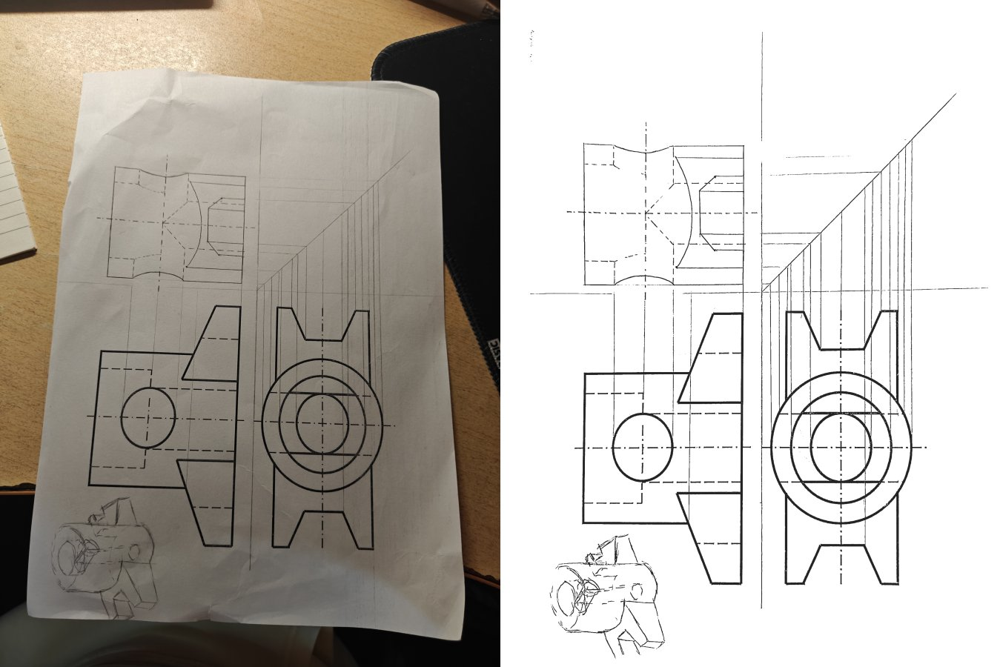
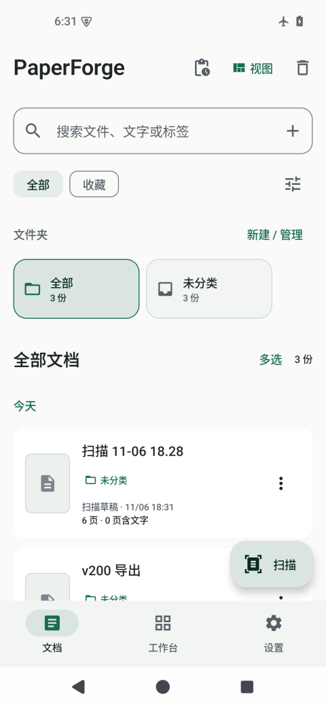
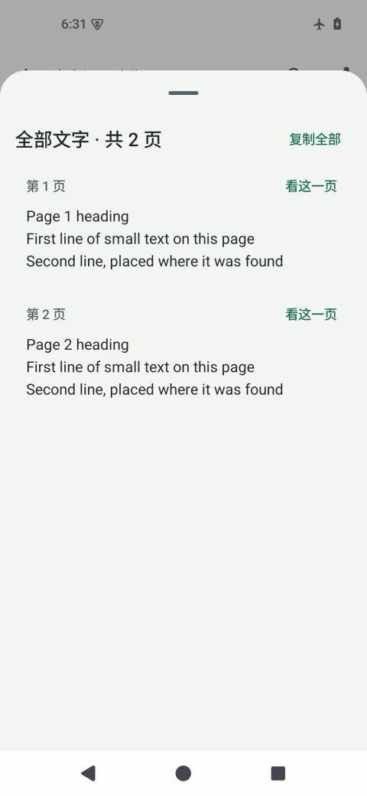
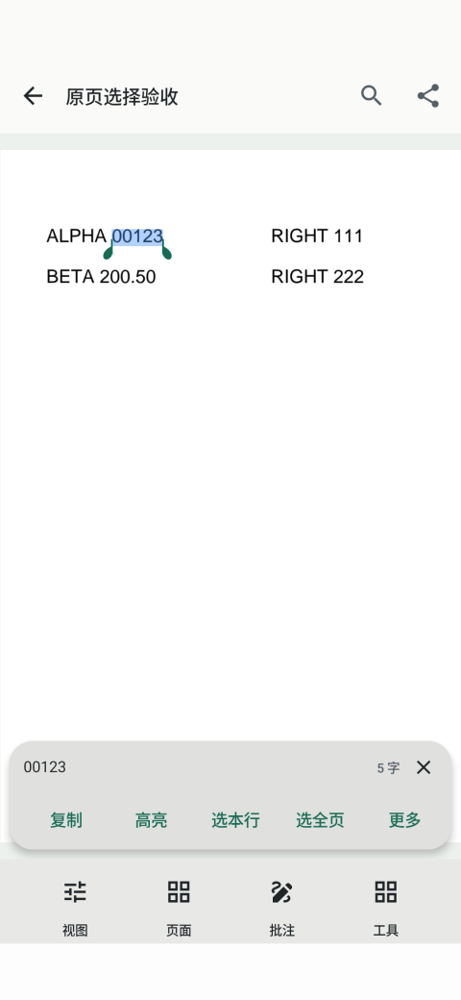

# PaperForge

**English** | [简体中文](README.md)

PaperForge is an open-source Android document scanner and PDF workbench. It scans with the camera, crops and flattens pages, removes shadows and show-through, recognises text, reads and annotates PDFs, and converts formats. Scanning and recognition run on the phone. There are no accounts, ads or subscriptions.

**Current version: v2.0.0.** Requires Android 8.0 or later on a 64-bit ARM phone.

[Download](https://github.com/HABAI182/paperforge-android/releases/latest) · [Changelog](CHANGELOG.en.md) · [Install and update](docs/INSTALL.md) · [Provenance and licences](docs/PROVENANCE.md)

## What it does

- **Scan.**
  - Finds the page edges, then corrects perspective and flattens the page.
  - Removes shadows and show-through.
  - Keeps printed text, handwriting and faint pencil as intact as it can.
  - Keeps colour pages in colour.
- **Edit.** Crop and rotate by hand on the original photo. Filters can be switched and every change undone. Split book spreads, annotate and redact.
- **Recognise.** Offline OCR with confidence-ordered proofreading and name suggestions. Receipt fields can be extracted and exported as CSV or XLSX.
- **PDF and files.** Read PDFs and save annotated copies, merge and split, add watermarks, and convert formats. Organise with folders and batch renaming.
- **Connect.**
  - Browse the phone's documents from a computer on the same network.
  - Check for updates in the app. When GitHub is unreliable, downloads fall back to mirrors.
  - Every download is checked against its SHA-256 and its signature.

## Highlights of v2.0.0

- Once the phone is still, the camera outline shows the final crop, and it moves smoothly.
- A new navigation, card and editor layout, with smoother page transitions and expanding cards.
- Page detection uses PageNet, a model trained by this project, checked against the photo's real paper edges.
- Engineering drawings keep their construction lines, dashes and sketches. On ruled paper, strokes no longer break where they cross a rule.
- Covers and colour pictures keep their colour. Manual crops can extend past the old page edge.
- Updates can download from mirrors and resume interrupted downloads.

See the [changelog](CHANGELOG.en.md) for everything, including known limitations.

| Library | Full text | Select on page |
|---|---|---|
|  |  |  |

Interface screenshots are from an emulator.

## Download and install

1. Download `PaperForge-2.0.0-full-arm64-v8a.apk` from the [releases page](https://github.com/HABAI182/paperforge-android/releases/latest).
2. Optionally check it against `SHA256SUMS.txt` on the same page.
3. Allow installs from unknown sources. Installing over an older PaperForge keeps your documents.

Later updates are available under **Settings → Check for updates**.

## Open source and privacy

- **Local processing.** Scanning, enhancement, OCR and PDF processing run on the phone, and documents are not uploaded.
- **Optional intelligence tool.** It goes online only after you configure your own endpoint and key. It then sends the text you select to that endpoint.
- **Update checks.** These contact only GitHub and its mirrors.
- **Models and third-party components.** PaperForge's own code is open source (AGPL-3.0-or-later), but not every runtime component is: the default text recognition uses Google ML Kit, a proprietary component that runs on the phone. Origins and licences are in [provenance](docs/PROVENANCE.md) and the [third-party notices](LICENSE_NOTICES.md).

## Development

For building and testing, see [docs/INSTALL.md](docs/INSTALL.md), [architecture](docs/ARCHITECTURE.md) and `scripts/build_distribution.py`. Model and code origins are in [provenance](docs/PROVENANCE.md).

## Licence and attribution

PaperForge's own code is released under the [GNU AGPL-3.0-or-later](LICENSE), which matches the bundled MuPDF. Third-party components, models and their licences are listed in [LICENSE_NOTICES.md](LICENSE_NOTICES.md).
