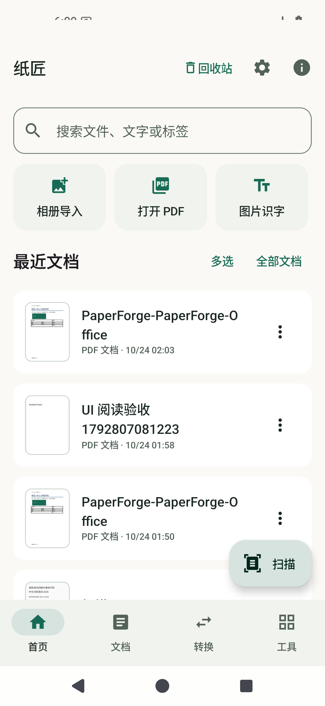
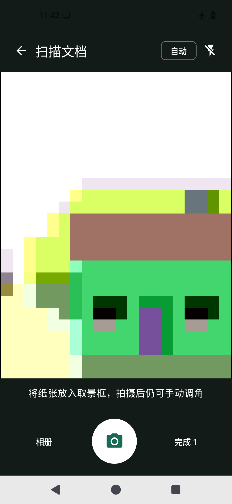
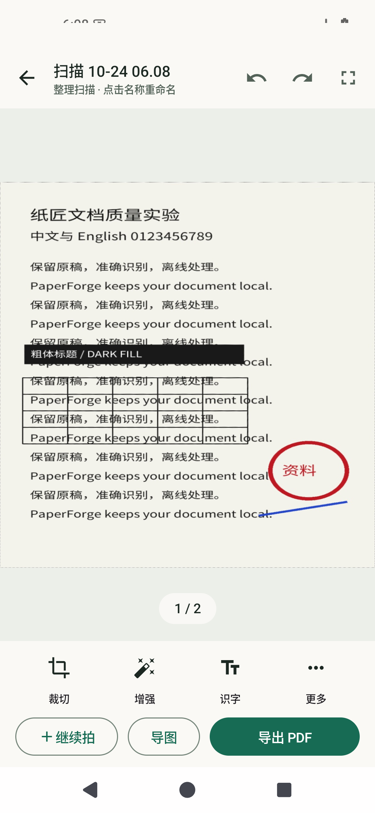

# 纸匠 · PaperForge

手机本地的扫描、阅读与文件转换工作台。无登录、广告或水印，应用不声明 INTERNET 权限。

当前发布版本 **0.6.0**；下一代大版本开发中，暂不创建新 tag 或 Release。这是你的个人私有项目；[源码](https://github.com/HABAI182/paperforge-android)与[安装包](https://github.com/HABAI182/paperforge-android/releases)需登录有权限的 GitHub 账号访问。

| 文档首页 | 扫描取景 | 扫描后检查 |
|---|---|---|
|  |  |  |

截图来自模拟器；取景图为既有版本留存，扫描检查使用生成的开发样张，不构成真机成像证据。

## 下一代开发进展：先把扫描结果看清楚

- 扫描完成后直接进入大画布：左右翻页、双击/双指放大、拖动查看、全屏检查。缩放回到原比例后继续翻页。
- 名称点按修改，裁切/增强/识字/更多放在底栏；滤镜和页条需要时再展开，保留重拍、旋转、撤销和排序。
- 回收站固定在首页/文档/工具顶栏；可返回文档、批量恢复和直接删除。
- 文档列表显示实际首页缩略图，搜索置顶、扫描悬浮按钮；统一字体层级、表面和圆角，支持系统动态配色及纯黑模式。
- 清晰滤镜通过亮度通道局部对比与细节增强处理文字；去阴影保留彩色内容。增强可对比同一裁切范围的原图。
- 遇到坏例可从编辑页“更多 → 保存本页诊断包”导出原图、结果、裁边参数与耗时。仅在手机本地保存，由你决定是否分享。

本节改动处于开发阶段，待完整计划收尾后统一发布。现有 Office 引擎仍可在手机离线运行。

Office 手机转换现接入持久任务中心：保留原件后在独立引擎进程排版，支持后台继续、取消、失败重试与完成结果复用。主应用和 Office 引擎需要安装同一签名渠道的新构建。

OFD / DjVu、XPS / OXPS、基础 SVG、CBZ、FB2、EML、PDF 容器 CAJ / KDH、常用 LaTeX 正文与数学可在手机离线转为 PDF / PNG 页包；DXF 使用手机 Office 引擎。原件、逐页缓存、实际结果对照和能力边界见 [特殊格式转换](docs/development/SPECIAL-FORMATS.md)，来源与协议见 [format-engine/UPSTREAM.md](format-engine/UPSTREAM.md)。

[版本记录](CHANGELOG.md) · [98 项计划实际状态](docs/roadmap/implementation-status.json) · [本轮范围和验证](docs/quality/SCAN-EXPERIENCE-0.6.1.md)

## 从这里开始

- **自动导出**：默认关闭，按文件夹和标签自动运行配方；保留成功与失败记录，目录不可用时可重选并续跑。
- **工作流配方**：按格式串联 OCR、压缩、转换、命名与保存；步骤可排序和保存复用，失败后从保留结果继续，改目录不重跑 OCR。
- **文档比较**：两份 PDF 并排同步核对文字和外观，点差异回原文；可忽略页眉页脚或单项变化，导出带原件的离线报告。
- **导出预设**：保存纸张、DPI、质量、OCR、PDF/图片包、命名模板和常用目录；成品一键保存到已授权目录，同名文件自动编号。
- **扫描**：首页开始扫描，连续拍摄后自动裁边；可随时手动拍摄、点击对焦、重拍、调四角。编辑页底栏提供裁切、增强、OCR 和更多操作。
- **导图 / 图片识字**：首页分别提供入口；图片识字导入后直接识别。支持中英文离线 OCR、编辑校正、复制、TXT、可搜索 PDF。
- **工具查找**：首页工具页搜索 Word / OCR / 图片等名称与别名，星标固定常用项；转换方式可查看输入、输出、参数及引擎说明。
- **PDF**：首页直接打开、合并或压缩。阅读器直接提供 OCR、转 Word、转图片和页面管理，工具箱可搜索、按类别筛选。
- **最近文档**：搜索名称与 OCR 全文；操作菜单包含收藏、分类、重命名、移入回收站、直接删除。直接删除只需一次明确确认；回收站支持恢复。

## 主要能力

- 多通道纸边评分、静态照片边缘精修、显示轮廓平滑；原图、裁切、滤镜和撤销历史保存在本地。
- 彩色去阴影、灰度、缩放自适应黑白、彩色/白板增强；去阴影强度、亮度、对比度和批量应用。
- 草稿 150 / 标准 220 / 高清 300 DPI，图像画质独立设置；A4/A5/Letter/原比例，证件双面 A4 合版。
- 真灰度 JPEG 与 1-bit Flate 黑白 PDF；普通压缩重编码合适的嵌入图片，保留原生文字、链接、表单和内容流。图像扁平化是单独命名的功能。
- 连续阅读、缩放、搜索高亮、跳页、缩略图；合并、抽页、拆分、页序、旋转、裁边、拼版、空白页。
- 中文水印、页码、图片包与嵌入图片提取；TXT/Markdown/HTML、可编辑段落 DOCX、原页参考图加段落 DOCX。
- 批注、画笔、手写签名、手动脱敏、AES-256 密码、基础 AcroForm；文件夹、标签、收藏、中文 FTS4 全文搜索、ZIP 备份/追加恢复。
- EPUB章节顺序/目录/封面/脚注与HTML/MD/TXT互转；结构文档生成EPUB，PDF文字重排附原页/PDF对照。
- Markdown/HTML静态结构互转及图片资源包，原件与结果预览、源代码、手机系统打印另存PDF。
- 可选防截图与系统设备凭据应用锁，默认关闭。它们不等同于文档存储加密。

## 质量证据与边界

[质量报告](docs/quality/QUALITY-REPORT.md)记录相同合成输入上的 v0.2/v0.3 对比、取舍和未完成项。[OCR 报告](docs/quality/OCR-BENCHMARK.md)区分固定标注四角与实际自动裁边流程。开发集结果不能当作真实照片或竞品准确率。

API35 无 GMS 模拟器已在飞行模式下运行内置中英 OCR；100 页草稿导出及取消已测。没有 ARM64 真机相机、国内 ROM、真实纸张弱光/反光、50MP 或电池/温升结论。

DOCX 有段落、原页对照和手机结构重建模式；结构模式可输出文字、表格和嵌入图片，复杂跨栏/脚注/裁剪对象不保证还原。手机表格和 Office 排版已接入。自动曲面判断、去手指/手写、超分、完整原生PDF编辑和证书签名等研究目标仍保留，状态见本次实施清单。

原图和草稿位于应用私有目录，卸载会丢失，请导出重要内容。普通 PDF 工具生成副本；手动脱敏和明确标记的扁平化生成图像 PDF。系统另存先生成完整本地文件；外部提供程序写入失败可重试。

## 构建

Android 8.0+（API26），target/compile36；JDK17、SDK Platform36、Build Tools35.0.0、Gradle8.13、AGP8.13.2、Kotlin2.1.20。新增 NDK28.2.13676358、CMake3.22.1；首次原生构建下载固定SHA256的官方MNN3.6.1源码。Android Studio 打开本目录并选择 JDK17，或：

```powershell
git clone https://github.com/HABAI182/paperforge-android.git
cd paperforge-android
# 设置本机 JAVA_HOME、ANDROID_HOME，或由 Android Studio 创建 local.properties。
.\gradlew.bat :app:assembleDebug :app:testDebugUnitTest :app:lintDebug
.\gradlew.bat :app:connectedDebugAndroidTest
```

macOS/Linux 使用 `./gradlew`。首次构建需下载依赖，已安装应用核心流程离线运行。默认 APK 包含 arm64-v8a 和 x86_64；可用 `-PpaperforgeAbis=arm64-v8a` 单独构建手机包。不支持仅32位 ARM。发布文件为开发签名的预发布包，可覆盖原开发签名版本；密钥不进入仓库。

基准脚本与固定种子见 `scripts/bench/`；真实照片可通过本地诊断包收集；当前未获得真实纸张标注集，不把合成输入结果视作真实质量。格式化使用 `scripts/format.ps1` 和 ktfmt0.54，历史格式整理位于独立提交。

## 项目索引

- [架构](docs/ARCHITECTURE.md)、[技术选型](docs/architecture/0001-architecture.md)
- [上游研究矩阵](docs/research/UPSTREAM_REFERENCE_MATRIX.md)、[审计](docs/research/OSS_AUDIT.md)、[许可](LICENSE_NOTICES.md)
- [测试矩阵](docs/TEST_MATRIX.md)、[隐私](docs/PRIVACY.md)、[发布检查](docs/RELEASE_CHECKLIST.md)
- [0.5.0 改动](docs/CHANGELOG-0.5.0.md)、[接续记录](docs/DEVELOPMENT_LOG.md)


构建可选 Office 手机引擎：先运行 `python tools/fetch_office_runtime.py`（从固定来源下载并校验运行时），再执行 `gradlew.bat :office-engine:assembleDebug -PpaperforgeAbis=arm64-v8a`。主应用独立构建不需要该运行时。运行时目录不进入源码包。

构建可选格式引擎：`gradlew.bat :format-engine:assembleDebug`。已提交固定版本的浏览器解析资源，普通 APK 构建无需 Node；原生 MuPDF AAR 固定 1.28.5，来源、SHA256 与重新构建方法见该模块文档。独立模块使用 AGPL-3.0-or-later，不改变主应用许可证。
