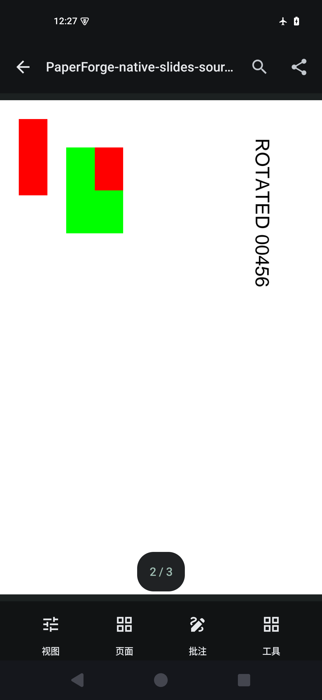
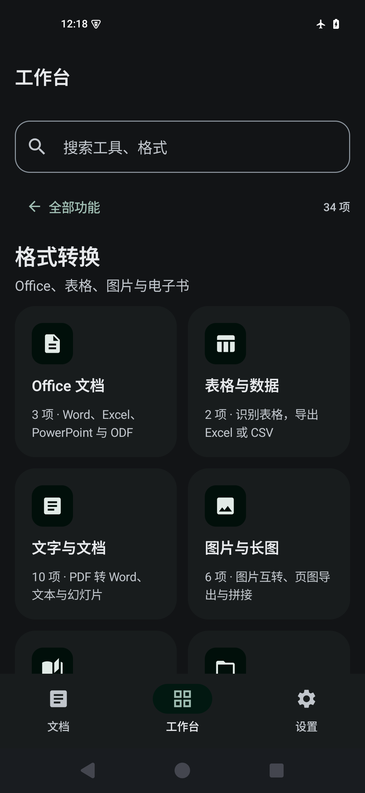
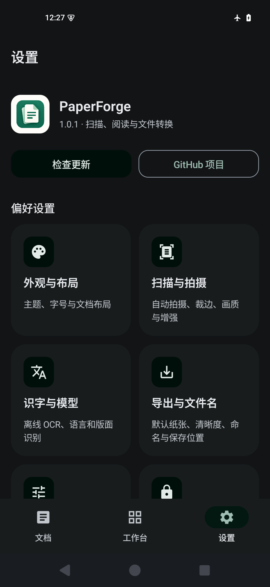

# PaperForge

手机本地的扫描、PDF阅读与文件转换工作台。个人非营利项目，无账户、广告、水印或订阅。

**1.2.0 · 完整功能版**，Android 8.0及以上，普通64位ARM手机只需安装一个APK。Office、特殊格式和联网工具均已内置，日常文档处理无需电脑。

[下载最新版](https://github.com/HABAI182/paperforge-android/releases/latest) · [安装与手机更新](docs/INSTALL.md) · [版本记录](CHANGELOG.md) · [能力与验证范围](docs/quality/V1.2.0-STATUS.md)

| PDF阅读 | 格式转换 | 设置 |
|---|---|---|
|  |  |  |

截图来自模拟器，文档为开发样张；不作为实体手机实拍效果证据。

## 下载与更新

在[发布页](https://github.com/HABAI182/paperforge-android/releases/latest)下载`PaperForge-1.2.0-full-arm64-v8a.apk`。只安装这个APK；`release-manifest.json`和`SHA256SUMS.txt`是核对文件，源码压缩包也不是安装包。沿用原应用身份和证书，可覆盖更新并保留文档。

手机内进入**设置 → 检查更新**，会明确显示最新版本、发现更新或连接失败。发现新版后由你选择下载，核对完成再交给Android系统安装器确认。不定时检查，不静默安装。公开仓库无需GitHub令牌；自定义私有仓库可在更新页配置只读凭据。

## 三个主页面

| 页面 | 内容 |
|---|---|
| 文档 | 最近、全部、收藏、搜索、导入、扫描、多选和回收站；顶栏“视图”切换列表/封面 |
| 工作台 | 扫描与识字、格式转换、PDF工具、文档整理、任务与流程、连接与智能 |
| 设置 | 检查更新、GitHub、外观、拍摄、识字、导出、高级和隐私偏好 |

转换和PDF工具继续按用途分成第二层卡片，避免把所有功能铺成一张长清单。工具可以固定到常用，默认预设压缩、识字、转图片和转Word。

打开PDF后，底栏只保留**视图、页面、批注、工具**。左右翻页、连续滚动、全屏、适页/适宽与纸张颜色集中在“视图”；目录、书签、朗读、翻译等放入阅读工具分类。双击/双指放大后可拖动检查细节。

## 主要能力

- **扫描与识字**：自动识边、连续拍摄、裁边精修、增强、去阴影、彩色/灰度/黑白；离线OCR、可搜索PDF、原图与处理历史。
- **阅读与整理**：翻页、滚动、缩放、全屏、书签、搜索、原页选字、重排与离线朗读；文件夹、标签、收藏、多选、直接删除及回收站。
- **PDF工具**：合并、拆分、抽页、旋转、裁边、拼版、水印、页码、批注、表单、密码、脱敏、证书、归档检查、压缩和资源优化。
- **文件转换**：手机本机Office排版；PDF/图片/Word/Excel/PowerPoint/文本/Markdown/HTML/EPUB等转换；表格与文档结构重建、特殊格式和逐页图片输出。具体输入、输出与限制在每个工具的能力说明中列出。
- **任务与流程**：批量转换、配方、自动导出、结果记录、失败重试和断点复用；完整备份/追加恢复。
- **连接与智能**：局域网配对互传、断点保留、按需下载语言包的本机翻译，以及自定义局域网/BYOK服务。联网任务由用户发起，原文按页码或选区选择。

## 外观与默认设置

六种外观：跟随系统、明亮、深色、纯黑、暖纸、午夜蓝；八种主题色：墨绿、海蓝、鸢紫、琥珀、青碧、玫瑰、岩灰、咖啡。跟随系统同步明暗，主题色独立选择；更新、传输和智能页面使用相同配色。窄屏与大字号自动调整卡片排列。

扫描PDF默认不做OCR；默认自动拍摄、85%增强、原比例纸张、标准清晰度与90%导出图片质量。改名保留输入名称，真实重名才处理冲突。已有个性化设置保留；首次升级本版时，仅为空的常用工具列表补入预设。

## 本机开发

JDK17、SDK36、Build Tools35.0.0、NDK28.2.13676358、CMake3.22.1；使用仓库中的Gradle Wrapper。先准备固定来源的手机Office运行时，再构建隔离调试包：

```text
python tools/fetch_office_runtime.py --abi arm64-v8a
./gradlew :full-app:assembleDebug -PpaperforgeAbis=arm64-v8a -PpaperforgeIdSuffix=.local
```

Windows将`./gradlew`换成`.\gradlew.bat`。调试APK位于`full-app/build/outputs/apk/debug/`，使用自己的调试证书与`.local`身份，不覆盖所有者发行包。正式包需要仓库外的所有者签名配置；构建/核对流程见[分发说明](docs/development/DISTRIBUTION.md)。

`app`及独立Office/格式/联网模块保留，便于开发和历史模块化构建；普通使用者下载完整功能包即可。共享主题在`theme-core`中，避免不同页面颜色不一致。

## 数据、组件与项目记录

原件、草稿和历史保存在手机，导入/导出使用系统文件选择器。完整包包含网络权限，更新、传输和自定义服务按需运行。卸载前请将需要保留的文档备份到应用外。

[隐私与数据](docs/PRIVACY.md) · [第三方组件、模型与许可声明](LICENSE_NOTICES.md) · [UI组织与参考](docs/design/UI-ORGANIZATION.md) · [当前质量状态](docs/quality/V1.2.0-STATUS.md) · [原计划与实际状态](docs/roadmap/implementation-status.json)

源码公开；项目自身发行许可及第三方组件/模型的具体状态以许可说明为准，不将所有依赖统称为同一种开源许可。复杂版式、特殊格式、实体手机扫描和无障碍的支持边界分别记录在工具说明与质量文档中。
