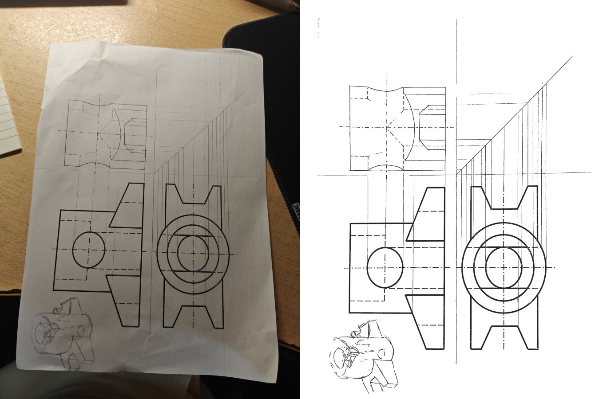
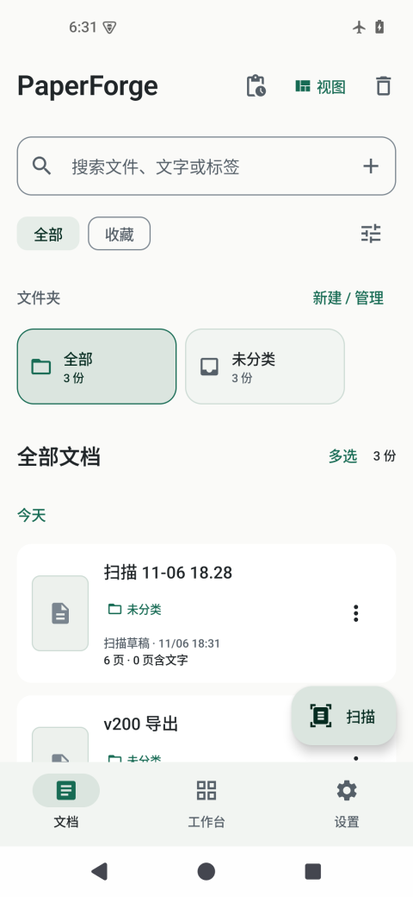
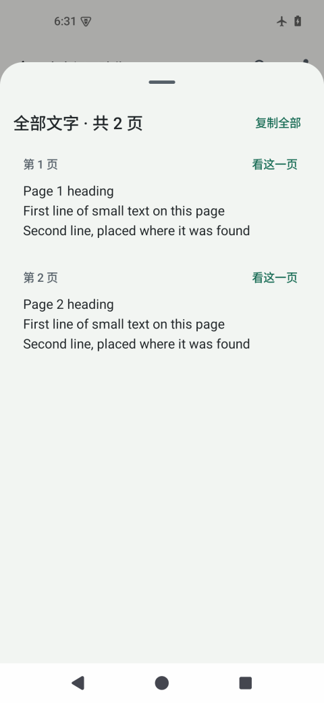
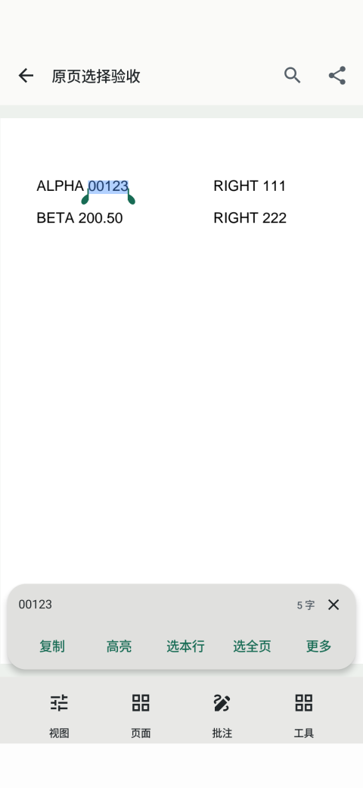

# PaperForge

[English](README.en.md) | **简体中文**

PaperForge 是一款开源的 Android 文档扫描与 PDF 工作台：拍照扫描、裁边展平、去阴影去透印、文字识别、PDF 阅读批注和格式转换。扫描与识别在手机本地完成，无账户、无广告、无订阅。

**当前版本：v2.0.0**（Android 8.0 及以上，64 位 ARM 手机）

[下载最新版](https://github.com/HABAI182/paperforge-android/releases/latest) · [更新记录](CHANGELOG.md) · [安装与更新说明](docs/INSTALL.md) · [来源与许可](docs/PROVENANCE.md)

## 核心能力

- **扫描**：自动找纸边、透视校正与展平；纸面去阴影、去透印；印刷字、手写和淡色铅笔尽量完整保留；彩色页面保持颜色。
- **编辑**：在原始照片上手动裁剪和旋转，滤镜可切换并可撤销；书页拆分、批注、打码。
- **识别**：离线 OCR，按置信度校对；文档命名建议；票据字段提取并导出 CSV/XLSX。
- **PDF 与文件**：阅读、批注副本、合并拆分、水印工具、格式转换、文件夹与批量命名。
- **连接**：局域网浏览器访问；应用内检查更新，GitHub 不稳定时自动改用镜像，下载均做 SHA-256 与签名校验。

## v2.0.0 主要改进

- 相机取景框稳定后即显示最终裁剪范围，并平滑移动。
- 全新导航、卡片与编辑器布局，页面切换和展开动画更连贯。
- 页面检测改用本项目训练的 PageNet 模型，并对照照片中的真实纸边。
- 工程图的构造线、虚线和草图保留更完整；横线本上的笔画跨线不再断开。
- 封面和彩色图案保持颜色；手动裁剪可超出旧页面向外扩展。
- 更新支持镜像下载和断点续传。

完整内容与已知限制见 [更新记录](CHANGELOG.md)。

| 文档库 | 全部文字 | 原页选字 |
|---|---|---|
|  |  |  |

界面截图来自模拟器。

## 下载与安装

1. 在 [发布页](https://github.com/HABAI182/paperforge-android/releases/latest) 下载 `PaperForge-2.0.0-full-arm64-v8a.apk`。
2. 可用同页的 `SHA256SUMS.txt` 核对文件。
3. 安装时允许“安装未知应用”。已安装旧版时直接覆盖安装，文档会保留。

之后可在 **设置 → 检查更新** 中更新。

## 开源与隐私

- **本地处理：** 扫描、增强、OCR 与 PDF 处理都在手机上完成，不上传文档。
- **可选的智能工具：** 只有在你自行配置接口地址和密钥后才会联网，并把你选中的文字发送到该接口。
- **更新检查：** 只访问 GitHub 及其镜像。
- **模型与第三方组件：** PaperForge 自有代码开源（AGPL-3.0-or-later），但并非所有运行组件都是开源的——默认的文字识别使用 Google ML Kit（专有组件，在手机本地运行）。来源和许可见 [来源记录](docs/PROVENANCE.md) 与 [第三方组件声明](LICENSE_NOTICES.md)。

## 开发

构建与测试说明见 [开发文档](docs/INSTALL.md)、[架构说明](docs/ARCHITECTURE.md) 与 `scripts/build_distribution.py`；模型与代码来源见 [来源记录](docs/PROVENANCE.md)。

## 许可与致谢

PaperForge 自有代码以 [GNU AGPL-3.0-or-later](LICENSE) 发布（与内置的 MuPDF 许可一致）。第三方组件、模型与各自许可见 [LICENSE_NOTICES.md](LICENSE_NOTICES.md)。
