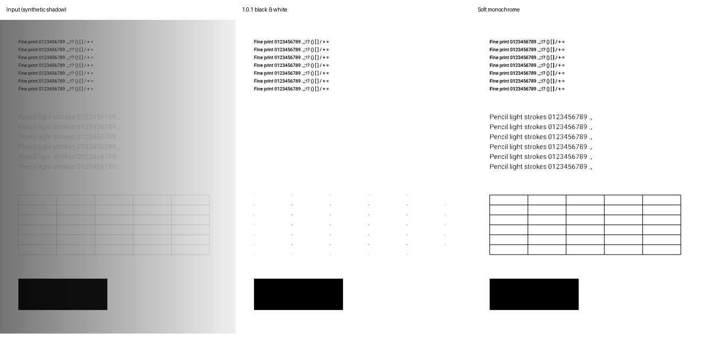

# #12 · 柔和黑白默认预设

黑白滤镜卡片及扫描主界面不增加控件。`EnhancePipeline.SoftMonochrome` 是唯一默认参数源，缩略图、单页渲染、批量应用和扫描 PDF 导出均复用它。原有强度滑块作为相对调整保留。

| 参数 | 1.0.1 | 本次 |
|---|---:|---:|
| 光照校正强度 | 1.0 | 0.85 × 用户强度 |
| 纸白目标 | 250 | 242 |
| 最大增益 | 3.0 | 2.6 |
| Sauvola 窗口 / 短边 | 0.05 | 0.035，上限 201 px |
| Sauvola k | 0.22 | 0.075 |

较低的校正增益避免先把浅字裁成纯白；较低的 k 保留低对比笔画。保留原来的大黑块阈值下限，不做会吞掉标点或单像素线的开运算。

## 验证

- API 35 x86_64 完整包 release 构建、lintVital 通过。
- `SoftMonochromeTest` 使用真实 Android OpenCV，三种确定性场景（普通、渐变阴影、轻微噪点）覆盖打印细字及标点、浅灰铅笔模拟、抗锯齿细表格线、实心黑块。数据见 [metrics.json](metrics.json)，原始图及前后图均在本目录。
- 浅字核心笔画像素从旧版 0% 提高到 99.84–100%；背景误黑率低于 0.1%。这是已知笔画蒙版的合成样张指标，不代表所有真实纸张识别率。
- 其它七种滤镜与提交 `82f16be` 的实现逐像素一致（测试目录保留旧实现，仅作对照）。
- 两页无损 PDF 内嵌图像与 `ScanProcessor.render` 输出逐像素一致，覆盖批量及导出共用链路。
- 该测试不执行 OCR 或边缘检测等无关回归。

进一步的极浅铅笔、纹理纸张、严重模糊仍取决于输入信号；可使用原有灰度/清晰滤镜。样张均由测试绘制，不包含用户文档。
