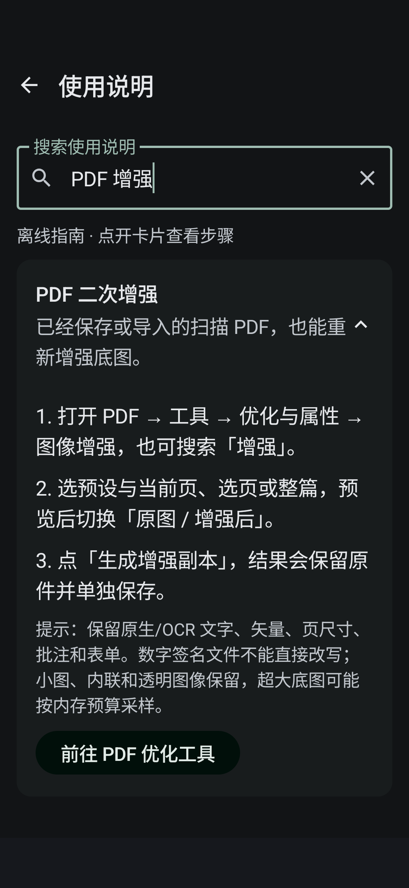

# #14 · 离线使用说明

设置首页末尾、「关于与项目主页」之后新增全宽横向使用说明卡片，复用 `SectionNavigationRow`。原六个设置分类及顺序、卡片组件均未改变。

`UsageGuide` 内置九组指南，每组包含用途、三步操作、注意事项及分类跳转：扫描裁边、增强预设、OCR、PDF 二次增强、合并拆分、压缩、格式转换、阅读全屏翻页、保存备份恢复。支持本地全文搜索；相关路线复用 `ToolCatalog` / `ToolCapabilityDialog` 展示已有能力边界。

帮助页按需展开步骤，搜索时展开匹配说明；系统返回及顶部返回均回到设置。修复了 `HomeScreen` 本地标签与 ViewModel 标签不一致导致跳转/大字体重建后返回错误分类的问题，以 ViewModel 为统一状态源。

## 验证

- API35 x86_64 完整 release 构建及 lintVital 通过。
- `UsageGuideUiTest` **OK (1 test)，6.287s**，见 [test.log](test.log)。
- 核对九组指南有 2–3 步与提示、六分类未变、搜索 PDF 增强、正确跳往 PDF 优化分类、返回设置。
- 通过系统 `font_scale=2.0` 验证实际 200% 字体，覆盖深浅色、长正文滚动、可见功能跳转与返回入口；恢复原系统字号及应用外观设置。
- 测试全程可离线，未请求帮助网站或下载内容。

大字体截图：[浅色](help-light-200.png) · [深色](help-dark-200.png)
