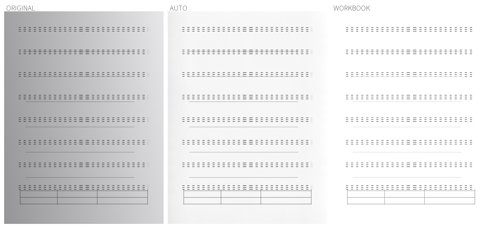

# #22 · 练习册去透页与增强预设

薄纸练习册的失败模式是反面透印、灰底和不均匀灯光压过正面细字。本版新增「练习册」滤镜，并把增强预设改成一眼能懂的名字。

## 实现

- 新增 `WORKBOOK`（练习册）滤镜：先做分块光照校正，再用「纸面残差软阈值」判断墨迹——只有明显比局部纸面更深的像素才保留，因此反面透印和灰底被压成白，正面印刷字、铅笔和表格线留下。输出为灰度。
- 参数集中在 `EnhancePipeline.Workbook`，与 `SoftMonochrome` 同构，缩略图、页面渲染、批量应用和扫描 PDF 导出共用同一份参数：纸白 246、最大增益 2.9、光照强度 0.9、透印下限 40、墨迹增益 1.35、锐化 0.3。
- 预设口径统一为：原图 / 自然 / 清晰文字 / 练习册 / 强力去背景 / 灰度 / 柔和黑白 / 彩色 / 白板。扫描编辑页、设置「导入与拍摄滤镜」、PDF 图像增强预设与离线使用说明同步更新；不增加主界面控件，强度滑块仍是相对调整。

### 关键修正（记录，避免复现）

第一版把**原始**纸面亮度当作参考，而像素已经过光照校正提亮，两个尺度不一致，结果把铅笔和表格线一起洗白（实测正文 140、铅笔 247）。改为用「校正后的纸面亮度」计算残差后复测通过。

## 验证

- 环境：API35 x86_64 模拟器（`paperforge_api35`），`app/src/androidTest/.../quality/WorkbookEnhancementTest`。
- 样张：合成薄纸场景（确定性绘制，不含用户文档）——不均匀灯光、灰底、镜像模糊的反向透印，以及印刷字、铅笔答案和三线表。
- 指标：笔画用 35% 分位读取（规避整像素预裁边造成的边缘落到白纸），透印与纸面用均值。

| 场景 | 透印 | 正文 | 铅笔 | 表格线 | 纸面 |
|---|---:|---:|---:|---:|---:|
| 原图 | 184.3 | 31 | 117 | 88 | 189.1 |
| 自动 | 230.3 | 33.8 | 152 | 118 | 245.2 |
| 练习册 | 249.7 | 31 | 190 | 146 | 254.7 |

- 断言：透印 ≥ 230 且比自动高 ≥ 10；正文 ≤ 90；铅笔落在 120–238（保留且未被压黑）；表格线 ≤ 205；纸面 ≥ 235。全部通过。
- 构建：`compileDebugKotlin`、`compileDebugAndroidTestKotlin` 与整包安装通过（含 OpenCV 原生构建）。

## 未验证与局限

- **真实练习册/薄纸照片尚未验证**：合成场景只能证明方向，真实样张到位后必须复测并更新本页。
- 实体手机未测，与既有验收口径一致；本测试不跑 OCR，文字识别率未比对。
- 透印下限 40 依赖当前光照校正强度；强透印或极淡铅笔若在真实样张上不达标，按图 2–3 张真实样张再调参并留档。
