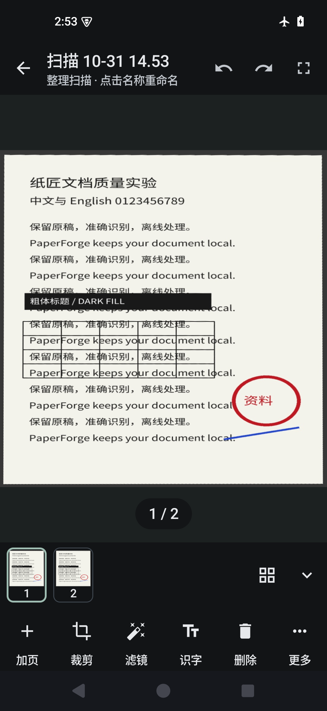
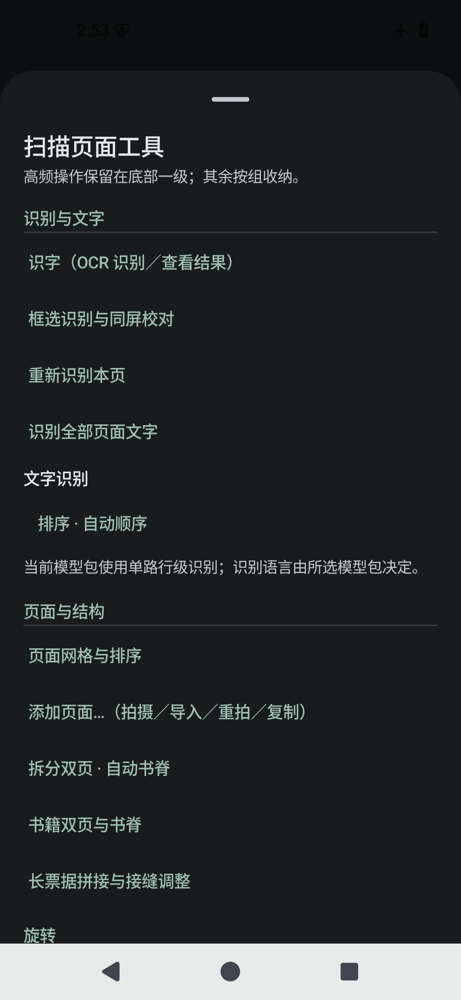
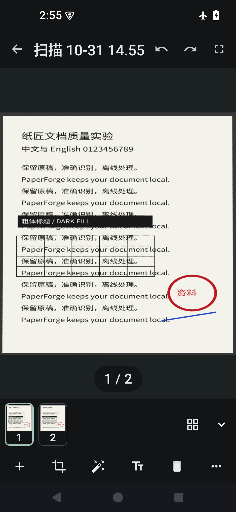
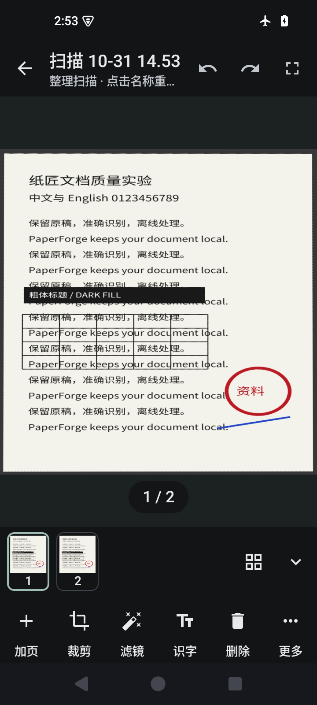
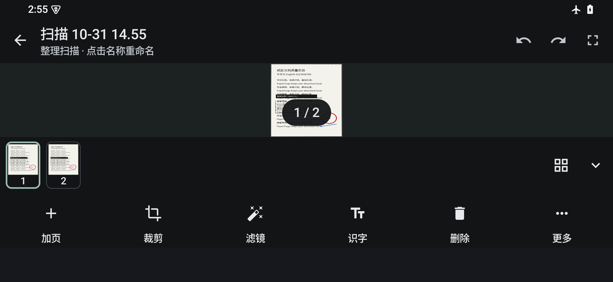

# #31 · 文档二次编辑入口与交互重排（实施验收）

> 本轮按已批准的 `proposal.md` 实施，并以用户裁决清单为准（OCR 留底部、旋转进「更多」、加页 1 步直达相机、删除二次确认 + 撤销、票据信息进编辑器、页码徽标保留）。
> 仅改 Compose 入口与交互：`MainViewModel` / `Repository` / `ScanProcessor` / OCR / 导出 / 历史结构均未改动（见 §6 文件清单）。
> 所有设备结论来自本机 AVD `paperforge_api35`（emulator-5554）实跑，截图见 §5。

## 1. 落地结构

```
┌─────────────────────────────────────────────┐
│ ←  标题（点击重命名）      ↺   ↻   [全屏]      │ 顶部栏（导出按实施要求移入「更多」）
├─────────────────────────────────────────────┤
│ 任务状态条（条件）                             │
│                                             │
│                 画布 / 页面                  │ weight 1
│  点按=全屏 · 双击=缩放 · 左右滑=翻页           │
│  按住 350ms = 看原图（新增，松开返回）          │
├─────────────────────────────────────────────┤
│ 1 2 ③ 4 …                          [⊞] [⌄]  │ 常驻缩略图条（默认展开；⊞=页面管理，⌄=收起）
├─────────────────────────────────────────────┤
│ 加页   裁剪   滤镜   识字   删除   更多       │ 一行六格；字号 >1.3 时自动只留图标
└─────────────────────────────────────────────┘
```

- **页码徽标**（`1 / 2`，裁决 5 保留）仍在画布底部，点击切换缩略图条展开/收起。
- **加页**：单击＝直接进相机（1 步，裁决 2）；**长按**＝「添加页面」弹层（继续拍 / 导入图片 / 重拍本页 / 复制当前页）。弹层的第二入口在 **更多 → 页面与结构 → 添加页面…**。
- **删除**：底部一级 → 二次确认「删除这一页？」→ 顶栏撤销可恢复（裁决 3，设备测试已断言）。
- **更多**（`ModalBottomSheet` 分组，7 组）：
  | 组 | 项目 |
  |---|---|
  | 识别与文字 | 识字（OCR）· 框选识别与同屏校对 · 重新识别本页 · 识别全部页面文字 · 识别记录与文字校正（条件）· 文字识别设置块 |
  | 页面与结构 | 页面网格与排序 · 添加页面… · 拆分双页 · 自动书脊 · 书籍双页与书脊 · 长票据拼接 · 页面来源与原件关系（条件） |
  | 旋转 | 顺时针旋转 90° · 旋转 180° · 旋转 270° |
  | 修复与增强 | 自动裁边 · 曲面校正 · 曲面来源与网格（条件）· 清理与修复 · 另存副本 |
  | 智能 | 翻译与智能工具 |
  | 导出与记录 | 导出 PDF / 图片包… · 票据信息 · 全部页面导出 JPG · PNG · 保存本页诊断包（含原图） |
  | 文档 | 重命名文档 · 全屏检查 |

- **票据信息**（裁决 4）：复用 `vm.receiptDraft(doc)`，无缓存 OCR 时显示「请先识别文字」提示；导出仍走 `vm.exportReceipt`。库内卡片入口保持不动。
- **#23 防护**：`key = { pages.getOrNull(it)?.id ?: "pending-$it" }` 与 `pages.getOrNull(index) ?: return@HorizontalPager` 原样保留；缩略图点击先 `index.coerceIn(0, pages.lastIndex)` 再 `animateScrollToPage`。
- **「应用全部」**：仍调用 `vm.applyAll(active)`，逐页写历史的既有语义与撤销行为未变。

## 2. 与已批准方案的差异（裁决优先，逐条记录）

| # | 方案 | 实际落地 | 原因 |
|---|---|---|---|
| 1 | 底部 6 格 = 加页 / 裁剪 / 滤镜 / **旋转** / 删除 / 更多 | 加页 / 裁剪 / 滤镜 / **识字** / 删除 / 更多；旋转进「更多」 | 用户裁决 1 |
| 2 | 识字移到更多（1→2 步） | 识字保留底部一级（1 步），并在「更多·识别与文字」保留重复入口（2 步） | 用户裁决 1 |
| 3 | 加页点击开弹层（2 步） | 点击直达相机（1 步）；弹层放长按 +「更多·添加页面…」 | 用户裁决 2 |
| 4 | 取消页码徽标 | 保留徽标，并复用为缩略图条开关 | 用户裁决 5 |
| 5 | 导出移顶栏（2 步） | 导出在「更多·导出与记录」（3 步） | 实施要求把导出列入「更多」；顶栏保留全屏图标 |
| 6 | 「更多」4+2 组 | 7 组（旋转单独成组，文档单独成组） | 裁决 1 后旋转需要明确入口；「重命名」按实施要求进更多 |
| 7 | 缩略图长按多选 → 批量旋转/删除 2 步 | **未实现多选**；批量操作仍走页面网格（进入 1 步 + 勾选 + 动作） | 本轮以“纯 UI 重排”为界，未新增选择态；见 §7 |
| 8 | 页码进标题副行 | 页码仍在徽标 + 缩略图高亮，标题副行保持原文案（新增 `maxLines=1` 防换行） | 裁决 5 保留徽标，避免重复 |
| 9 | 底栏字号阈值待定（1.3/1.5） | 有效 `fontScale > 1.3` 隐藏文字标签（图标 + contentDescription） | 与首页 `fontScale > 1.3` 的既有语言一致 |
| 10 | 横屏转竖向缩略图条 | 未做（编辑器仍无横屏分支），只记录挤压现状 | 方案 §5.3/§6.7 本轮不做 |

其他行为变化：
- 缩略图条常驻后不再拦截系统返回键（原先是“返回折叠缩略图”），返回键恢复为离开编辑器；全屏/滤镜面板仍拦截。
- 全屏检查时页码徽标也隐藏（与顶栏/底栏/缩略图条一致）。
- 「旋转本页」在更多内拆成 90°/180°/270° 三项，避免“点两次进两次菜单”。

## 3. 步数前后（沿用 `entry-map.csv` 口径：含提交，长按计 1 次）

| 能力 | 方案前 | 落地后 | 说明 |
|---|---|---|---|
| 加页·继续拍 | 1 | **1** | 点「加页」直达相机（裁决 2） |
| 加页·导入图片 | 1 | **2** | 长按「加页」→ 导入；也可 更多→添加页面→导入（3） |
| 加页·重拍 / 复制当前页 | 2 | **2** | 更多→添加页面→项（3）或长按加页（2） |
| 裁剪 / 裁剪微调 | 2 / 3 | **2 / 3** | 入口改名「裁剪」，对话框不变 |
| 滤镜 / 调节强度 / 应用全部 | 2 / 3 / 2 | **2 / 3 / 2** | 「增强」改名「滤镜」；应用全部语义不变 |
| 对比原图 | 2 | **1** | 按住画布 350ms（面板开关仍 2） |
| 旋转 90° | 2 | **2** | 裁决 1 后置入「更多·旋转」；180°/270° 由旧路径约 4 步降为 **2** |
| 删除本页 | 3 | **2** | 底部「删除」+ 确认；撤销仍 1 |
| 批量旋转 / 批量删除 | 4 / 4 | **3 / 3** | 缩略图「页面管理」1 步进入，再勾选 + 动作；未做长按多选（方案目标 2 未达） |
| 撤销 / 重做 | 1 / 1 | **1 / 1** | 顶栏位置不动 |
| 识字（OCR） | 1 | **1** | 裁决 1 保留底部；更多内另有 2 步重复入口 |
| 框选识别 / 重新识别 / 全部识别 | 2 | **2** | 仅换分组 |
| 识别记录与文字校正（条件） | 2 | **2** | 条件保留（`ocrText != null`） |
| 文字识别设置块 | 2 | **2** | 仍在「识别与文字」组内 |
| 拆分双页·自动书脊 | 2 | **2** | 新分组路径，回调不变 |
| 书籍双页 / 曲面校正 | 3 / 3 | **3 / 3** | 含应用 |
| 页面网格 | 2 | **1** | 缩略图条「页面管理」 |
| 拖拽排序 | 3 | **2** | 管理 1 + 长按拖动 1 |
| 复制/移动到其他文档 | 5 | **4** | 管理 1 + 勾选 1 + 复制 1 + 选目标 1（方案目标 3 未达） |
| 票据信息 | 3（退出编辑器） | **2** | 更多→票据信息，复用 `vm.receiptDraft`（裁决 4） |
| 导出（PDF/图片包） | 2 | **3** | 更多→导出→生成（实施要求） |
| 全部页面 JPG / PNG / 诊断包 | 2 | **2** | 分组后仍 2 步；不再需要长距离滚动才“存在” |
| 长票据拼接 / 曲面来源 / 页面来源 / 清理与修复 / 翻译 | 2 | **2** | 条件项条件保留 |
| 重命名 | 2 | **2** | 标题点击不变；更多内新增重复入口 2 步 |
| 全屏检查 | 1 | **1** | 点画布/顶栏 1；更多内新增显式项 2 |
| 缩放 / 查看任务 | 1 / 1 | **1 / 1** | 未动 |
| 翻页 / 跳到指定页 | 2 | **1** | 缩略图常驻后直接点（旧路径需先点徽标） |

## 4. 构建与测试（实际执行）

| 命令 | 结果 |
|---|---|
| `gradlew :app:compileDebugKotlin` | **BUILD SUCCESSFUL** |
| `gradlew :app:compileDebugAndroidTestKotlin` | **BUILD SUCCESSFUL** |
| `gradlew :app:connectedDebugAndroidTest`（`EditorEntryLayoutTest`） | **PASS**（最终代码在 4 种环境各跑一次：1080×2340 / 720×1600+320dpi / 有效字号 1.625 / 2340×1080 横屏） |
| `gradlew :app:connectedDebugAndroidTest`（`SpreadSplitSampleTest`，#23 路径） | **PASS**（单独运行；从新版分组「更多 → 拆分双页 · 自动书脊」进入，拆分→撤销页数恢复 1 页、原图 SHA 不变）。曾与 `EditorEntryLayoutTest` 同批运行时在 `SpreadSplitSampleTest.kt:71` 超时一次（30s 等不到 2 页），单独重跑通过，属该 AVD 的时序波动，未定位为产品回归 |
| `gradlew :app:testDebugUnitTest` | 130 tests，**1 failed**：`GeometryTest.fileNamesCannotEscapeDestination`（`GeometryTest.kt:137`，交接文档已列既有失败）；其余 129 通过 |
| `gradlew :app:connectedDebugAndroidTest`（`EditorExperienceTest`） | **FAIL**：`ComposeTimeoutException`（`EditorExperienceTest.kt:89`，全屏内 `swipeRight()` 后等不到 `1 / 2`）。与交接文档记录的 AVD touch-injection 失败一致；失败发生在改名后的「滤镜/裁剪」之前（:104/:113 未执行），不能作为本次回归证据，也无法用它验证新入口 |

新测试 `EditorEntryLayoutTest` 覆盖（全部用语义点击/语义长按，不用 touch-injection）：
1. `thumbnail-strip` 可见（常驻、默认展开），画布与缩略图预览加载；
2. 底部六个一级入口 `加页/裁剪/滤镜/识字/删除/更多` 均可达；
3. 长按「加页」打开「添加页面」弹层（含继续拍/导入/重拍/复制）并可取消；
4. 「更多」打开后，滚动到「顺时针旋转 90°」并点击，等 `rotation == 90` 落库；
5. 「更多 → 票据信息」在无缓存 OCR 时打开提示对话框（不崩）；
6. 底部「删除」→ 二次确认 → 页数 −1 → 顶栏撤销 → 页数恢复；
7. 「更多 → 添加页面…」第二入口打开同一个弹层。

> 测试过程中曾出现两次时序波动（预览等待、票据对话框等待）和一次同批运行的分页等待超时；均通过加等待条件/单独重跑消除，最终代码上逐项通过。这里如实记录，不当作“零波动”。

## 5. 截图（本机 AVD，系统深色主题）

截图均由最终代码上的 `EditorEntryLayoutTest` 通过 `uiAutomation.takeScreenshot()` 产出。设备上「应用字体比例」偏好为 1.25（沿用 AVD 既有设置，非本次改动），因此系统字号 1.0 时有效字号约 1.25。

默认（1080×2340，系统字号 1.0 × 应用字体比例 1.25 ≈ 1.25）：





大字体（系统字号 1.3 × 应用字体比例 1.25 ≈ 有效 1.625；底栏自动只留图标）：



窄屏（720×1600，密度 320dpi ≈ 360dp 宽，有效字号 1.25）：



横屏（2340×1080，未做横屏分支，仅记录现状：画布只剩约 150dp，页码徽标覆盖在页面上）：



## 6. 文件清单

修改：
- `app/src/main/java/cn/paperforge/app/ui/ScanEditorLayout.kt`：六格底栏、常驻缩略图条、页码徽标保留/切换、`coerceIn`、按住对比挂点、`renameRequest`/`fullscreenRequest`、底栏字号降级。
- `app/src/main/java/cn/paperforge/app/ui/EditorScreen.kt`：`delete`/`addPageSheet` 动作、分组更多弹层接线、添加页面弹层、票据信息对话框、`ToolAction` 增加 modifier/长按/标签降级。
- `app/src/main/java/cn/paperforge/app/ui/ScanPageCanvas.kt`：按住 350ms 看原图 + “原图 · 松开返回”提示，长按不触发单击/双击。

新增：
- `app/src/main/java/cn/paperforge/app/ui/EditorMoreSheet.kt`：`EditorMoreSheet`（7 组）、`EditorAddPageSheet`、`MoreGroup`/`MoreItem`。
- `app/src/androidTest/java/cn/paperforge/app/EditorEntryLayoutTest.kt`：本轮设备测试。
- `docs/acceptance/issues/31/README.md`、`docs/acceptance/issues/31/screenshots/*.png`。

未改：`MainViewModel.kt`、`Repository.kt`、`ScanProcessor.kt`、`CropDialog.kt`、`PageGridScreen.kt`、`ScanExportDialog.kt`、`HomeScreen.kt`、`MainActivity.kt`、任何 Room schema/迁移；未做 git 写操作。

## 7. 未验证 / 已知限制

1. **缩略图长按多选未实现**：批量旋转/删除/复制仍走页面网格（3/3/4 步），方案里的 2/2/3 未达成；缩略图条只做点选翻页 + 「页面管理」。
2. **横屏无专用布局**：保持现状（画布约 150dp、页码徽标覆盖页面），未新增分支。若后续要做，需单独立项。
3. **浅色主题未走查**：本轮截图环境为系统深色；仅通过 `MaterialTheme.colorScheme.*` 保证未写死颜色，未做浅色实拍。
4. **<360dp 宽度未测**：窄屏只测了 720×1600/320dpi（360dp）；更窄时六格可能挤压。
5. **票据信息完整路径未在本轮设备测试中走通**：只验证了「入口可开 + 无 OCR 提示」；有 OCR 时的 `ReceiptReviewDialog` 表单/导出由既有 `ReceiptReviewDialogTest` 覆盖，本轮未重跑。
6. **TalkBack / 长按可发现性未实机走查**：长按加页、长按看原图、缩略图图标按钮的读屏语义已按 `ToolAction` 既有封装与 `contentDescription` 实现，但未用 TalkBack 实测。
7. **`EditorExperienceTest` 仍失败**：AVD swipe 注入问题（同 main 已知失败），无法作为新入口的回归验证；本轮以新增语义测试 + #23 设备测试替代。
8. **按住看原图的首次加载**：沿用“对比原图”的渲染路径（切到 ORIGINAL 参数重新解码），首次按住可能短暂显示加载态；未做原图预缓存。
9. **长按看原图未进自动化测试**：`performTouchInput` 在该 AVD 不稳定，本轮不用它做断言；该交互与「对比原图」共用同一条渲染路径，建议下一轮真机手动确认。
10. **缩略图条「收起」与徽标再展开**未写成断言（只验证了默认可见与点击缩略图跳页的路径）。
