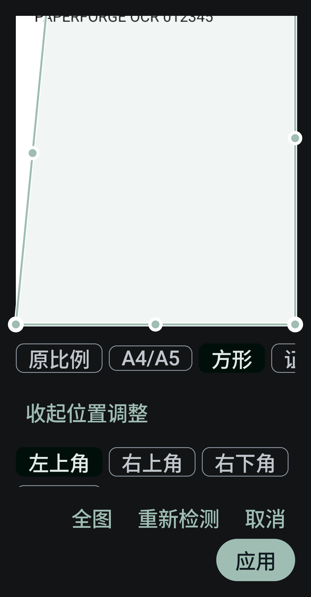

# #8 · 无障碍、大字体与折叠切换

## 实现

- `CropDialog.kt`、`AccessibilityState.kt`：TalkBack 开启时自动展开四角位置调整；选择角点、水平/垂直百分比滑杆代替拖动，非法交叉有朗读反馈。原手势保留，未保存角点、比例与选中角点可跨重建保留。内容滚动、底部操作自动换行。
- `ScanPageCanvas.kt`、`ScanEditorLayout.kt`、`ReaderViewportCanvas.kt`：扫描页提供无障碍翻页/缩放/重置操作；PDF 页有名称、缩放状态、放大缩小、平移和现有翻页/读文字动作。滤镜暴露选中状态，忙碌时不可误操作。
- `DocumentWorkspace.kt`：文档区域固定在同一个容器，只调整位置和尺寸，避免切换折叠/宽屏容器时重挂无障碍子树。
- `EditorScreen.kt`、`OcrProofreadScreen.kt`、`ScanExportDialog.kt`、`MainActivity.kt`：裁切/调整/导出弹窗、参数和 OCR 校正草稿保存至 Compose saveable state；OCR/输出对话框采用可滚动的通用工具弹窗。任务进度提供 live region，操作按钮可换行。
- `SectionCards.kt`：通用工具弹窗在大字体短窗口下整体可滚动，其余窗口保留固定底部操作。`HomeScreen.kt` / `LibraryDocumentCard.kt` 为更多操作、文档选择/多选提供明确名称和状态。继续复用现有卡片、四个阅读入口与主题。

## 实际验证

API 35 x86_64 模拟器，完整 release 应用，离线 OCR 可用。没有把 Compose 点击断言当成 TalkBack 朗读验收。

| 场景 | 结果与记录 |
|---|---|
| 系统字体 200%，窄屏竖屏及横屏 | 裁切角点 12%/8%、方形草稿保持，取消/应用可见且可执行，应用后数据库准确更新；[large-type-test.log](large-type-test.log)，1 项通过，5.192s |
| OCR 行校正和结果弹窗 | 活动重建后未保存的两种文字草稿保留，数据库原文未被提前覆盖；[state-test.log](state-test.log)，2 项通过，8.699s（含初版横屏用例） |
| 分隔铰链展开/折叠及重建 | 2400×1800 窗口通过 WindowLayoutInfoPublisherRule 注入竖直分隔铰链；第 2/3 页、150% 缩放、原生节点的 accessibilityFocused 状态在折叠及展开后保留；重建后页码和缩放保留；真实 TalkBack 同时运行；[fold-test.log](fold-test.log)，1 项通过，5.494s |
| 实际 TalkBack 核心链路 | 图片分享导入 → 四角滑杆 → 裁切应用 → 离线 OCR（命中 012345）→ PDF 导出 → 预览 → 视图/连续滚动 → 回收站恢复 → 设置/离线帮助全部可通过原生无障碍动作完成；[talkback-test.log](talkback-test.log)，1 项通过，50.34s |
| 实际朗读 | TalkBack 开发者“显示语音输出”读取到裁切、识字、导出、生成 PDF、预览、视图、连续滚动、返回、回收站、设置、使用说明等；[talkback.json](talkback.json) 只记录本次夹具与控件标签 |
| 构建 | release 构建及 lintVital 通过，未增加屏幕阅读器生产依赖 |

原生无障碍断言查询具体应用节点的 `isAccessibilityFocused`。TalkBack 的语音浮层会改变活动窗口查询结果，因此不以 `rootInActiveWindow.findFocus()` 的单一窗口缓存推断焦点丢失。折叠截图未收入，避免发布侧栏中与夹具无关的文档缩略图。

## TalkBack 来源与范围

测试屏幕阅读器由 [Google 官方 TalkBack 源码](https://github.com/google/talkback/tree/229212fdf5842191d0a93fc95d9ca1423b346866) 构建，commit `229212fdf5842191d0a93fc95d9ca1423b346866`，版本 `TfPu_release_16_2-2026_10_30_1129`。仅将 `shared.gradle` 的 ABI 过滤改为 x86_64，Java/native 算法未改动；使用模拟器原有 `com.reecedunn.espeak` 离线语音引擎。测试前完成官方引导页、开启显示语音输出，给测试版 TalkBack 授予其请求的 READ_PHONE_STATE 权限。

测试使用真实服务的触摸探索、原生节点焦点和与 TalkBack 激活相同的 ACTION_CLICK；未宣称完成实体设备的滑动/双击手势、实物铰链与厂商 TalkBack 版本验收。系统字体、朝向、屏幕尺寸和无障碍开关在测试后恢复；仅清理本次文档夹具。

测试代码：`AccessibilityFixtures.kt`、`AccessibleStateUiTest.kt`、`TalkBackWorkflowTest.kt`。

参考：[Android 无障碍测试](https://developer.android.com/guide/topics/ui/accessibility/testing) · [Compose 无障碍测试](https://developer.android.com/develop/ui/compose/accessibility/testing)。

[横屏裁切](crop-landscape-200.png) · [TalkBack 帮助页](talkback-help.png)
