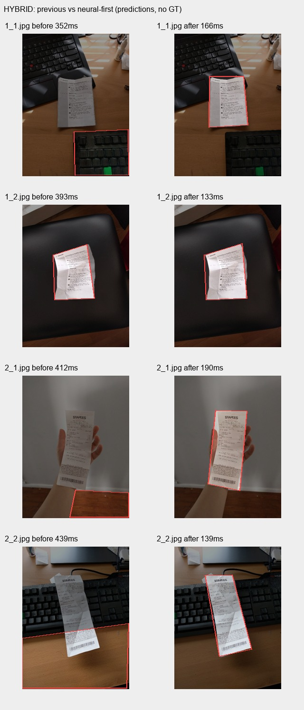
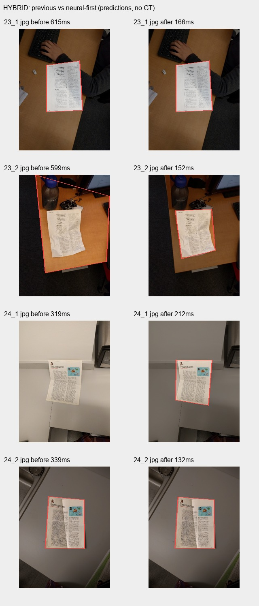

# 真实照片中的混合识边错误与修复

日期：2026-10-24。开发验证，仍不发布版本。

本组使用 [DocUNet 作者公开的相机照片](https://www3.cs.stonybrook.edu/~cvl/docunet.html)，取自然排序前50张，覆盖25份纸张的两种拍摄形态。包含票据、折弯书页、彩页及复杂背景；不是机主手机实拍。75个下载文件（另含25张平板扫描参照）的路径、CRC校验后SHA256和来源见 corpus-provenance.json。作者旧数据主机证书过期；获取脚本的显式公共数据证书例外记录在清单里。

## 具体故障

旧 `HYBRID` 分支完全跳过了已经接入的 MNN 纸边模型，只比较 DocQuad 与传统矩形检测。DocQuad 的角点分数较低时，代码直接采用传统候选；传统候选的分数又不能证明候选是纸张。真实照片中，它会选中键盘、桌沿、窗框、椅垫、显示器或整块地板。运行前后读取到的配置均是 HYBRID，没有通过改用户配置绕过问题。

已查看全部13张四路联系图。典型错误文件有1_1、2_1、2_2、8_2、13_2、14_1、15_2、16_1、20_1、21_2、23_2、24_1、25_1、25_2。这里是人工观察到的失败样例清单，不是逐角点标注或准确率统计。

## 改动

自动/混合模式现在先运行纸边神经模型，找到有效纸框后直接沿纸边精修；只有主模型无法提供结果或不可用时，才进入原有回退。保留显式传统模式。设置里合并了正常路径相同的旧 NEURAL/HYBRID 选择，旧配置继续兼容。没有给手动快门增加拒绝条件。

同图复跑后，50张的自动模式输出与先前单独运行 MNN 的候选一致，之前框到键盘/桌面以及24_1没有纸框的案例得到纠正。典型前后图如下。

## 记录的范围

环境为 API35 AOSP x86_64 模拟器。输入最长边解码1800像素；修复前比较四个头，修复后只复跑自动模式，避免重复运行未改动模型。旧自动模式单次调用耗时中位数401.87ms，新模式158.79ms；缓存、运行顺序和模拟器环境会影响时间，不代表机主 ARM64 手机性能。批处理总时间也不能直接比较，因为头数量不同。

返回纸框的数量由49变50，只代表返回了候选，不能作为正确率。没有这50张的独立角点和逐字标注，因此没有报告 IoU、角点误差或 CER。曲面页的四边形仍只是裁切入口，不能代替非线性展平；淡字、铅笔、强反光及真实相机跨旋转还要分别验证。

原始前后输出保留在 before.json / after.json，逐图对照与时间在 comparison.json。探针位于 app/src/androidTest/.../quality/RealPhotoProbe.kt，仅显式ADB研究使用，不给主应用增加存储权限或网络权限。
