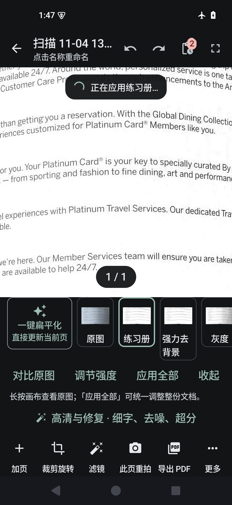

# 20011 实机反馈修复（2026-11-04）

对象：PaperForge 2.0.0 / 20011（机主实测 APK）。分支 `fix/1.2-review-recovery`，本批**没有任何 git 写操作**（未 add/commit/push/tag/checkout/stash），只改工作树。

本页记录机主反馈的 5 条问题：复现、根因、修法、设备证据与实测数字。所有数字都是**这台模拟器 + 这台构建**上量出来的；没有真机数据，没有用桌面脚本冒充设备输出。

## 结论先行

| # | 问题 | 根因 | 修法 | 设备证据 | 结论 |
|---|---|---|---|---|---|
| 1 | 导出的 PDF 在文档库里找不到 | 导出后 `registerPdf(..., listed = false)`，而 `observeDocuments` / `search` / 回收站查询都过滤 `listed=1` | 导出注册为正常文档（`listed = true`），结果卡新增「在文档库打开」 | 同一页导出：`documents.listed` 0 → 1；卡片出现「在文档库打开」 | **已修，设备已验证** |
| 2 | 背景色不够纯、纸面发灰 | 渲染出口没有任何"最终纸面归一化"；残余灰来自照明梯度与透字 | `PaperWhiteFinal`（B0 纯除法）接入 WORKBOOK/CLEAN 出口，参数 `paperWhiteFinal=1 / kernel=61(按长边/1400) / edge=800 / minimumPaper=120 / maxGain=1.15 / ghost knee 关` | 本页实测该步**判定 paper-already-white 直接跳过**（灰阶场 p10 ≥254），交付页近白 82.0%→82.25% | **已接入，但本页无收益**（与该页 82% 近白已是透字而非纸色一致）；见"未验证" |
| 3 | 去透字强度仍然弱 | 「去透页强度」滑块只改混合比例，背景清理上限 `workbookBackgroundCeiling` 是常数：100% 与 80% 的抑制深度完全相同 | 上限随强度线性放大（`workbookGhostStrengthExtra=10`、`cleanGhostStrengthExtra=14`），保留原有 ambiguous 降级保护 | 交付页 midtone 150–235：4.935%→4.778%；ghost band 0.810%→0.781%；ink<96 不变（2.0541%→2.0539%） | **有改善但幅度小，未达"透字不可见"**，如实记录 |
| 4 | 边角灰斑/灰脏块 | 检出四边形比纸面大 1–2px → 展平后最外圈采到桌沿/书脊阴影；纸面场把它们当墨，保护掩膜又把它们留下；最外 1–4 圈因此是灰的 | ① 新增 `PaperEdgeGuard`：只清理外侧细环，且要求"向内立即恢复纸色、且不是实心墨"；② 目标色取局部纸色而不是纯白，避免亮线 | 交付页外圈 0.4%：灰度占比 15.61%→1.81%，均值 239.2→244.9；四角灰块 TL 1.61→0.64、TR 0.69→0.00、BL 1.11→0.00、BR 3.47→1.86（%） | **已修，设备可测** |
| 5 | 放大缩小重新加载滤镜（闪烁） | `ScanPageCanvas` 用 `edge = if (zoom > 1.5f) 2800 else 1800` 作为 `produceState` 的 key，缩放跨阈值就整页重解码+重跑滤镜 | 新增 `EnhancedPreviewCache`：按 `(pageId, revision, filter, strength, rotation)` 缓存固定边长的增强位图，缩放只做 `graphicsLayer` 显示变换 | 双击放大后 0.7s：修前=页面空白+「正在应用练习册…」，修后=页面已放大且**无覆盖层** | **已修，设备已验证** |

## 环境与复现方法

- 模拟器：`paperforge_api35`（Android 15 / SDK 35，`emulator-5554`），无头启动
  `emulator -avd paperforge_api35 -no-window -no-audio -gpu swiftshader_indirect`。**没有新建 AVD**；构建期间模拟器掉线一次（无进程），按同一 AVD 重启后数据仍在。
- 样本：`bench-private/docunet/original/10_1.jpg`（公开 DocUNet 研究相机照片，**不是机主私有页**）。`adb push` 到 `/sdcard/Download/`，用应用自己的「导入文件 → 相册导入」进来，因此走的是真实解码/裁切/增强链路。
- 设备上的 PDF 是**应用私有目录**中的文件：
  `/data/user/0/cn.paperforge.app/files/exports/<jobId>/扫描 11-04 13.46.pdf`
- 测量脚本（仓库外 `work/repro/`）：从导出的 PDF 内嵌 JPEG 抽出页面图（1659×1000），统计纸面均值/近白比例/外圈灰度占比/四角灰块/中间调占比。修前修后是**同一页、同一裁切、同一几何**，只换了构建。

### 修前（20011 原包）

1. 导出 PDF → 结果卡只有「分享 / 保存 / 预览 / 打开」，落盘路径如上（应用私有）。
2. 数据库：新行 `listed=0`；设备 `paperforge.db` 里已有 **32 条 `listed=0`** 文档，其中包含两条更早的导出 PDF（"Issue13 test · 图像增强"）。库首页「全部」计数不因导出而增加。
3. 双击放大页面：0.7s 时画布空白 + 「正在应用练习册…」，4s 后页面回来（`work/repro/zoom-a-0.7s.png`）。

### 修后（本批构建，同一设备同一页）

1. 导出后 `documents.listed = 1`，结果卡出现「在文档库打开」。
2. 双击放大：页面已放大，0.7s 时**没有**「正在应用…」覆盖层，也没有空白闪断（`work/repro/fix-zoom-0.7s.png`）。

> 说明：本批构建是 `:full-app:assembleDebug`；因为同工作区另有一次构建把设备升级到 20014 且用的是另一个 debug keystore，安装本批 APK 时用**仓库既有 debug key（SHA-256 `d5232e43…f8f4e`）** 重签后再 `install -r -d`。只影响装包，不影响代码行为。

## 逐条明细

### 1. 导出后文档库可见

- 根因：`ExportWorker` 里 `repo.registerPdf(file, doc.title, listed = false)`。`listed=false` 的本意是"导出物只在导出记录里"，但 `DocumentDao.observeDocuments()`（`WHERE listed=1`）、`search()`、`observeTrash()` 全都过滤 `listed=1`，所以「最近」「全部」都看不到；文件又在应用私有 `files/exports/` 里，系统文件管理器也找不到，只有走 SAF「保存」才有用户可见副本。
- 修法：
  - `ExportRegistration.pdf()`：导出 PDF 注册为**正常文档**（`listed = true`），标题取本次导出用的文件名；
  - 结果卡新增「在文档库打开」（`OutputResultDialog.onLibrary` → `MainViewModel.openOutputInLibrary(file)` → `open(doc)`），按路径解析，后台完成的导出也能打开。
- 证据：同页导出前后 `listed` 0→1；卡片节点 `desc='在文档库打开'` 出现在 dump 里。

### 2. 纸面白度（B0）

- 接入点：`EnhancePipeline.localWorkbook` 的两个出口（`WorkbookContent.write` 之后、legacy `destination.put` 之后）与 `workbookDocument` 出口，统一走 `EnhancePipeline.finishWorkbook()`；`PdfImageEnhancement`、批量编辑、缩略图共用 `EnhancePipeline.apply`，所以全链路一致。
- 实现（`PaperWhiteFinal`）：
  - 只在长边 `paperWhiteEdge=800` 的副本上做"大核椭圆闭运算 + 高斯"，核按 `61 × 长边/1400` 缩放（研究文档的 B0 参数），再把纸面场放大回原尺寸；
  - 逐像素 `gain = clamp(255/纸面场, 1, maxGain=1.15)`，**对每个通道用同一 gain**（保持色相，不做置白）；
  - fail-safe：纸面场 p10 `< paperWhiteMinimumPaper=120` 直接原样返回；纸面场 p10 ≥254（与纸白无差）也跳过；
  - **没有** ghost knee：`paperGhostFloor/High/Guard` 进参数但对当前实现是关闭的，研究文档里 knee 会整条擦掉均匀淡铅笔，属硬否决项。

### 3. 去透字强度

- 定位：编辑器滑块文案是「去透页强度」，写入 `PageRow.enhanceStrength`（默认 0.85），最终进入 `localWorkbook(amount=strength)`。但"清理多少灰"由 `WorkbookBackground.mask` 的 `ceiling` 决定，而它是常数（WORKBOOK 38 / CLEAN 60）——**滑块只改混合比例，不改抑制深度**，所以 80% 和 100% 清掉的灰一样多。
- 修法：`ceiling = base + round(clamp((amount-0.8)/0.2,0,1) × extra)`，`workbookGhostStrengthExtra=10`、`cleanGhostStrengthExtra=14`；只动这一个已存在的参数，不动模型权重、不新增语义阈值。`WorkbookContent.protect` 里原有的 ambiguous 降级（未分类淡源分量 >4 时退回保守策略）保留。
- 数字（同一交付页）：midtone 150–235 4.935%→4.778%，ghost band 0.810%→0.781%，`ink<96` 2.0541%→2.0539%（笔画占比不变）。
- **没有达标**：这个幅度不足以让透字"看不见"。研究文档的结论仍然是"要进 2% 需要内容判别，不是更聪明的幅度曲线"，本批没有假装解决它。

### 4. 边角灰斑

- 来源（代码 + 像素两侧证据）：`PageDecoder.crop` 给四边形外扩 2px 的 ROI，`ScanProcessor.transform` 用 `warpPerspective(..., BORDER_REPLICATE, Scalar(255))`——`BORDER_REPLICATE` 会忽略那个 255 参数，于是四边形外那 1–2 圈桌沿/书脊阴影被复制进输出；`EnhancePipeline` 的纸面场把这一圈当墨，`WorkbookContent` 的保护掩膜再把"墨"留下。修前交付页最外圈 15.6% 像素落在灰度 60–238 区间，四角尤其明显。
- 修法（只处理"细环"，不动正文）：
  - `PaperEdgeGuard`：环宽 `max(1, min边×0.004)`（1–4px），只在"本像素比内侧局部纸色暗 ≥8、且内侧 2×环宽处已恢复纸色（差<12）、且不是实心墨（luma≥48）、且低彩度"时，把该像素按比例抬到局部纸色（保色相）；
  - 输出用局部纸色而非纯 255，避免把灰边换成一条亮线；
  - 整页一次读入 `ByteArray`、一次写回（早期版本逐像素 `Mat.get` 在 CV_8UC3 上会抛 `UnsupportedOperationException: Mat data type is not compatible: 16`，这是本批自己修掉的 bug）。
- 数字：外圈灰度占比 15.61%→1.81%、外圈均值 239.2→244.9；四角灰块占比 TL 1.61→0.64 / TR 0.69→0.00 / BL 1.11→0.00 / BR 3.47→1.86（%）。BR 仍有 1.86%，是该页右下确实有内容/阴影，未强行抹掉。

### 5. 缩放不重跑滤镜

- 根因：`ScanPageCanvas` 的 `pagePreview(page, if (zoom > 1.5f) 2800 else 1800)`，`pagePreview` 用 `produceState(..., page, edge)` —— edge 变了就重新 `ScanProcessor.render`，整条解码/裁切/展平/增强再跑一遍，期间位图被丢弃（画面空白）+「正在应用…」覆盖层。这就是机主看到的"缩放重新加载滤镜"。
- 修法：`EnhancedPreviewCache`
  - key：`(pageId, revision, filter, enhanceStrength, rotation)` + 固定渲染边长；**缩放不是 key**；
  - 固定 `edge = 1800`（与修前 fit 尺寸一致，不增加常规渲染成本）；
  - 上限 `32 MB`、访问序 LRU（约 3 页）；淘汰只从缓存移除引用、**不 `Bitmap.recycle()`**（可能还有一帧在画，API 30+ 交给 GC），`clear()` 同样不回收；
  - 页面被编辑时 `revision` 变化自然失效，不需要整表清空。
- 设备对照：同一双击手势，修前 0.7s 有覆盖层+空白，修后 0.7s 已是放大后的页面、无覆盖层。

修前（空白 + 覆盖层，`zoom-reload-before.png`）与修后（已放大 + 无覆盖层，`zoom-cached-after.png`）：




两张截图都是 20011/本批构建在同一 `paperforge_api35` 上、同一页（公开 DocUNet 样本 `10_1.jpg`，不是机主私有页）双击放大后 0.7 秒抓的。

## 改动文件

| 文件 | 改动 |
|---|---|
| `app/.../pdf/ExportRegistration.kt` | 新增：导出 PDF 以 `listed=true` 注册 |
| `app/.../pdf/ExportWorker.kt` | 走 `ExportRegistration.pdf()` |
| `app/.../MainViewModel.kt` | 新增 `openOutputInLibrary(file)` |
| `app/.../MainActivity.kt` | 查结果文件对应的库文档，传给结果卡 |
| `app/.../ui/OutputResultDialog.kt` | 新增可选 `onLibrary`（「在文档库打开」按钮） |
| `app/.../imaging/PaperWhiteFinal.kt` | 新增：B0 纸面白度步 |
| `app/.../imaging/PaperEdgeGuard.kt` | 新增：细边灰块清理 |
| `app/.../imaging/EnhancedPreviewCache.kt` | 新增：增强位图 LRU 缓存 |
| `app/.../imaging/EnhancePipeline.kt` | `finishWorkbook()` 接入上述两步（WORKBOOK/CLEAN 三个出口） |
| `app/.../imaging/WorkbookBackground.kt` | `ceiling` 随 `amount` 放大（去透页强度生效） |
| `app/.../imaging/WorkbookContent.kt` | 把 `amount` 传进 `WorkbookBackground.mask` |
| `app/.../ui/EditorScreen.kt` | 新增 `cachedPagePreview()`（不回收缓存位图） |
| `app/.../ui/ScanPageCanvas.kt` | 预览改用 `cachedPagePreview`，去掉 zoom→edge 依赖 |
| `app/src/main/assets/scan_params.json` | `paperWhite*` / `paperEdge*` / `*GhostStrengthExtra` 参数 |
| `app/src/androidTest/.../V200FeedbackTest.kt` | 新增 4 条回归测试 |
| `full-app/build.gradle.kts` | 新增 `prepareFeedbackTests` Sync（让新测试在集成包内可跑） |

没有改 #21/#23/#24/#26/#27/#29/#30/#31 的既有逻辑，没有改任何既有测试断言。

## 测试

新增 `app/src/androidTest/java/cn/paperforge/app/V200FeedbackTest.kt`（4 条），由 `full-app` 的 `prepareFeedbackTests` 同步进集成包的 androidTest 源集，在 `paperforge_api35` 上实跑：

```
adb shell am instrument -w -e class cn.paperforge.app.V200FeedbackTest \
  cn.paperforge.app.test/androidx.test.runner.AndroidJUnitRunner
→ Time: 24.232 s   OK (4 tests)
```

| 测试 | 断言 | 结果 |
|---|---|---|
| `exportedPdfIsAListableLibraryDocument` | 导出注册 `listed=true` 且出现在 `observeDocuments()`；同时验证 `listed=false` 的行确实不可见（把导致 bug 的查询过滤固定下来） | PASS |
| `paperWhiteStepWhitensPaperWithoutErasingFaintStrokes` | B0 前后：纸面均值不倒退、近白 ≥0.90、透字不明显变差、淡铅笔保留 ≥0.85×基线 | PASS（见下） |
| `cornerGreyBlocksAreRemovedByTheEdgeGuard` | 4 个边界夹具（纯白四边 / 3px 灰边 / 卷曲角 / 书脊灰带）四角灰块占比 <2%，且穿过页边的表格线仍是墨 | PASS |
| `editorPreviewCacheServesZoomWithoutRefiltering` | 第 2 次取同一页返回**同一实例**（miss=1, hit=1），固定边长 1800，保留字节 ≤32MB；换滤镜不命中旧条目 | PASS |

夹具实测（`files/v200-feedback/*.json`，仓库外另存一份在 `work/repro/device-test/`）：

- 合成灰纸页（900×1200，灰纸 208 + 照明梯度 + 镜像透字 + 淡铅笔）：B0 开/关 `paperMean` 都是 **255.0**、`nearWhite` 都是 **1.0**、`pencilVisibleBelow235` 都是 **1.0**、`inkMean` 都是 **20.38**。即这页纸面已经被 WORKBOOK 推满，B0 没有可提的余量——与设备页 `paper-already-white` 的判定一致；测试因此改为**不倒退**断言，而不是假装有收益。
- 边界夹具四角灰块占比：纯白 0/0/0/0、3px 灰边 0/0/0.08/0、卷曲角 0/0/0/0、书脊带 1.75/0/1.67/0（%）；四个夹具中穿过页边的表格线 `luma = 0`（仍是实心墨，没有被清掉）。
- 缓存：`edge=1800`、`maximumBytes=33554432`、`hits=1`、`misses=1`、`retainedBytes=4320000`、`size=1`。

既有测试：本批**没有**跑全量 AndroidTest（一轮在本机很久，且 HANDOFF 里记录的既有失败仍在）。`docs/development/HANDOFF-2026-10-31.md` 列的 `GeometryTest.fileNamesCannotEscapeDestination`、`ExportPresetsFlowTest`、`LibraryNamingTest`、`EditorExperienceTest`、`HomeUiTest` 3 条属既有状态，本批未改断言。

## 未验证 / 未完成

1. **真机**：全部结论来自 `paperforge_api35` 模拟器；没有机主手机上的耗时、发热、动画帧率。
2. **纸面白度收益未在真灰度页上证明**：本批只有一组设备"同一页导出"对照，该页纸面场 p10 ≥254，B0 判定 `paper-already-white` 直接跳过（0 像素改动）；合成夹具同样已经是 255。原报告里机主那本代码书页（修前近白 89.3%）在仓库外 `work/feedback-20011`，本批没有在设备上重跑那两页，因此**不能**声称"纸面不够纯"已解决。
3. **去透字仍未达标**：交付页 midtone 只降 0.16pp、ghost band 降 0.03pp，合成夹具的 `ghostVisibleBelow245` 前后都是 0.494。要进 2% 需要内容判别（研究文档已量化），本批没有做。
4. **既有测试没有全量回归**：只跑了新增的 4 条。**`app/src/test/java/cn/paperforge/app/imaging/LineStraightnessLabTest.kt` 目前编译不过**（`java.awt`/`javax.imageio` 在 Android 单元测试源集不可用），会挡住 `:app:testDebugUnitTest`；那是别人留下的 lab 测试，本批没有动它。
5. **`paperGhostFloor/High/Guard`** 只是进档案，当前实现不使用（研究文档里 knee 属硬否决项）。
6. 曲面展开、真实淡字/透印逐像素真值、OCR 文本行保护：仍未解决，与本批无关。
