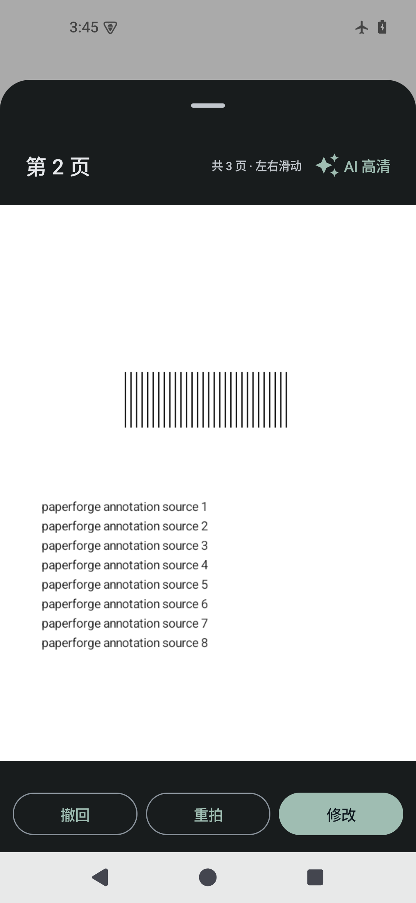
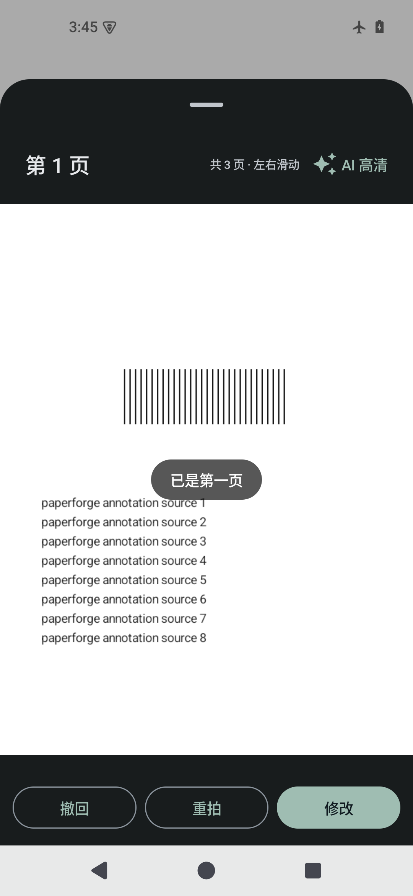
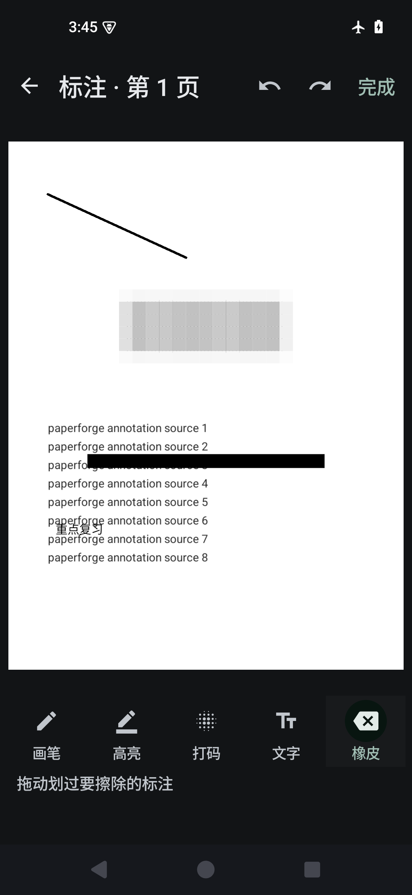
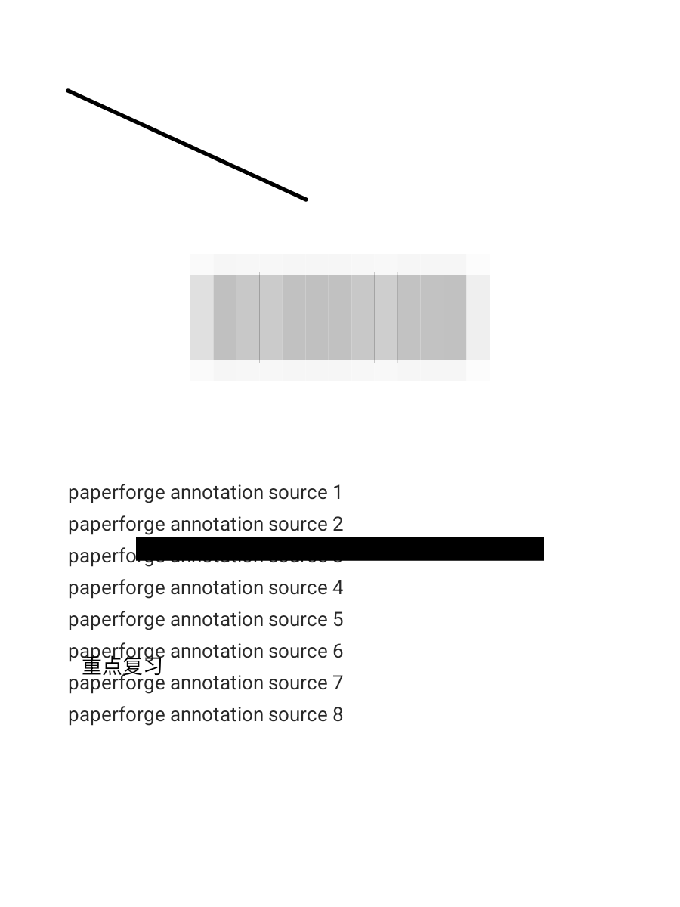
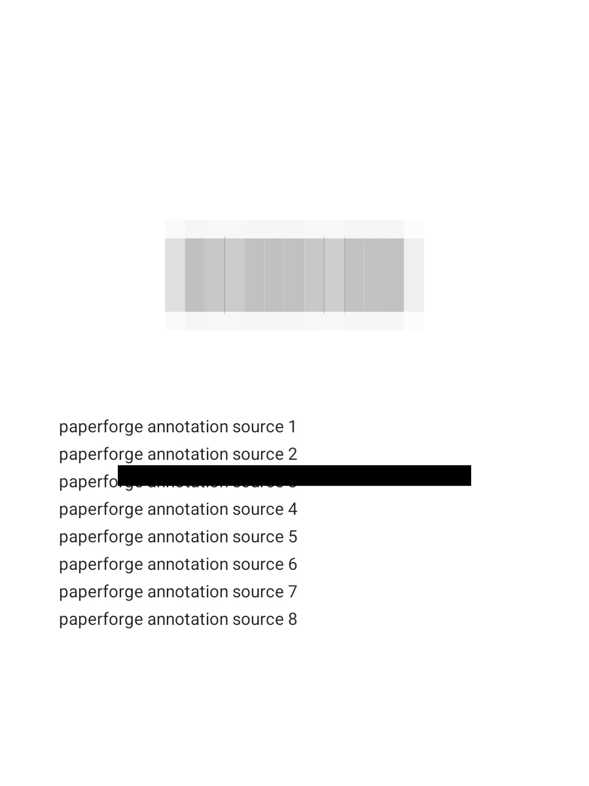

# 20011 编辑体验增强：预览左右翻页与标注（2026-11-04）

对象：PaperForge 2.0.0 / 20011（提交 `08c0b8a` 之后），分支 `fix/1.2-review-recovery`。
本批**没有任何 git 写操作**（未 add/commit/push/tag/checkout/stash），只改工作树。本文所有数字都是这台 `paperforge_api35` 模拟器 + 本批 Debug 构建上量出来的；没有真机数据。

## 结论先行

| 项 | 实现 | 设备证据 | 结论 |
|---|---|---|---|
| 预览弹层左右翻页 | `CapturePagePreview` = `HorizontalPager`，页码「第 N 页」跟随当前页，四个操作只绑定当前页；首/尾越界显示提示并触发一次触感反馈 | `PageAnnotationTest.capturePreviewSwipesPagesAndActsOnTheVisiblePage`：滑动后页码 1→2→1，修改/重拍/AI 高清收到的页 id 均为当前页；越界出现「已是第一页」 | **通过** |
| 打码 / 文字 / 画笔 | 标注模式内的底部工具栏：画笔、高亮、打码（马赛克/黑条，粗细滑杆）、文字、橡皮；二级行只放颜色或样式+粗细 | `annotation-tools.png`；`PageAnnotationTest.annotationStrokeUndoRedoAndBakeKeepsOriginalAndHistory` 保存后四类标注都在 | **通过** |
| 撤销/重做/橡皮 | 标注编辑器内 40 步撤销栈；橡皮按笔迹/框/文字命中擦除 | 同一测试：画一笔→撤销→重做；模型级橡皮命中与撤销恢复 | **通过** |
| 烘焙进页面、保留原图 | 新 PNG 作为新页面版本，`page.original` 指向新文件；旧原图与 `edit_history` 里的旧页都保留 | 原图 SHA-256 前后相同；撤销回到旧原图，重做回到标注版 | **通过** |
| 导出包含标注 | 页面像素已含标注，`PdfEngine.scan` 直接带走 | 从导出 PDF 抽出内嵌页图：黑条仍为黑、马赛克区域边缘能量低 | **通过** |
| 未进入标注模式时编辑页不变 | 只有「更多 → 标注与打码…」新增一项，进入后是独立全屏页；编辑页没有常驻标注按钮 | `EditorMoreSheet.kt` 仅加一个 `MoreItem` | **通过（结构检查）** |

## 入口与交互

### 1. 拍摄预览弹层

入口不变：取景区右下角缩略图 →「第 N 页」弹层（`CameraScreen` → `CapturePagePreview`）。

- 弹层内容是**当前文档页序**的 `HorizontalPager`，左右滑动切页；标题「第 N 页」跟随可见页，右侧「共 M 页 · 左右滑动」只在多页时出现。
- 「AI 高清」「撤回」「重拍」「修改」全部接收 `pages[pager.currentPage]`，因此只作用于当前页；滑页不会改变其他页。
- 首/尾边界：在 Initial pass 旁路观察横向手势（不消费手势，不影响正常翻页）。第一页继续向右滑显示「已是第一页」，最后一页继续向左滑显示「已是最后一页」，同时触发一次 `LongPress` 触感；提示 2.2 秒后淡出（`EdgeHint`，testTag `capture-preview-edge`）。
- 兼容：保留 `CaptureSinglePagePreview(page, number, …)` 旧签名给既有测试/调用，内部复用同一 pager，避免出现两套预览行为。既有测试断言未改。

### 2. 标注编辑（新）

入口：**预览/相册缩略图 →「修改」→ 编辑页 →「更多」→「画面与修复」→「标注与打码 · 马赛克/文字/画笔」**。
没有在编辑页常驻任何新按钮；标注工具条只存在于这个全屏标注模式里。

顶部：返回、撤销、重做、「完成」。底部一级工具行 + 二级参数行：

| 工具 | 交互 | 二级参数 |
|---|---|---|
| 画笔 | 自由笔迹，归一化坐标保存 | 黑/红/蓝 + 笔宽 |
| 高亮 | 自由笔迹，半透明黄色、更粗 | 固定样式 |
| 打码 | 拖出矩形；「马赛克」把区域按块平均后放大，「黑条」填充纯黑并保证最小厚度 | 马赛克/黑条 + 粗细（块大小 / 条厚） |
| 文字 | 点按放置，弹窗输入正文；再点已有文字可重新编辑 | 黑/红/蓝 + 字号 |
| 橡皮 | 划过笔迹/框/文字即删除（命中测试在归一化坐标里做，缩放无关） | — |

撤销/重做覆盖新增、擦除、文字修改；一次拖动只产生一个撤销步。返回不会保存，只有「完成」走保存。

### 3. 保存语义

`MainViewModel.saveAnnotations`：

1. `ScanProcessor.render(page, 3000)` 得到当前外观（已有增强/滤镜结果都算进去），在副本上绘制标注；
2. 新 PNG 写入文档私有目录，文件名随机；
3. `repository.savePage(page.copy(original = 新文件, corners = Full, rotation = 0, deskew = 0, filter = ORIGINAL, …))`：revision+1、清 OCR、写一条 `edit_history`（before = 旧页，after = 新页）；
4. 原图文件从未被写入；旧的 `flatDocument` 复用提示被移除，`processingMetadata.pageAnnotations` 只记录版本/数量/类型/时间，便于审计。

因为标注已经进入页面像素，PDF/图片包/分享/缩略图都自动包含标注，不需要在导出端再做一次渲染。撤销恢复旧页（旧原图仍在），重做恢复标注页。

## 设备与测试

环境：`paperforge_api35`（Android 15 / SDK 35，`emulator-5554`，无头，复用已存在的 AVD，未新建）。构建：`:full-app:assembleDebug` + `:full-app:assembleDebugAndroidTest`，`adb install -r -d` 安装到同一设备。

新增 `app/src/androidTest/java/cn/paperforge/app/PageAnnotationTest.kt`（3 条），由 `full-app` 的 `prepareAnnotationTests` Sync 进集成包 androidTest 源集：

```
adb shell am instrument -w -e class cn.paperforge.app.PageAnnotationTest \
  cn.paperforge.app.test/androidx.test.runner.AndroidJUnitRunner
→ Time: 28.016 s   OK (3 tests)
```

| 测试 | 断言 | 结果 |
|---|---|---|
| `capturePreviewSwipesPagesAndActsOnTheVisiblePage` | 3 页 fixture；滑到第 2 页后页码=2；修改/重拍/AI 高清回调页 id = 第 2 页；回到第 1 页再右滑出现「已是第一页」且页码仍=1 | PASS |
| `annotationStrokeUndoRedoAndBakeKeepsOriginalAndHistory` | 画一笔→撤销→重做；橡皮命中笔迹并可撤销；马赛克/黑条/文字三类保存；原图 SHA 不变、revision+1、metadata 计数一致、无 flatDocument；马赛克区域边缘能量下降、黑条区域>95% 纯黑、文字区域有暗像素；重开页面文字仍在；撤销回旧原图、重做回标注页 | PASS |
| `exportedPdfContainsBakedAnnotations` | 标注页走 `PdfEngine.scan` 导出 PDF；抽内嵌页图：黑条>90% 纯黑、马赛克区域边缘能量低 | PASS |

既有预览契约的回归（未改断言）：`CaptureReviewFeedbackTest#centredShutterAndSinglePageReview` 单独复跑 `Time: 12.342 s OK (1 test)`，旧 `CaptureSinglePagePreview(page, 12, …)` 仍显示「第 12 页」且四个按钮正常。

测试截图（设备 `files/annotation-tests/`，已拉到本目录）：`preview-pager-page-2.png`、`preview-pager-edge.png`、`annotation-tools.png`、`annotated-page.png`、`pdf-embedded-page.png`。











实现细节与失败复现记录：

- 马赛克最初用 `Bitmap.createScaledBitmap(..., filter = true)` 缩到块网格，Android 的双线性缩放在 30:1 降采样时只取 2×2 邻域，保留若干近黑/近白块，设备截图里表现为“只盖住几块、其余还是白”。改成逐块读像素求 RGB 均值再画方框（`PageAnnotations.drawMosaic`），`annotated-page.png` 才是连续的块状遮盖。
- 打码框最初用 `detectDragGestures`，`onDragStart` 拿到的是越过 touch slop 之后的位置，设备上 0.28 的左边界实际从约 0.38 开始。改成 `awaitFirstDown + drag` 后用按下点作首点，`annotation-tools.png` 里的马赛克从 0.28 覆盖到 0.72。

## 改动文件

| 文件 | 改动 |
|---|---|
| `app/.../ui/CaptureReview.kt` | 新增 `CapturePagePreview`（HorizontalPager + 页码 + 首尾提示）；旧 `CaptureSinglePagePreview` 保留为单页包装 |
| `app/.../ui/CameraScreen.kt` | 预览改为传整份页列表与初始页，回调按当前页 |
| `app/.../ui/ScanAnnotationScreen.kt` | 新增标注模式（工具栏、颜色/粗细、文字弹窗、撤销重做、橡皮） |
| `app/.../ui/EditorScreen.kt` | 打开标注模式；「更多」接线 |
| `app/.../ui/EditorMoreSheet.kt` | 「画面与修复」新增「标注与打码」一项 |
| `app/.../MainViewModel.kt` | 新增 `saveAnnotations`（烘焙新页、保留原图/历史） |
| `app/.../model/PageAnnotation.kt` | 新增标注模型、JSON、命中测试、`AnnotationEditor` 撤销栈 |
| `app/.../annotation/PageAnnotations.kt` | 新增绘制/马赛克/黑条/文字与烘焙、metadata |
| `app/src/androidTest/.../PageAnnotationTest.kt` | 新增 3 条设备测试 |
| `full-app/build.gradle.kts` | 新增 `prepareAnnotationTests` Sync |

未改：`imaging/`（含 EnhancePipeline/PaperWhiteFinal）、几何/裁切逻辑、既有测试断言、数据库 schema。

## 未验证 / 限制

1. **只有模拟器**：没有真机耗时/触感强度/动画帧率；标注页渲染 3000 长边的耗时没有单独计时。
2. **烘焙是“拍平”**：保存后该页的滤镜会固定为当前外观（filter=ORIGINAL，像素已含增强和标注）。之后再改滤镜/增强是在已烘焙像素上再处理；撤销可回到旧页，但旧页的“重跑增强链”依赖历史里的旧页而不是新页。
3. **打码是像素覆盖**：不是 PDF 原生涂黑；如果外部阅读器能恢复被覆盖前的原始文件（本应用的历史/原图本来就保留），这是本地历史语义，不是密码学删除。需求是“打码/马赛克”视觉与导出，未实现不可逆的安全脱敏。
4. **文字编辑只在本次标注会话内**：保存后文字已经是页面像素，重进标注不会再变成可编辑文本对象；如需继续改，只能撤销到标注前重做或再叠加新文字。
5. **边界提示的触感强度**未在真机校准；测试只断言提示出现与页码不跳。
6. **未跑全量 AndroidTest**：本批只跑了新增 3 条；既有失败项沿用 `docs/development/HANDOFF-2026-10-31.md` 的记录，本批未改任何既有断言。
7. 预览 pager 的缩放手势仍是 `ScanPageCanvas` 原有双指缩放；放大后再横滑优先平移，这是既有阅读手势契约，未改动。
