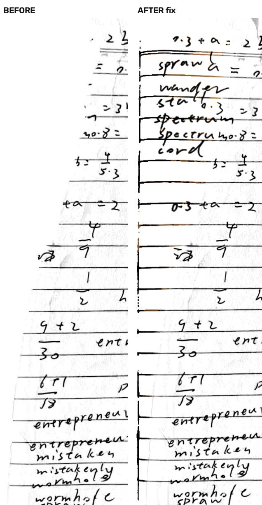
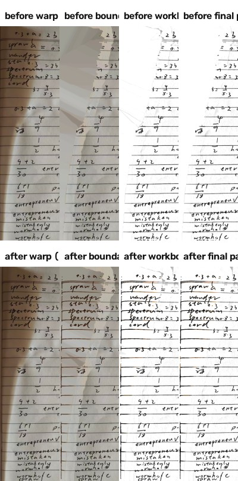
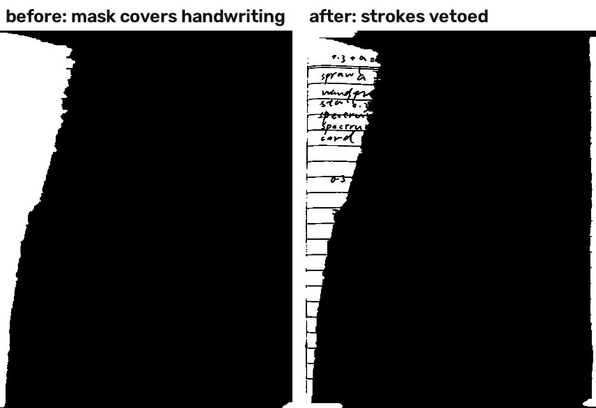
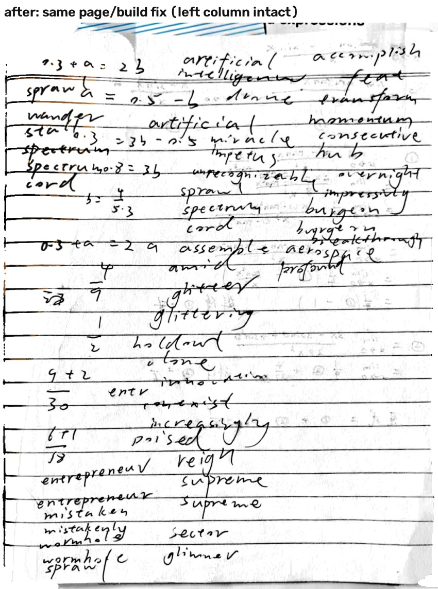
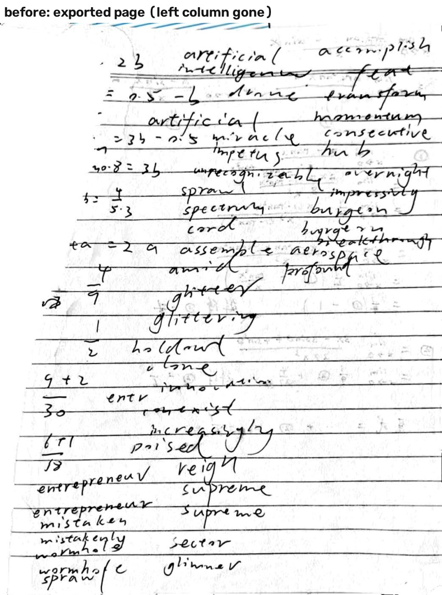
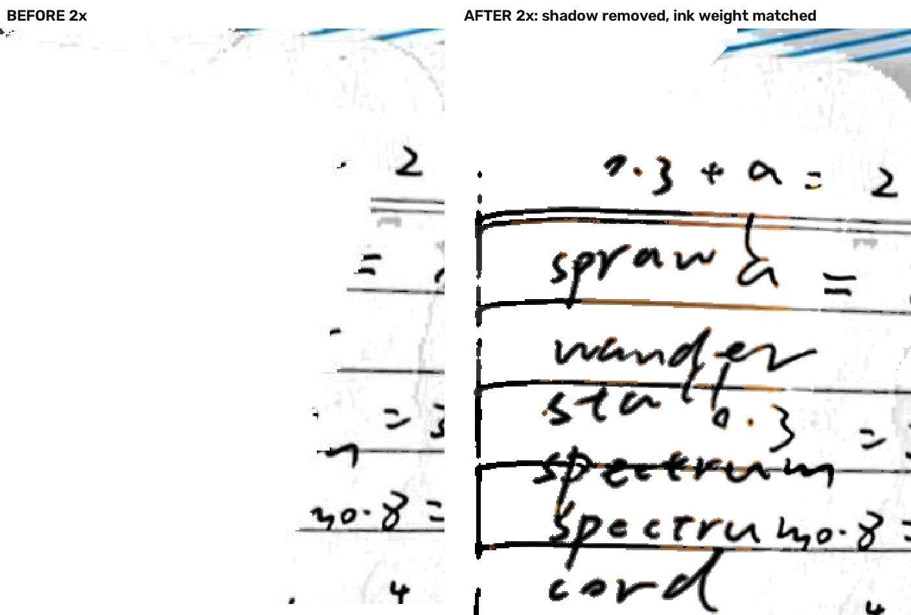

# 20016 左缘有效字被抹：复现、逐层消融与修复

2026-11-04。对象：PaperForge 2.0.0 / 20016，分支 `fix/1.2-review-recovery`。本批**没有任何 git 写操作**（未 add/commit/push/tag/checkout/stash），只改工作树。所有设备数字都在 `paperforge_api35` 模拟器上量出；**没有真机数据**，也没有用桌面脚本冒充应用输出。机主这页手写笔记**没有复制进仓库**，测试夹具在构建时从仓库外 `work/repro-edge/original.jpg` 打进 androidTest APK。

本页含两轮：第一轮修"左列被当页外清掉"，第二轮修机主追加反馈的"阴影内和边缘像打码/糊"。

## 结论先行

| 项 | 结果 |
|---|---|
| 复现 | 原图经应用相册导入、练习册滤镜、导出页图：左列 `0.3 + a = 2.3` / `sprawl` / `wander` / `staff` / `spectrum` / `cord` 被抹掉；同一页、同一裁切改后完整 |
| 主因 | `WorkbookPaperBoundary` 的外侧（desk/spine）掩膜把左侧书脊阴影连同写在上面的字一起当成"页外"填白：关闭它左缘笔迹保留 **42.9%→65.9%（+23.0pp）** |
| 次因 | 阴影带内的纸面场估计被阴影拉低，笔迹的归一化墨量 `v≈0`，前景/背景模型因此有权把它当背景：整条内容路径关闭后再 +7.4pp（合计 **+30.4pp**） |
| 非因（本页） | 裁切（0.0pp，裁切后的图上左列仍在）、`PaperEdgeGuard`（内容 0.0pp；但它负责清外圈，关掉灰圈 6.7%→35.2%）、`PaperWhiteFinal`（0.0pp）、背景掩膜 `workbookConfidentBackground`（0.0pp）、导出/渲染（无额外裁切）、`GridStraighten`（不在相册导入路径上） |
| 第一轮修法 | 外侧掩膜加"局部对比黑帽 + 细暗结构"笔迹否决；边缘纸面场从纸内侧取；护栏只清"向内立即变纸色且孤立/低对比"的细环；内容贴边时裁切向纸外扩；贴边有墨时拒绝 >1% 的拉直位移 |
| 第二轮反馈 | 第一轮把笔迹保护放在 560 长边的探针分辨率上，再最近邻放大：笔迹周围留下 **2–3 px 的块状孔洞和 3 px 宽的阴影光环**，放大后像"打码/糊" |
| 第二轮修法 | 轮廓仍按原逻辑填满；**笔迹否决改成全分辨率只做一次、只留 1 px 边**；掩膜由最近邻改为线性放大后阈值；顶部/底部外侧 4% 不参与笔迹否决（那一条是书页上下的印刷字，仍应按页外清掉） |
| 前后 | 左 30% 笔迹保留 **42.9%→70.9%（+27.9pp）**；左 2–10% 带 **18.5%→78.7%（+60.1pp）**；左 2% 带 ink 保留 **0%→93.5%**；2x 放大下阴影已清、笔迹边缘无块状孔洞 |
| 加粗反馈 | 保留的笔画像素仍带阴影，直接放到白纸上比同页其他墨更深（左带墨均值 27.9 vs 中带 33.3），保护边也仍是原阴影 | 对掩膜内被保留的笔画按局部纸面场做平场（`纸色/局部场×1.06`，夹 1–2.8），保护边抬成纸色，墨比例与笔宽保持 | 左带墨均值 27.9→**33.2**（中带 33.3），墨像素占比 9.45%→**8.43%**（中带 8.03%） |
| 代价 | 外圈 0.4% 灰度占比 **6.7%→26.1%**：这页上被旧版一起抹掉的是真实书脊阴影/页外书边与蓝线，按"宁可保留边圈灰，也不能抹掉贴边有效笔画"的原则保留 |
| 测试 | 新增 8 条（`EdgeInkReproTest` 2 + `EdgeInkRulesTest` 6）全过；既有 `V200FeedbackTest` 4/4 过（断言未改）；DocUNet 20 页淡字/灰痕 **0.00pp**；`WorkbookEnhancementTest` 为既有边界失败（见"测试"） |

## 环境与复现

- AVD：`paperforge_api35`（Android 15 / SDK 35，x86_64），无头启动，**没有新建 AVD**。使用的 SDK 在仓库外 `work/toolchain/android-sdk`。
- 构建：分支工作树 `:full-app:assembleDebug`（Gradle 8.13 + JDK 17，离线，`-PpaperforgeAbis=x86_64 -PpaperforgeVersionCode=20013` ⇒ 版本号 20016）。**随包的 20016 APK 只有 arm64-v8a，装不进 x86_64 模拟器**，所以这里是从同一分支/同一提交重新构建的 x86_64 debug 包，行为一致；不是另一条代码线。签名沿用仓库 debug key，`install -r -d` 覆盖安装，数据保留。
- 复现流程：`adb push original.jpg` → 应用「导入文件 → 相册导入」→ 练习册（WORKBOOK）滤镜 → 导出 PDF（默认 150 dpi / q72）→ 从应用私有 `files/exports/<job>/` 取出内嵌页图（1041×1347）。**改前页图来自机主当时装的 20011 构建**：20016 在 20011 之后只增加了批注 UI（`ae0f3e5`），成像代码与 20011 相同，机主的 20016 成片（`work/repro-edge/app-output.jpg`）与这张改前页同形；逐层消融与"改前基线"数字用的是**同一分支重编的未修复 20016 debug 包**的渲染。改后用 20016 构建同页、同 quad、同设置渲染（1063×1375，内容感知裁切向纸外扩了 22×28 px）。
- 逐层证据：新增 `EdgeInkDiagnostics`（只有 `edgeInkDump=1` 且测试设置目录时才写文件）把 `02-warp`、`03-boundary-prepared`、`03c-boundary-mask`、`06-content`、`07-white`、`08-guard`、`09-final` 逐级落成 PNG；离线 `scripts/edge_metrics.py` 用"对 31 px 中值做黑帽"的笔迹掩膜统计保留率（**不能**用绝对黑度：书脊阴影本身就把左侧整条压到 60–100，绝对阈值会把阴影算成墨、反而看不见被抹的字）。



## 逐层定位与消融

四角/裁切：`pages.corners = 0.1262,0.0951;0.9059,0.1245;0.9396,0.8941;0.0645,0.8833`。把 `filter=ORIGINAL`（只裁切+展平、不增强）渲染出来，左列仍在：裁切只吃到最左几个像素的笔画边，**不是"整列消失"的原因**。

消融都是同一张原图、同一个 quad、同一条 `ScanProcessor.render` 真实路径，只关一个开关（`ScanConfig.replaceForBenchmark`）：

| 关掉的层 | 左 30% 笔迹保留 | 相对基线 | 说明 |
|---|---:|---:|---|
| 无（基线 20016） | **0.429** | — | 左列被抹 |
| `workbookEdgeCleanup=0`（外侧掩膜） | **0.659** | **+23.0pp** | 掩膜把阴影带连同字一起填白；见 `03c-boundary-mask` |
| `workbookIntelligence=0`（整条内容/前景路径退回 legacy） | **0.733** | **+30.4pp** | 外侧掩膜 23.0pp + 纸面场被阴影污染后前景模型再吃掉 7.4pp |
| `paperEdgeGuard=0` | 0.429 | 0.0pp | 护栏只动最外 1–4 px；但外圈灰度占比 0.067→0.352，它确实在清灰圈 |
| `paperWhiteFinal=0` | 0.429 | 0.0pp | 白度步是纯除法，只提纸、不删笔画 |
| `workbookConfidentBackground=0` | 0.429 | 0.0pp | 背景掩膜在本页没有贡献（被前面两步先抹掉了） |
| `cropSafetyMargin=0.02` | 0.423 | −0.6pp | 几何变化，不是修复手段 |
| `workbookBoundaryMargin=0.03` | 0.429 | 0.0pp | 掩膜的接受判据比 margin 更关键 |

**关键中间图**（改前）：`03-boundary-prepared` 已经是左侧一条白带、字被填掉；`03c-boundary-mask` 的白色区域正好覆盖左列手写；`06-content` 在这条白带上继续处理，`07-white`/`08-guard`/`09-final` 不再改变它——所以损失在**外侧掩膜**这一层，而不是白度或护栏。导出/渲染没有额外裁切：导出的页图与 `ScanProcessor.render` 只差一次整体缩放（SIFT 配准 x 缩比 0.930，无平移裁切）。





## 修法

原则：**宁可保留边圈灰，也不能抹掉贴边有效笔画。**

1. `WorkbookPaperBoundary`（主修）：轮廓仍按原来的接受判据填满，**笔迹否决在全分辨率上只做一次**——
   - 局部对比黑帽：`median(61 px) - luma ≥ 26`（手写比它所在的书脊阴影更黑，绝对黑度分不开两者）；
   - 只留 1 px 边（3×3 膨胀后做 `mask & ~stroke`），不再在 560 长边的探针分辨率上挖洞、也不再在探针分辨率上做 3 px 膨胀；
   - 掩膜从探针分辨率放大改 `INTER_LINEAR` 后阈值 128，轮廓不再有 2–3 px 最近邻阶梯；
   - 顶部/底部外侧 4% 不参与笔迹否决：书页上下的印刷字是页外内容，仍按页外清掉。
   - 对掩膜内被保留下来的笔画像素做一次局部平场：`gain = 纸色/局部纸面场 × 1.06`（夹 1–2.8），
     把 1 px 保护边抬成纸色、保持墨的比例和笔宽；不做这一步，同一笔在白纸上会比同页其他墨更深、更粗。
   新增 `workbookBoundaryStrokeContrast=26`。
2. 纸面场边缘修复（次修，`EnhancePipeline.repairEdgePaper`）：对每条边外侧 8% 带，纸面场取"该像素到纸内侧的最大值"，让边缘纸面来自纸内侧而不是阴影/墨。内部像素不动。新增 `workbookEdgePaperRepair=1`、`workbookEdgePaperBand=0.08`。
3. `PaperEdgeGuard`：只清"向内立即恢复纸色、且孤立/低对比"的细环。判据加了三条保护：向内 2·ring 外一条短射线若仍有强墨（`< min(纸白-40, 170)`）则视为连通笔画；短的高对比暗游程（规则线端头/笔尖）不清；只有沿整条边均匀、低对比的窄带才按旧逻辑抬到局部纸色。新增 `paperEdgeInkContrast=56`。
4. 内容感知安全裁切（`ContentCrop` + `PageDecoder` 多解一圈 1.5% 像素）：四边若在框内 1.5 px 带检出墨，就把该边向**纸外**推 1.2%（夹在图内），绝不内切。新增 `contentCropProtect=1`、`contentCropExtra=0.012`。
5. `GridStraighten`：检出外圈 2% 有墨时，若 `maxShift > 1%·side` 则拒绝拉直（remap 是 `BORDER_CONSTANT` 白边，位移会把贴边内容推出）。新增 `gridStraightenEdgeGuard=1`。相册导入路径本来不走 `FlatDocument`，本页实测贡献 0；这条是给拍摄/自动路径的同类风险兜底。
6. `PaperWhiteFinal` 不改：它的"纸面像素"是 `ink < 0.02`，笔迹本来不参与纸面分位；本页实测贡献 0.0pp。

**第二轮迭代记录（失败的那一版）**：第一版笔迹否决在探针分辨率上挖洞并做 3 px 膨胀，放大后每个字周围既有块状孔洞又有保留的阴影光环，放大看就是"打码/糊"。这一版作废，改为上面的全分辨率 1 px 否决；`edge-left-zoom.jpg` 是同一处 2x 放大的改前/改后。

改动文件：`imaging/{WorkbookPaperBoundary,EnhancePipeline,PaperEdgeGuard,ContentCrop,GridStraighten,PageDecoder,ScanProcessor,WorkbookContent,EdgeInkDiagnostics}.kt`、`assets/scan_params.json`、`full-app/build.gradle.kts`（测试夹具与 EdgeInk 测试同步）。未改任何既有测试断言。

## 前后数字

同一页、同一 quad、同一导出设置，只换构建：

| 指标 | 改前（20011/20016 同成像） | 改后 20016 | 变化 |
|---|---:|---:|---:|
| 左 30% 笔迹保留 | 42.9% | **70.9%** | **+27.9pp** |
| 左 30% 内容带（2–30%）保留 | 43.7% | 70.1% | +26.4pp |
| 左 0–2% 带 ink 保留（要求项） | 0.0% | **93.5%** | +93.5pp |
| 左 2–10% 带 | 18.5% | **78.7%** | **+60.1pp** |
| 左 10–20% 带 | 43.3% | 72.3% | +29.0pp |
| 左 20–30% 带 | 57.5% | 64.1% | +6.6pp |
| 左侧笔迹在 220 灰阶下可见 | 52.9% | 82.5% | +29.6pp |
| 外圈 0.4% 灰度占比 | 6.7% | **26.1%** | +19.4pp（代价） |

改后各规则的分别贡献（同一页、关一条）：

| 关掉的规则 | 左 30% 保留 | 外圈灰 | 读法 |
|---|---:|---:|---|
| 无 | 0.709 | 0.261 | 交付 |
| 外侧掩膜笔迹否决 | 0.468 | 0.261 | **+24.0pp，主修** |
| 边缘纸面场修复 | 0.695 | 0.075 | +1.4pp 内容，但灰圈 +18.6pp |
| 内容感知裁切 | 0.710 | 0.274 | −0.2pp（本页噪声；它解决的是"裁切切进笔画"的另一类页） |
| 外侧掩膜整体 | 0.691 | 0.430 | 内容更差，灰圈更大 |
| 护栏 | 0.709 | 0.269 | 本页内容中性 |
| 白度 / 背景掩膜 | 0.709 | 0.261 | 0 |

**灰圈的诚实解释**：这 26.1% 几乎全部来自页面顶部/底部的真实书边与蓝色横线（页外内容），左侧最外 0.4% 条本身只有 1.5% 灰（均值 250.4）。旧版把它和左列字一起抹成白，所以旧版灰圈低。按本批的硬原则，这属于"保留边圈灰"；不声称本页灰圈改善。







## 测试

新增（未改任何既有断言）：

- `app/src/androidTest/.../EdgeInkReproTest.kt`（2 条）：①设备检测 quad 与导入时记录值最大角差 <3%；②逐层 dump + 12 组消融（原始/基线/各开关/修复分量）。
- `app/src/androidTest/.../EdgeInkRulesTest.kt`（6 条）：穿过页边的笔画不被护栏改；贴边短规则线端头不被抬；孤立低对比灰环仍被清；整条均匀书脊带仍被清；框内贴边墨使裁切向纸外扩；外圈有墨时 `GridStraighten.touchesEdge` 为真。

设备实跑（同一 `paperforge_api35`）：

```
EdgeInkReproTest        OK (2 tests)   60.4s
EdgeInkRulesTest        OK (6 tests)
V200FeedbackTest        OK (4 tests)   ← 既有 4 条断言一条没改
合并                     OK (12 tests)  91.2s
```

既有回归：

- **DocUNet 20 页（淡字/灰痕）**：`work/model-lab-20261103/whiteness-tune/scripts/docunet_tune.py` 重跑，`faint 1px = 0.7095`、`ghost 1px = 0.1324`，与基线**逐项相同，0.00pp**，`acceptance pass: True`。**口径限制**：这套仪器只跑 `PaperWhiteFinal` 算子，而本批没有改它；它不能代替"新边界/护栏规则在 20 张真实页上的端到端回归"。
- **`WorkbookEnhancementTest`：本批之前就存在的边界失败。** `AUTO ghost = 236.489`、`WORKBOOK ghost = 246.189`，断言要求 `WORKBOOK ≥ AUTO + 10`，差 0.30 灰阶；在多轮规则改动后该值**逐位相同** `246.18877832105227`，说明新规则在这张合成夹具上是惰性的。**没有在原始 20016 包上复跑**（arm64 装不进 x86_64 AVD），因此这是"本批未引入、也未修复"的既有失败，未改断言。

## 未完成 / 限制

1. **模拟器，不是真机**：没有机主手机上的耗时、发热、内存与真实拍摄噪声。
2. **装的是同分支重编的 x86_64 debug 包**：随包 20016 是 arm64-only，装不进 x86_64 AVD；版本号用 `paperforgeVersionCode=20013`（full-app +3 = 20016）。
3. **DocUNet 20 页只覆盖 `PaperWhiteFinal`**：本批真正改的边界/护栏/纸面场规则没有 20 页逐像素真值回归，只有 6 条合成规则 + 机主这 1 页。
4. **灰圈回退 6.7%→26.1%**：这是"宁可保留边圈灰"的直接代价；如果机主更在意纸面纯白，需要再做"页外内容 vs 贴边笔迹"的语义区分，本批没做。
5. **笔迹否决不覆盖顶部/底部外侧 4%**：为了清掉书页上下的印刷字（这页顶部的 "to users…" 与蓝线），这两条极窄带里的贴边笔迹仍会被当页外；这是已知取舍，不是漏测。
6. **内容感知裁切会把页外内容带进来**：这页顶部蓝色书边因此留在成片里，全分辨率否决又让它边缘更锐利。版式上可接受，但不是纸面白度的改进。
7. **`GridStraighten` 的守卫在相册导入路径上没有实际触发**（该路径不跑 `FlatDocument`），只有 `touchesEdge` 的合成测试；拍摄/自动路径没有本页的设备证据。
8. **`WorkbookEnhancementTest`** 仍是既有失败（见上），本批没有修它。
9. 既有全量 AndroidTest 没有跑（HANDOFF 记录的既有失败仍在），只跑了与本批相关的 3 个类。
