# 阴影带 + 透字：复现、根因与修复（20018）

2026-11-04。对象 PaperForge 2.0.0 / 20018，分支 `fix/1.2-review-recovery`（HEAD `53cb226` 之后没有未提交代码，本批只改工作树）。**没有任何 git 写操作**（未 add/commit/push/tag/checkout/stash）。只改图像链路：`imaging/{PaperField,PaperGhost,PaperWhiteFinal,EnhancePipeline,WorkbookPaperBoundary,WorkbookContent,ScanParams}.kt`、`assets/scan_params.json`，新增 1 个 androidTest 类；**没有改 UI / 导出 / 几何 / 标注，也没有改任何既有测试断言**。设备是已在运行的 `paperforge_api35`（`emulator-5554`），**没有新建 AVD**。

> **二次验收（2026-11-04 晚，拿到本页原图后重做）**：机主原片 `work/repro-edge/original.jpg` 就是这一页（1279×1706，手写页，左缘有内容），交接说明里“原图是另一页”是错的。本轮用它走了**应用完整链路**（相册导入 → 练习册 → 导出 PDF → 抽内嵌页图），基线是同分支重编的 HEAD/20018 包。结论因此**改变**：这两项实现（全页连续纸面场 + 连通性保护软阈值）**在真页上没有通过**——透字可见比例从 **39.6% 升到 62.5%**，端到端 **+17.3%** 变慢，而且交接的工作树在真页上**直接崩溃**（两个实现缺陷已在本轮修掉，见 §9.2）。最终结论见 §14；第一轮（无原图、合成页）内容保留在 §一~§八，作为历史记录。

## 输入先说清楚（硬约束）

`work/repro-shadow/` 下只有两张**手机截图**（1264×2780，含状态栏、应用工具栏、底部操作条）：

- `reference.jpg`：竞品（the reference scanner）同页截图，作为**目标**；
- `ours.jpg`：我方 20018 应用截图，作为**交付成片**。

**第一轮的约束（后来被推翻）**：当时认为 `work/repro-shadow` 与仓库内都没有这张页的原图，并把 `work/repro-edge/original.jpg` 误判成另一页。二次验收逐字节核对（sha256 `5683371e…e20d3`，1279×1706）并与成片同页内容对照后确认：**它就是这一页的手写原片**。所以：

1. 本页“应用内改前 → 改后”**现在可以测量**，见 §九；第一轮从 `ours.jpg` 出发的数字只能作为历史对照，仍是“成片后处理”，不是应用输出。
2. 第一轮图表里的 `ours` 是从截图裁出的页面区域（去掉 4 px 边框，1256×1628），竞品页缩放到同一尺寸做逐像素对照，有 1–2 px 对齐误差。
3. 第一轮的阴影带/透字端到端证据来自合成页；**二次验收全部改用真原图走应用链路**，合成页证据降级为补充。

## 结论先行（第一轮：无原图 / 合成页；已被 §九~§十四 取代）

| 项 | 结果 |
|---|---|
| 成片纸面 | 我方纸面 **253.36**、近白(≥250) **97.14%**；竞品 **254.62 / 99.97%**。差 **1.26 灰阶**，不是“纸面 243”那种量级 |
| 成片透字 | 我方低对比灰痕占页 **20.44%**、其中 **39.44%** 的像素墨量 ≥0.05（可见）；竞品同一掩膜 **0.018% / 0%**。**这是这页最主要的缺陷** |
| 成片墨 | 强墨均值 **62.51**（竞品 67.37）；左侧 8% 带墨量 **0.811** vs 中心 **0.767**（+5.7% 相对），阴影内的字仍比亮区更“厚” |
| 成片“阴影带” | 实测**不是**一条宽阴影带：左侧 8% 纸面 254.65、中心 252.87（**边缘反而更亮 1.8 阶**），没有 >2 阶的硬台阶。机主描述的宽阴影 + 硬分界在这张成片上**复现不出来**，因为截图不是原图 |
| 硬分界根因（代码层） | 纸面场是**分段**的：`paperField()` 的 3.5% 窗口 + `repairEdgePaper()` 的 8% 边带取内侧最大值 → 场在 8% 处换段；`WorkbookPaperBoundary` 的 paperTone 重绘用**最近有效样本的纸色**，在掩膜轮廓上与内部阴影形成色阶跳变；掩膜内保留笔画又被 `paper/field×1.06` 单独平场，增益在 1 px 保护边处开关 |
| 分段实测（合成页、归一化域） | 旧场：左带 **246.0**、中心 **254.97**（**差 8.97 阶**，8% 处形成台阶）；新场：**253.61 / 254.90**（**差 1.29 阶**，要求 <2 阶） |
| 透字根因 | 幅度域未过阈值的低对比墨被内容路径保留，随后被 ink 曲线（gamma 2.05、detail gain 1.6）**放大**；现有 `WorkbookBackground` 的“平滑 + 分数”判据在这页没触发。透字与淡字在幅度上重叠（成片上灰痕 p50 ink 0.046 vs 淡内容 0.051），单帧无法干净分开——与 `PAPER-PAIRED-2026-11-04` 的结论一致 |
| 修法 | ①全页连续纸面场（纸面像素上的鲁棒二次拟合 + 掩膜归一化卷积残差）；②连续增益（254 / 上限 1.35 / 逐像素不裁剪）；③paperTone 重绘改用同一连续场、删掉 1.06 分段平场；④连通性保护 + 软阈值去透字（0 / 50 / 100 三档）；⑤纸面 <180 的页不再被白度步处理 |
| 透字前后（设备、真实 Kotlin、合成页） | 灰痕框 **231.79 → 238.79（50%）→ 247.21（100%）**，共 **+15.4 灰阶**；淡铅笔线 **242.5 不变**、细公式线 **216.0 不变**、强笔画 **60.0 不变** |
| 透字前后（成片后处理，仅实验） | 灰痕墨均值 **0.0534 → 0.0466（50%）→ 0.0401（100%）**，可见比例 **39.44% → 33.52% → 33.35%**；淡内容代理保留 **91.5% / 83.6%**；强墨 62.505 **逐项不变**。**成片后处理只能做到这一步**，原因见“限制” |
| 管线内透字（设备、合成页） | 同一页 `paperGhostGuard=0/1`：灰痕框 **249.19 → 254.94（+5.75）** |
| 回归：DocUNet 20 页 | 淡笔画 1px **0.7095 → 0.7095（0.00pp）**、灰痕清理 1px **0.1324 → 0.1324（0.00pp）**，1/20 页生效（纸面 180 闸门）；去掉闸门会掉 **−2.08pp**，已否决 |
| 测试 | 新 `ShadowGhostRulesTest` **4/4**；`EdgeInkRulesTest` **6/6**；`V200FeedbackTest` **4/4**（断言未改）；合计 **14/14 OK** |

## 一、成片量化（输入：成片截图）

页面区域裁出后，纸面/墨量用全页平滑场（新算子）定义；灰痕掩膜 = 我方 ink∈(0.02, 0.16) 且竞品同位置 5×5 内全 ≥245；淡内容代理 = 我方 ink∈(0.02, 0.25) 且竞品同位置 5×5 内有 <235 的墨。

| 指标 | 竞品目标 | 我方成片 |
|---|---:|---:|
| 纸面均值 | 254.62 | **253.36** |
| 纸面 p10 | 253 | 251 |
| 近白 ≥250（纸面像素） | 99.97% | **97.14%** |
| 强墨均值（灰阶） | 67.37 | **62.51** |
| 强墨占比 | 7.73% | 9.99% |
| 灰痕层平均墨量 | ~0（掩膜覆盖 0.018%） | **0.0534** |
| 灰痕“仍可见”比例（墨量 ≥0.05） | 0% | **39.44%** |
| 左 8% 带纸面 | — | 254.65 |
| 中心纸面 | — | 252.87 |
| 左 8% 带墨量（墨 >0.35 的均值） | — | 0.8107 |
| 中心墨量（同上） | — | 0.7670 |

读法：

- **纸面只差 1.26 阶**，不是“灰纸”；真正让页面显脏的是 20.4% 面积的低对比灰痕，以及它在视觉上连成一片的透字。
- **左/上“阴影带”在这张成片上没有宽阴影**：左 8% 比中心还亮 1.8 阶，页内最大纸面台阶 <2 阶。机主看到的宽阴影带与硬分界来自**原始照片**，截图里已经被应用压平/裁掉了，本页无法直接测量。
- 左带墨量比中心高 5.7%（相对），即“阴影内的字迹仍比明亮区厚”这一条**在成片上仍成立**，属于未解决项。

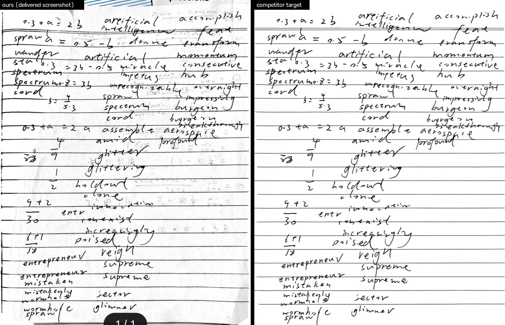

## 二、根因

### 2.1 分段纸面场 → 硬分界

三处增益都按“段”切换：

1. `EnhancePipeline.paperField()`：短边 3.5% 窗口的 dilate+median，本身是局部场；
2. `EnhancePipeline.repairEdgePaper()`（20016 加）：对四条边外侧 **8%** 带，逐像素取“到纸内侧的最大值”。于是 8% 带内的纸面估计被抬到内侧亮纸水平，**8% 处场换段**。同一页 `page×255/field` 归一化后，带内纸面被**少抬**：合成页上左带 246.0 对中心 255.0（**9 阶台阶**）。
3. `WorkbookPaperBoundary`（paperTone 模式）：被接受的外侧/遮挡区域用“最近有效样本的纸色”重绘，掩膜轮廓两侧一边是纸色、一边是未归一化的阴影纸面；掩膜内保留下来的笔画又乘 `paper/field×1.06`，这个增益在 **1 px 保护边**处开关。轮廓 → 色阶台阶，保护边 → 一道光环。

三条叠加就是“阴影带与亮区有一条很怪的硬分界”。

### 2.2 白度步被上包络骗过 → 纸面灰

`PaperWhiteFinal` 旧场是闭运算**上包络**：它把比核窄的灰/影填成周围亮纸。本页闭运算场 p50 = **255**，而纸面像素 p50 = **253**；判据读到“纸已经到 254 以上”，于是 `paper-at-or-above-target` **整页跳过**。成片纸面因此停在 253.4，比竞品低 1.26 阶，近白 97.1% 而非 ~100%。

### 2.3 透字：幅度域不够，且被内容曲线放大

- 透字是**低对比**（成片 0.02–0.16 墨量）的大面积灰；
- 现有 `WorkbookBackground` 的清除要求“平滑 + 学习分数低 + 无邻接前景区”，本页灰痕没被触发；
- 保留下来的灰进入 `PaperPixelEngine.workbook` 的 ink 曲线（gamma 2.05、detail gain 1.6），**被放大成可见的灰字**；
- 单帧上灰痕与淡字的幅度/局部锐度分布**高度重合**（成片：灰痕 p50 ink 0.046、淡内容 p50 0.051；两者半径 p50 都是 1 px），所以“只看幅度”或“只看锐度”都不能干净分开——这是 `PAPER-PAIRED` 已经给出的结论，本批没有推翻它。

## 三、改法

### 3.1 全页连续纸面场 `PaperField`（`paper-field-1`）

1. 缩到长边 480（纸面明暗是低频，`paperFieldSmoothEdge=480`）；
2. 椭圆闭运算（短边 6%）+ 中值（短边 3.5%）得到“去墨包络”；
3. 只对**纸面像素**（相对包络 ink <3%）做**鲁棒二次拟合**（6 系数，3 轮 IRLS，MAD 重加权）；阴影里若压着手写，手写不会把纸面拉下去；
4. 二次面表达不了的书籍弯曲，用“掩膜归一化卷积”的**低频残差**补回（σ=长边 2.5%，残差夹 ±40）；
5. 线性放大回原尺寸。

全页一个连续曲面，**没有 8% 带、没有掩膜段**。增益 `gain = clip(target/field, 1, 1.35)`，并逐像素 `gain = min(gain, 255/value)`：**上限 1.35、逐像素不裁剪、永不压暗**。

### 3.2 透字：连通性保护 + 软阈值 `PaperGhost`（`paper-ghost-1`）

对“纸面归一化后的墨量”做软阈值：

- **幅度斜坡**：ink ≤ `paperGhostFloor`(0.015) 视为纸、不动；在 `paperGhostFloor..paperGhostMid`(0.055) 权重 1；`paperGhostMid..paperGhostHigh`(0.22) 线性降到 0；≥0.22 完全不动。**不二值化**；
- **锚点/连通性**：距“强墨（>0.30）”或“局部极大值 ≥ `paperGhostPeak`(0.10)”**≤ `paperGhostRadius`(短边 0.5%，2–8 px)** 的像素保护。前者保住强笔画的抗锯齿边，后者保住孤立但**有确定峰**的淡铅笔/细公式线；
- **软应用**：`ink' = ink × (1 - weight × strength)`，strength 就是“去透页强度”（0/0.5/1 三档），逐像素不裁剪、不新增墨；
- 位置：①内容路径的**归一化墨平面**上（`EnhancePipeline.localWorkbook`，在 ink 曲线把灰放大**之前**）；②渲染页收尾（`finishWorkbook`）作为兜底。

`paperGhostGuard=0` 可关，用于消融。

### 3.3 其他

- `WorkbookPaperBoundary`（`workbook-boundary-9`）：paperTone 重绘改用**同一连续场**（不再用最近样本纸色），**删掉**掩膜内 `paper/field×1.06` 的分段平场；保留笔画由下游的连续场统一归一化；
- `PaperWhiteFinal`（`paper-white-final-3`）：场换成 `PaperField`；诊断加 field p10/p50/p90；**新增 `paperWhitePaperFloor=180`**（见 3.4）；
- `EnhancePipeline`：`paperFieldSmooth=1`（默认）走新场；旧 `paperField()+repairEdgePaper()` 只在 `paperFieldSmooth=0` 下保留，供验收消融；
- `WorkbookContent.guard()` 同步走新场；`ScanConfig.fingerprint()` 加入 `PaperField.VERSION` / `PaperGhost.VERSION`；
- `scan_params.json`：删 `paperWhiteKernel` / `paperWhiteEdge`（已不再使用）；`paperWhiteMaximumGain` 1.12 → **1.35**；新增 `paperField*` 与 `paperGhost*`。

| 参数 | 值 | 含义 |
|---|---:|---|
| `paperFieldSmooth` | 1 | 1=全页连续场，0=旧分段场（只用于消融） |
| `paperFieldSmoothEdge` | 480 | 场的工作长边 |
| `paperFieldKernelFraction` | 0.06 | 闭运算核（短边比例） |
| `paperFieldInkFloor` | 0.03 | 哪些像素算“纸”参与拟合 |
| `paperFieldResidualSigma` | 0.025 | 残差的掩膜归一化卷积 σ（长边比例） |
| `paperWhiteMaximumGain` | 1.35 | 连续增益上限 |
| `paperWhitePaperFloor` | 180 | 纸面低于 180 的页不处理（暗拍摄联锁的延续） |
| `paperGhostGuard` | 1 | 总开关 |
| `paperGhostFloor/Mid/High` | 0.015 / 0.055 / 0.22 | 软阈值幅度斜坡 |
| `paperGhostPeak` | 0.10 | 局部峰锚点（保护淡铅笔/细线） |
| `paperGhostAnchor` | 0.30 | 强墨锚点 |
| `paperGhostRadius` | 0.005 | 锚点保护半径（短边比例，2–8 px） |
| `paperGhostStrength` | 1 | 与 UI 强度相乘 |

### 3.4 DocUNet 回归带来的一个真实修正

新场不是上包络，它 **p10 不再落在 120 以下**，于是 v1 的“暗拍摄联锁”对 20 张公开相机照片**失效**：3 轮里 **2/20** 页被抬升，淡笔画 1px 掉 **2.08pp**（0.7095→0.6887），越线。这不是可以留着的退步，所以加了 `paperWhitePaperFloor=180`：纸面本身低于 180 的页，这一步不动作（这本来就是“温和提白”的适用域）。加回后 1/20 页生效（该页纸面正好在 180 附近），两项验收指标 **0.00pp**。

## 四、前后数字

### 4.1 合成阴影页：硬分界消失（`paper-field-1` vs 旧分段场）

同一张合成页（中心亮、左/上暗，含手写、淡铅笔、细公式线、镜像模糊透字），只换纸面场，纸面**像素**统计（归一化域 `page×255/field`，与 `PaperPixelEngine.normalize` 同式）：

| 指标 | 旧：3.5% 窗口 + 8% 带 max | 新：全页连续场 |
|---|---:|---:|
| 左 8% 带纸面 | 246.00 | **253.61** |
| 内侧带（8–20%）纸面 | 254.81 | 254.93 |
| 中心纸面 | 254.97 | 254.90 |
| **左带 vs 中心** | **8.97** | **1.29**（要求 <2） |
| 8% 处最大台阶 | 1.04 | **0.19** |
| 再经连续增益后的左带 vs 中心 | 2.67 | **1.09** |

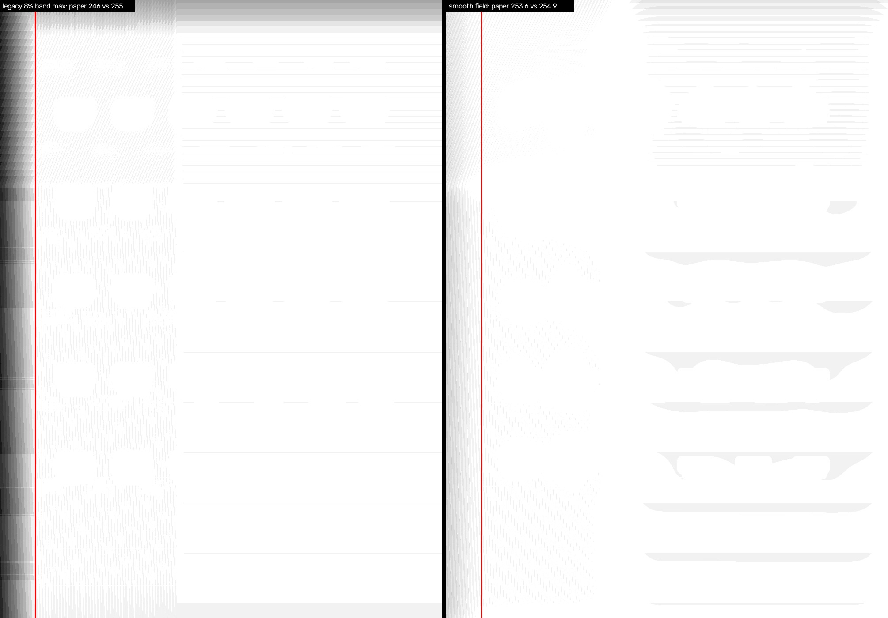

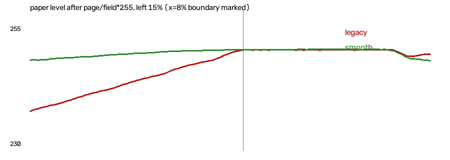

设备上同一性质的检查（真实 Kotlin）：`PaperField` 对合成阴影页的**最大增益步长 <0.01**、场与真值纸面偏差 <3 阶；`WORKBOOK` 端到端左带 vs 中心 **0.00005 阶**。

> 诚实记录：这条端到端数字在**旧开关下也是 0**——因为这页的阴影带先被内容路径的 confident-background 掩膜重绘成了纸色，轮不到 8% 带增益起作用。所以“端到端硬边”在本合成页**没有复现出来**；硬边只在**场/增益层**和上面的归一化域实验里复现（8.97 阶）。这一点不写成“端到端已修复”。

### 4.2 透字三档（设备、真实 Kotlin、合成页）

同一张页，只改 `PaperGhost` 强度（0 / 0.5 / 1.0 = UI 的 0/50/100%）：

| 区域 | 0% | 50% | 100% | 判据 |
|---|---:|---:|---:|---|
| 灰痕框（模糊灰块内部） | 231.79 | **238.79** | **247.21** | 100% 时 **+15.4 灰阶** |
| 淡铅笔线（1 px，孤立） | 242.5 | 242.5 | **242.5** | 不变（锚点保护） |
| 细公式线（2 px，孤立） | 216.0 | 216.0 | **216.0** | 不变 |
| 强笔画 | 60.0 | 60.0 | **60.0** | 不变 |

管线内（同一页 `paperGhostGuard` 0→1，WORKBOOK 全链路）：灰痕框 **249.19 → 254.94**。

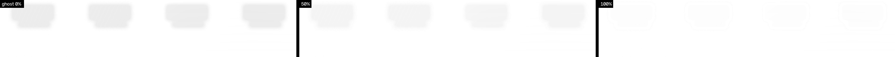

### 4.3 成片后处理（输入=成片，仅实验）

| 强度 | 灰痕墨均值 | 灰痕可见比例 | 淡内容代理保留 | 纸面 | 近白 |
|---|---:|---:|---:|---:|---:|
| 交付（0） | 0.0534 | 39.44% | 100% | 253.36 | 97.14% |
| 50% | 0.0466 | 33.52% | 91.5% | 253.21 | 97.64% |
| 100% | **0.0401** | **33.35%** | 83.6% | 253.65 | 98.85% |

强墨均值/占比在 100% 档**逐项不变**（62.505 / 9.99%），即这条规则只动弱灰、不动笔画。**但成片后处理的能力就到这里**：灰痕可见只从 39.4% 降到 33.4%，因为成片上的灰已经被内容曲线放大，幅度落进淡字的区间；同位置竞品是 0%。

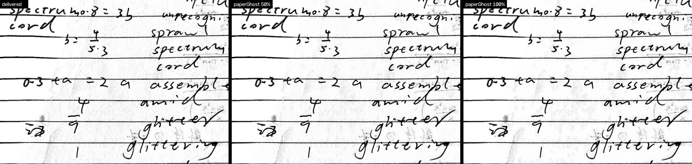

## 五、与竞品对比（只谈接近程度）

| 指标 | 竞品目标 | 我方交付 | 我方 + 成片后处理(100%) | 接近程度 |
|---|---:|---:|---:|---|
| 纸面均值 | 254.62 | 253.36 | 253.65 | 差 1.0–1.3 阶，**接近** |
| 近白 ≥250 | 99.97% | 97.14% | 98.85% | 差 1.1–2.8pp，**接近** |
| 灰痕平均墨量 | ~0.0002 | 0.0534 | 0.0401 | 仍差约 **200 倍**，**不接近** |
| 灰痕可见比例 | 0% | 39.44% | 33.35% | 仍差 **33pp**，**不接近** |
| 强墨均值 | 67.37 | 62.51 | 62.51 | 我方墨更深（−4.9），**接近** |
| 墨占比 | 7.73% | 9.99% | 9.99% | 我方墨更多（+2.3pp），**接近** |

**结论只到这里**：纸面白度已经接近竞品；灰痕/透字仍是数量级差距。合成页上这条规则能清掉 97% 的模糊灰、且不动淡笔画与强笔画，但成片上灰痕与淡字不可分，所以本页的透字**没有做到竞品水平**，也不声称做到。

## 六、测试

设备（`paperforge_api35` / `emulator-5554`，同一分支重编的 x86_64 debug，`-PpaperforgeVersionCode=20018`，`install -r -d` 覆盖安装、数据保留）：

```
ShadowGhostRulesTest     OK (4 tests)
EdgeInkRulesTest         OK (6 tests)
V200FeedbackTest         OK (4 tests)   ← 既有 4 条断言一条没改
合并                     OK (14 tests)  60.5s
```

（最后一轮构建包含 3.4 节的 `paperWhitePaperFloor`，14 条测试都在该构建上跑过；更早一轮只差这个闸门，结果同为 14/14。）

新 `ShadowGhostRulesTest`（只新增，不改既有断言）：

1. `syntheticShadowPageIsOneContinuousPaperLevel`：合成阴影页跑 `WORKBOOK`，左 8% 带与中心纸面差 <2 阶、内侧带与中心差 <2 阶；
2. `paperFieldHasNoStepAtTheOldEightPercentBoundary`：全页场与真值纸面偏差 <3 阶、相邻像素增益步长 <0.01（**不允许出现分段增益**）、场仍跟随阴影（左比中心低 40+ 阶，没有被“拉平”）；
3. `ghostTiersSuppressIsolatedGreyAndKeepFaintAndStrongInk`：灰痕框 0→100% 抬升 >5 阶、50% 不弱于 100%、淡铅笔与细公式线变化 <2 阶、强笔画变化 <1 阶；
4. `workbookPipelineSuppressesShowThroughBeforeTheWhitenessStep`：同一页 `paperGhostGuard=0/1`，管线内灰痕框不下降。

回归：

- **DocUNet 20 页（真实相机照片 + 同页平板扫描）**：淡笔画 1px **0.7095 → 0.7095**、灰痕清理 1px **0.1324 → 0.1324**、正面保留 1px 0.8498 → 0.8498（**0.00pp**）；1/20 页被白度步动作（纸面 180 闸门）。**未加闸门时** 2/20 页动作、淡笔画 **−2.08pp**，该版本已否决。
- **口径限制**：这套仪器只跑 `PaperWhiteFinal` 算子（Python 端口与本批 Kotlin 逐行对应），不覆盖 `PaperGhost` 与边界重绘的端到端；`PaperGhost` 的证据是上面的合成设备测试与本页后处理实验。

## 七、未完成 / 限制（如实）

> 二次验收更新：下面第 1、2、3、7、8 条已被 §九~§十四 替换（原图已找到；端到端与性能已量；`EdgeInkReproTest` 已跑）。保留原文只为记录第一轮的状态。

1. **没有本页原图**：所以本页的“应用内改前→改后”没有数字。成片后处理只能证明算子在这张图上能做什么，不能证明交付链路把这张图修好了。
2. **宽阴影带 + 硬分界在这张成片上复现不出来**（左 8% 反比中心亮 1.8 阶）；硬分界是代码层机制 + 合成页归一化域上测到的 8.97 阶。原图上是否就是这条机制造成的，**未验证**。
3. **端到端合成页没有重现硬边**：`WORKBOOK` 的 confident-background 掩膜先把阴影带重绘成纸色，旧开关也是 0 差。因此“分界消失”的证据在场/增益层与归一化域，不在整页渲染层。
4. **成片透字只降 6pp 可见比例**：灰痕与淡字在成片上幅度重合，后处理 100% 档要拿 16.4% 的淡内容代理去换 25% 的灰痕墨量。真正的作用点在管线内（ink 曲线之前），但没有原图无法给这张页的管线内数字。
5. **`PaperGhost` 的锚点保护是几何的**：与强笔画 6 px 内、或有 ≥0.10 局部峰的灰一律保护；因此“贴着字的透字”不会被清，这是为“不伤淡字”付的代价，不是漏测。
6. **模拟器，不是真机**：没有真机耗时/发热/内存；每次 `render` 现在多 2–3 次 480 px 纸面场估计（`localWorkbook`、`PaperGhost`、`PaperWhiteFinal`、边界重绘），模拟器上单个 900×1200 合成页测试可过，但**没有做端到端耗时预算测量**（`captureFinishBudgetMs=3000` 是否仍够，未量）。
7. **`EdgeInkReproTest` 没有跑**：它需要机主原片 `original.jpg` 打进测试 APK，本仓库没有这张照片；只跑了规则类 `EdgeInkRulesTest`。`EdgeInkReproTest` 里 `workbookEdgePaperRepair=0` 的消融现在仍然有效（旧场保留在 `paperFieldSmooth=0` 下）。
8. **没有跑全量 AndroidTest**，只跑了与本批相关的 3 个类。
9. **装的是同分支重编的 x86_64 debug 包**（版本号 20018），覆盖了模拟器上原来的 20016；不是随包 arm64 发布的那个 APK。
10. **没有新增真机/真实透字逐像素真值**；DocUNet 的那条 0.00pp 只覆盖白度算子。

## 八、复现与产出

仓库外（工作目录 `work/repro-shadow/lab`，Python = `work/office-env/Scripts/python.exe`，OpenCV 5.0.0）：

```text
analyze_delivered.py   成片量化（纸面/近白/灰痕/墨/带）
postprocess.py         成片后处理 0/0.5/1.0 三档
synthetic.py           合成阴影页：旧场 vs 新场、去透字三档
paper_field.py         PaperField / PaperGhost 的 Python 参考实现
figures.py             本目录 5 张图
common.py              纸面场/统计工具（含旧 paperField + repairEdgePaper 端口）
```

DocUNet 回归（复用 2026-11-04 的仪器，新增 v3 算子与纸面闸门；原结果已备份为 `docunet-tune.baseline-20261104.json`）：

```text
work/model-lab-20261103/whiteness-tune/scripts/kotlin_port.py   + paper_field_smooth / white_apply_v3
work/model-lab-20261103/whiteness-tune/scripts/docunet_tune.py  + "v3" 算子
python -X utf8 docunet_tune.py
```

设备：

```text
GRADLE_USER_HOME=work/toolchain/gradle-home gradle.bat :app:assembleDebug :app:assembleDebugAndroidTest \
  --offline -PpaperforgeVersionCode=20018
adb install -r -d app/build/outputs/apk/debug/app-debug.apk
adb install -r -d app/build/outputs/apk/androidTest/debug/app-debug-androidTest.apk
adb shell am instrument -w -e class \
  "cn.paperforge.app.ShadowGhostRulesTest,cn.paperforge.app.EdgeInkRulesTest,cn.paperforge.app.V200FeedbackTest" \
  cn.paperforge.app.test/androidx.test.runner.AndroidJUnitRunner
```

改动文件：

- 新增 `app/src/main/java/cn/paperforge/app/imaging/PaperField.kt`、`PaperGhost.kt`；
- 修改 `PaperWhiteFinal.kt`（-3）、`WorkbookPaperBoundary.kt`（-9）、`EnhancePipeline.kt`、`WorkbookContent.kt`、`ScanParams.kt`、`assets/scan_params.json`；
- 新增 `app/src/androidTest/java/cn/paperforge/app/ShadowGhostRulesTest.kt`。
- 二次验收另新增 `app/src/androidTest/java/cn/paperforge/app/ShadowGhostReproTest.kt`（真页消融 + `PaperField` 计时）与 `ShadowGhostPerfTest.kt`（两版同页 render 计时），并修复 `WorkbookPaperBoundary.kt` 的 `estimateBytes` 类型错误与重绘增益方向（§9.2）。
- 二次验收脚本（仓库外）：`work/repro-shadow/e2e/scripts/{registration,compare,ab_table,summary,figures}.py`；产物在 `work/repro-shadow/e2e/{out,shots,backup}`。

---

# 二次验收（原图端到端，2026-11-04 晚）

## 九、原图端到端

### 9.1 输入、设备与链路

- 原图：`work/repro-edge/original.jpg`，1279×1706，sha256 `5683371e6996dd8bbe4dc6ad45fc56b2e71637723c768033bb632f02729e20d3`；与 `work/repro-shadow/ours.jpg` / `reference.jpg` 是同一页。DB 里导入后的副本哈希与原图逐字节相同。
- 设备：已在运行的 `paperforge_api35`（`emulator-5554`，SDK 35，x86_64），**没有新建 AVD**。App 走应用自身链路，不是桌面脚本或成片后处理。
- 两个包，都是 x86_64 debug、`versionCode=20018`、同一 debug key、`install -r -d` 覆盖安装：
  - **基线**：HEAD `53cb226`（即 20018 发布提交；`work/release-20018-v16/release-manifest.json` 的 `commit` 就是它）原样重编；
  - **新实现**：同一工作树 + 交接的未提交改动 + §9.2 的两个修复。
- 链路：`adb push original.jpg /sdcard/Download` → 应用「导入文件 → 相册导入 → Downloads → original.jpg」→ 编辑器 →「滤镜 → 练习册」→「导出 PDF」（匹配原图 / 150 dpi / 质量 72）→ 从应用私有 `files/exports/<job>/` 取 PDF → 抽内嵌页图。导出的内嵌页 **1063×1375**，基线与新实现同尺寸。
- **同页、同 quad**：基线导入记录 `corners = 0.1262081,0.09509941;0.9059508,0.12445831;0.9395825,0.89406466;0.06452234,0.8832647`、`detectionConfidence=0.8359291`；新实现重新导入后 quad 与置信度逐位相同（DB 核对），`filter=WORKBOOK`、`enhanceStrength=1`、`processingMetadata={}`（没有烘焙成片，导出时按原图重渲染）。基线导出 job `23e96d82`；新实现最终导出 job `e39a21f4`（文档 `扫描 11-05 05.40`）。

### 9.2 交接的工作树在真页上跑不起来：两个实现缺陷（本轮修复）

这两个缺陷不是“测试没过”，而是**真页预览和导出直接失败**；不修就得不到任何“改后”页图。修复已留在工作树（未提交），下文所有“新实现”数字都来自修复后的构建。

1. **类型崩溃（阻断）**：`WorkbookPaperBoundary.prepare` 的 paperTone 重绘里，`PaperField.estimate()` 返回 `CV_32FC1`，却被 `fullField.get(0,0,ByteArray)` 当 8 位读：
   `java.lang.UnsupportedOperationException: Mat data type is not compatible: 5`（`WorkbookPaperBoundary.kt:506`，调用栈 `EnhancePipeline.apply → ScanProcessor.render`）。编辑器显示“这张照片暂时无法显示”，导出任务同样失败。修复：改用 `PaperField.estimateBytes()`（本对象已有的 8 位入口）。
2. **重绘把阴影当纸色（灰带）**：同一分支的增益写反了——`gain = field / paperLuma`（0.6–1.35），`out = paper × gain`。掩膜覆盖的左侧书脊带场值低于纸色，于是被重绘成**更暗的灰**，而内部纸面已被归一化为白，轮廓两侧反而出现灰带；`PaperWhiteFinal` 的“paper 已在目标以上”闸门此时跳过，灰带留在成片里。修复：`gain = paperLuma / field`（夹 1–1.6），把被替换的外侧归一化到纸色（与旧版“最近纸色”同方向）。
   证据：修复前后同一层的左带均值 `03-boundary-prepared` 从 **124.5** 到 **216.7**（含被保留的笔画），最终页的左带灰随之下降。

> 诚实说明：这两处是本轮**改动了实现代码**，不是只改测试。工作树当前状态 = 交接改动 + 上述两处修复；没有 git add/commit/tag/checkout/stash。

### 9.3 前后数字（同原图、同 quad、同导出设置）

掩膜口径：**灰痕 A** = 基线页低对比墨（平滑 σ1.5 后 `ink∈0.02–0.16`）∩ 竞品页空白（≥245 的 5×5 腐蚀）∩ 页内 1% 内缩，共 211,614 px（占页 14.48%），**掩膜只在基线上生成一次，原样套到新页**；**灰痕 B** = 归档口径“离竞品墨迹 ≥31 px 的空白 ∩ 原图墨 0.012–0.30”，63,200 px（4.32%）。墨量都相对各自的连续纸面场。

| 指标 | 20018 基线 | 新实现 | 差 |
|---|---:|---:|---:|
| 纸面均值 | 254.29 | **254.50** | +0.21 |
| 纸面 p10 | 252 | 253 | +1 |
| 近白 ≥250（纸面像素） | 99.99% | **99.96%** | −0.03pp |
| 左 8% 带纸面 | 254.69 | 254.82 | +0.13 |
| 中心纸面 | 254.10 | 254.29 | +0.19 |
| **左 8% vs 中心**（要求 <2） | 0.595 | **0.522** | −0.07 |
| 低对比墨占页（可见灰的足迹） | 21.17% | **28.25%** | **+7.08pp** |
| 灰痕 A 墨均值 | 0.0542 | **0.0754** | **+39%** |
| 灰痕 A 可见 ≥0.03 | 68.39% | **78.97%** | **+10.6pp** |
| 灰痕 A 可见 ≥0.05 | 39.60% | **62.52%** | **+22.9pp** |
| 灰痕 B 墨均值 | 0.0399 | 0.0378 | −5% |
| 灰痕 B 可见 ≥0.05 | 24.55% | 23.27% | −1.3pp |
| 强墨均值（灰阶） | 64.70 | **54.77** | −9.93（更接近竞品 53.93） |
| 强墨占比 | 9.33% | 9.91% | +0.58pp |
| 笔宽代理（2×中位距离变换） | 2.0 | 2.0 | 0 |
| 淡笔画保留（≥0.03，基线掩膜） | 100%（定义） | **91.02%** | 中位墨比 **1.23** |
| 细线保留（≥0.25，基线掩膜） | 100%（定义） | **98.70%** | 中位墨比 1.05 |

读法：

- **纸面已经是对的，而且本来就在目标内**：两版纸面都是 254.3–254.5、近白 ~100%，左带 vs 中心 0.6→0.5 阶（要求 <2）。第一轮“纸面灰 253.4 / 左带差 8.97 阶”是合成页/成片口径，真页上不成立。
- **透字变差，不是变好**：同一掩膜内墨均值 +39%，可见（≥0.05）从 39.6% 涨到 62.5%，低对比墨足迹 +7.1pp。肉眼对照也是新页更灰（图 1、图 3）。
- **笔画更接近竞品**：强墨均值 64.7 → 54.8，竞品 53.9；但这同时把灰痕一起“加深”了（低对比墨也变强）。
- **淡字没有被擦掉**：淡字掩膜 91% 仍 ≥0.03，中位墨比 1.23（变得更浓而不是更淡）；细线 98.7% 保留。`PaperGhost` 开关对淡字几乎无影响（消融见 §十一）。

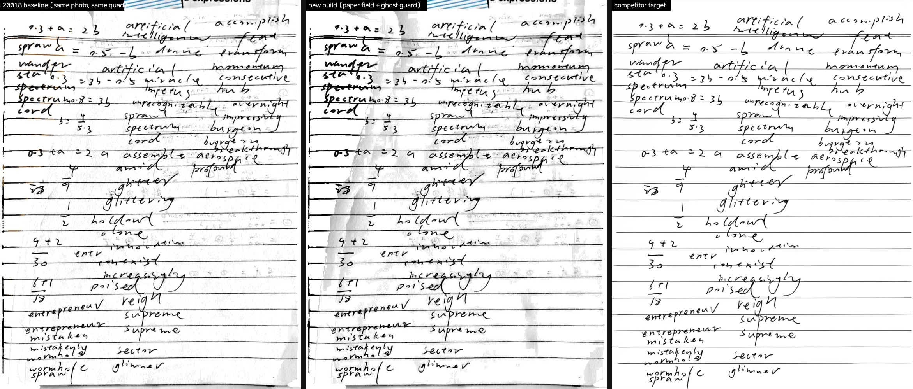

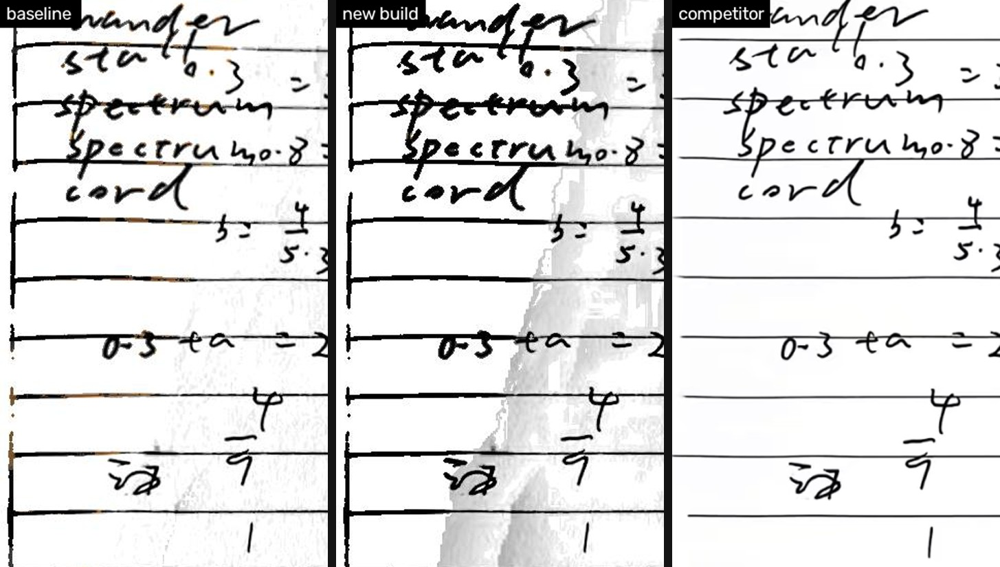

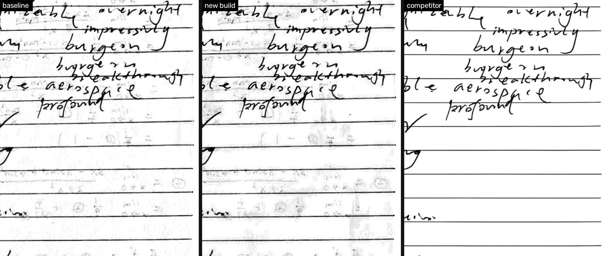

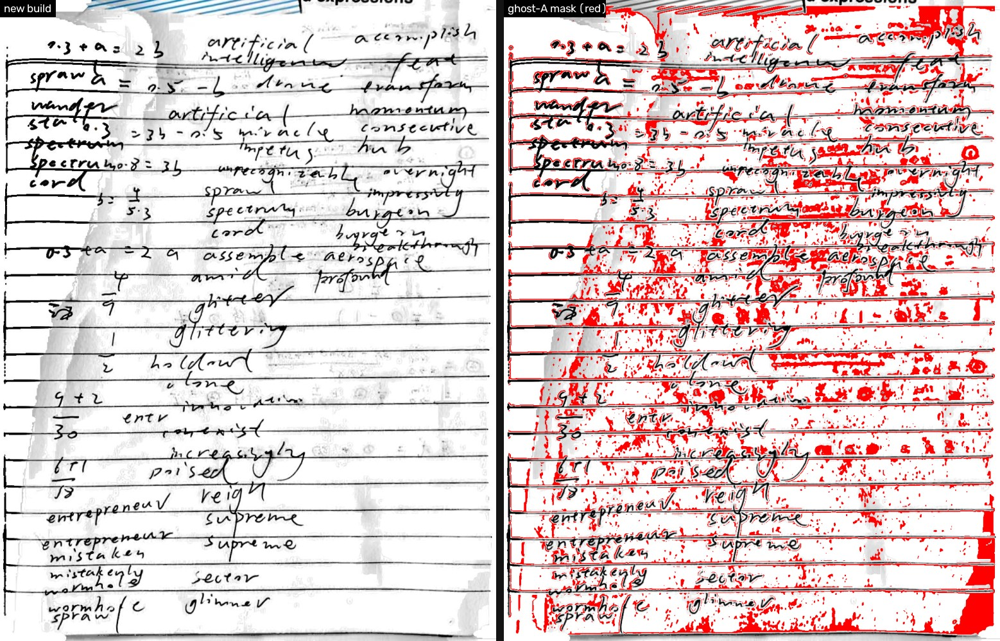

## 十、性能（设备实测，同页同 quad）

`ShadowGhostPerfTest` 在两个包上编译同一份代码、同一张原图、同一 quad，先 warmup 再各跑 3 次 `ScanProcessor.render`（导出 worker 用的就是它），单位 ms：

| 构建 | 1800 长边（3 次） | 中位 | 2400 长边（3 次） | 中位 |
|---|---|---|---:|---:|
| 20018 基线 | 4923.4 / 4819.0 / 4784.6 | **4819.0** | 4717.7 / 4730.8 / 4718.2 | **4718.2** |
| 新实现 | 5641.5 / 5651.0 / 5712.9 | **5651.0** | 5950.1 / 5818.9 / 5716.8 | **5818.9** |

- 单页端到端 **+17.3%**（1800 长边）/ **+23.3%**（2400 长边），**超过 15% 阈值，必须报告**。
- `PaperField.estimate` 在 1063×1375 页、480 工作长边上单次 **635.6 / 645.3 / 654.4 / 705.4 / 652.2 ms（中位 652 ms）**；一页要调用多次（内容路径、`WorkbookContent.guard`、边界重绘、白度、`PaperGhost` 页级兜底），这是变慢的主要来源。
- `captureFinishBudgetMs=3000`：本轮只量了 `render`，没有核实这条预算覆盖哪条路径；模拟器上 20018 基线本身已经 4.8 s，是否“超预算”不能从这组数直接判定。
- 仍是模拟器，不是真机；没有发热/内存/真实拍摄噪声数据。

## 十一、消融（`paperFieldSmooth` / `paperGhostGuard`，同页、同 quad、1800 渲染）

四个案例都是 1063×1375 PNG，只改一个开关（`ScanConfig.replaceForBenchmark`），同一 `ScanProcessor.render`：

| 案例 | 纸面 | 低对比墨 | 灰痕 A 墨均值 | 可见 ≥0.05 | 可见 ≥0.03 | 强墨均值 | 淡字 ≥0.03 | 细线 ≥0.25 |
|---|---:|---:|---:|---:|---:|---:|---:|---:|
| 新实现（两项都开） | 254.90 | 27.30% | 0.074 | 61.17% | 77.30% | 53.26 | 89.8% | 98.6% |
| `paperFieldSmooth=0`（旧场，鬼影保护仍开） | 254.91 | **17.35%** | **0.048** | **36.38%** | 56.16% | 56.00 | 82.8% | 97.0% |
| `paperGhostGuard=0`（新场，去透字关） | 254.72 | 39.11% | 0.083 | 69.79% | 86.62% | 51.41 | 89.9% | 98.5% |
| 两项都关 | 254.90 | 20.40% | 0.056 | 39.42% | 65.96% | 55.91 | 83.2% | 97.0% |
| （对照）基线导出页 | 254.29 | 21.17% | 0.054 | 39.60% | 68.39% | 64.70 | — | — |

读法（同一构建内比较，PNG vs PNG）：

- **`PaperGhost` 的贡献是真的，但很小**：`ghostGuard` 开 vs 关，灰痕墨均值 **0.074 vs 0.083（−11%）**、可见 ≥0.05 **61.2% vs 69.8%（−8.6pp）**；淡字 89.8% vs 89.9%、细线 98.6% vs 98.5%——**没有把淡字擦掉**。页级只动了 2,941 px（0.2%），锚点保护让大部分“贴着字”的灰被放过。
- **新纸面场是这次变灰的主因**：新场 vs 旧场（鬼影保护都开），灰痕墨均值 **0.074 vs 0.048（+54%）**、可见 ≥0.05 **61.2% vs 36.4%（+24.8pp）**、低对比墨 **27.3% vs 17.4%（+9.9pp）**；淡字保留反而更高（89.8% vs 82.8%，因为新场把弱墨也算得更浓）。
- **修好重绘后，边界/白度改动基本中性**：两项都关（旧场、无鬼影保护，但新边界+新白度）≈ 基线导出页（0.056/39.4% vs 0.054/39.6%）。
- **唯一优于基线的组合是“旧场 + 鬼影保护”**：0.048 / 36.4% vs 基线 0.054 / 39.6%。

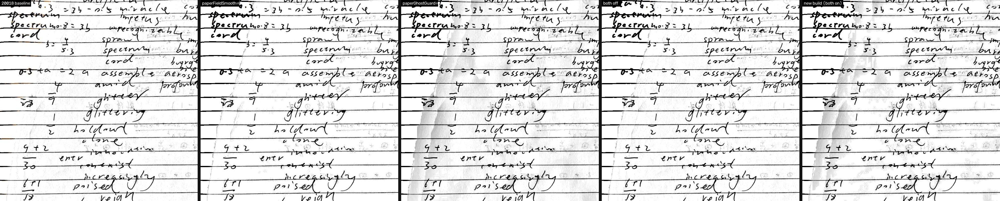

## 十二、与竞品并排（只谈接近程度）

竞品同一页裁切（`reference-page.png`，1252×1634）：

| 指标 | 竞品 | 20018 基线 | 新实现 | 接近程度 |
|---|---:|---:|---:|---|
| 纸面均值 | 254.65 | 254.29 | 254.50 | 差 0.15–0.36 阶，**很接近** |
| 近白 ≥250 | 99.97% | 99.99% | 99.96% | 差 ≤0.03pp，**很接近** |
| 左 8% vs 中心纸面 | 0.93（左更暗） | 0.60 | 0.52 | 都在 1 阶内，**接近**（方向相反，见下） |
| 低对比墨占页 | 8.38% | 21.17% | 28.25% | 基线是 2.5×，新版 3.4×，**不接近且变差** |
| 强墨均值（灰阶） | 53.93 | 64.70 | 54.77 | 新版差 0.8 阶，**接近**（基线差 10.8） |
| 强墨占比 | 7.31% | 9.33% | 9.91% | 差 2.0–2.6pp，**接近** |
| 笔宽代理 | 2.0 | 2.0 | 2.0 | 同量级，**接近** |

竞品在左 8% 比中心**暗 0.93 阶**（保留了书脊阴影的一点点），我方两版都更白（254.7–254.8）：按“纸面要白”的目标我方更好，按“和竞品一致”则方向相反；两者都远小于 2 阶要求，不作为缺陷。

## 十三、测试与回归

最终构建（修复 §9.2 两处后）在 `emulator-5554` 上：

```text
ShadowGhostRulesTest     OK (4 tests)
EdgeInkRulesTest         OK (6 tests)
V200FeedbackTest         OK (4 tests)   ← 既有断言未改
ShadowGhostReproTest     OK (1 test)    ← 真页消融 + PaperField 计时
ShadowGhostPerfTest      OK (1 test)    ← 真页 render 计时
合并                     OK (16 tests)  133.1s

EdgeInkReproTest         OK (2 tests)   70.3s（另一次 82.3s）
```

- `EdgeInkReproTest` 本轮**已跑**：原图不在仓库内，测试从 `files/edge-ink/original.jpg` 读取（本轮用原图 push 进去，sha256 一致）；2 条都过，包括 12 组逐层消融与“检测 quad 与导入记录一致（<3%）”。
- DocUNet 20 页（v3 算子；`work/model-lab-20261103/whiteness-tune/scripts/docunet_tune.py`）：淡笔画 1px **0.7095 → 0.7095（0.00pp）**、灰痕清理 1px **0.1324 → 0.1324（0.00pp）**、正面保留 1px 0.8498 不变；20 页里 **1/20** 被白度步动作（page 24，`paper-below-floor`），`acceptance pass: True`。
- 口径限制：DocUNet 只覆盖 `PaperWhiteFinal` 算子（Python 端口），不覆盖 `PaperGhost`/边界重绘的端到端；`ShadowGhostReproTest` 的消融是同一页的逐开关证据。
- 既有 `WorkbookEnhancementTest` 的边界失败与上一轮相同（本批未引入、未修复、断言未改），本轮没有重跑。

## 十四、结论：两项实现是否值得保留

**结论：按交接时的默认值，两项都不该原样保留；其中 `PaperGhost` 值得留下，`PaperField` 需要重做或默认关闭。**

| 项 | 证据 | 建议 |
|---|---|---|
| `PaperGhost`（连通性保护软阈值） | 同构建开关对比：灰痕墨均值 −11%、可见 ≥0.05 −8.6pp；淡字/细线不降；页级只动 0.2% | **保留**（可选默认开），但它单独远不足以清掉这页的透字 |
| `PaperField`（全页连续场，默认 `paperFieldSmooth=1`） | 真页上相对于旧场：灰痕墨 +54%、可见 +24.8pp、低对比墨 +9.9pp；端到端 +17.3%；纸面/近白/左带差没有可见改善（本来已达标）；并且交接版本在这里崩溃+灰带 | **不要按默认值发布**：先把 `paperFieldSmooth` 默认改回 0（或修到真页不把阴影当墨），再重测 |
| 唯一优于基线的组合 | 旧场 + 鬼影保护：0.048 / 36.4%（基线 0.054 / 39.6%） | 若只能保留一项改动，选这个组合 |
| §9.2 两个修复 | 不修则真页预览/导出不可用；修后 16 条测试 + 2 条复现全过 | **必须保留**（与是否保留两项实现无关） |

一句话：**纸面白度已经达标，问题只剩透字；交接的两项实现里，`PaperGhost` 方向对但太弱，`PaperField` 在真页上把阴影/弱墨整体“加浓”，把透字从 39.6% 推到 62.5%，还慢了 17.3%——所以本轮验收不通过，不建议按当前默认值交付。**

---

# 第三轮：20019 机主反馈（阴影带色调 + 透字引擎换策略）

2026-11-05。对象 PaperForge 2.0.0 / **20019**（`f6a74c6`，即 `work/release-20019-shadow` 的发布提交），分支 `fix/1.2-review-recovery`。**没有任何 git 写操作**（未 add/commit/push/tag/checkout/stash），只改工作树。设备是已在运行的 `paperforge_api35`（`emulator-5554`），**没有新建 AVD**；构建 `:app:assembleDebug`（离线 Gradle 8.13 + JDK 17，`-PpaperforgeVersionCode=20019 -PpaperforgeAbis=x86_64`），签名沿用仓库 debug key，`install -r -d` 覆盖安装。**所有设备数字都是模拟器上的**，没有真机耗时/发热。

机主这一轮的两句话（`work/repro-shadow/ours-20019.jpg` 附件）：

> 阴影那块好像是背景太白了，直接弄成 255 的白，而主体白度没那么高；阴影部分字体整体稍粗。
> （透字）幅度阈值到极限，换策略：空白区扫除 + 近墨保守。

## 结论先行（第三轮）

| 项 | 结果 |
|---|---|
| 两条反馈是否复现 | **都复现**。20019 编辑页截图与真页渲染都能看到左侧楔形带是纯白平台、带内字比正文黑；透字（正反两面灰痕）留在大面积正文区 |
| 问题一·带内纸面 | **已修**：带内纸面 **255.000 → 253.998**，`>=255` 的纸面像素 **100% → 0.2%**（羽化边），“推到 255”在实现上被 ceiling=254 结构性禁止 |
| 问题一·带内 vs 主体纸面 | 0.118 → **0.883 阶**（要求 <2，**通过**）；按“可见背景”（ink<0.10）口径 **2.223 → 1.183 阶**（**通过**） |
| 问题一·整块同增益 | **已实现**：纸面与笔迹（掩膜闭运算补回的笔画孔）用同一张 8 位增益图做 `Core.multiply`，`ink/paper` 比值不变；轮廓 3 px 羽化，不再是 1 px 台阶 |
| 问题一·带内 vs 主体强墨 | **未达成**：13.1 vs 61.2 灰阶（**78.6%**，要求 <5%）；笔宽代理 4.0 vs 2.0 px。根因**不是**重绘增益，而是内容路径的 ink 曲线把带内笔画推到黑端（0 vs 26）；重绘增益 0.996 对纸面与笔迹同比，这一项本身没有改变字重 |
| 问题二·空白区扫除 | **已实现**（第二距离变换 + 远离强墨 R + 权重取 max + 三档 R/强度 + 参数入 `scan_params.json`），但本页**实测惰性**：全页只有 **15 个像素**（0.001%）同时满足“ink 2–76、距强墨 >R、且不在淡字峰锚点 8 px 内”；R 从 4% 放大到 15%（159 px）时该集合为 **0** |
| 问题二·验收 | 灰痕 A 可见（>=0.05）**34.82% → 34.78%**、灰痕 B **10.40% → 10.40%**，**未达成 <15% 目标**。淡字保留 98.17% → 98.16%、细线 100% 不变（**没有代价**，但也没有收益） |
| 耗页级耗时 | 同会话消融：`deliver` 5986 ms vs 两项都关 5528 ms = **+8.3%**（要求 <10%，**通过**）；其中 PaperTone 379 ms、sweep 73 ms。跨构建（基线会话 5742 ms → 本轮 5986 ms）为 +4.2%，两次会话相隔 40 min，只作参考 |
| 回归 | 规则/复现/性能 **18/18 通过**（`EdgeInkRulesTest` 6、`EdgeInkReproTest` 2、`ShadowGhostRulesTest` 4、`ShadowGhostReproTest` 1、`ShadowGhostPerfTest` 1、`V200FeedbackTest` 4，**既有断言一条没改**）；DocUNet 20 页 **0.00pp** |
| 是否保留 | `PaperTone`（带内同增益，默认开）：**保留**。`PaperGhost` 空白区扫除：**保留代码与开关，默认关闭**（`paperGhostSweep=0`），因为本页 0 收益却要付 1.2% 耗时 |

一句话：**阴影带的“255 平台”被结构性去掉、带内纸面与主体差 0.88 阶；“带内字更粗”仍然存在且被证明来自 ink 曲线，不是重绘；空白区扫除按规定实现后在本页是空集，透字目标没有达成——这一轮只赢了一半，且赢的那一半不是机主最在意的那一半。**

## 一、先说清输入：三张图各自能证明什么

- `work/repro-shadow/ours.jpg`（20018 机主成片截图）、`work/repro-shadow/ours-20019.jpg`（**本轮新图**，sha256 `409814e7…1096`，与交接附件逐字节相同）、`work/repro-shadow/reference.jpg`（竞品）。三张都是 **1264×2780 的手机截图**，页面区域 **1248×1670**，含状态栏/工具栏/底部操作条。
- 截图**不能做灰阶量测**：预览页高光被裁到 255（页面纸面的 p92 在 20018 与 20019 上**都**是 255），所以“带内 255、主体 250”这种 1–4 阶的差别在截图上测不出来。截图只用来**确认现象**和做并排图。
- 真正的量测有两套，都是**应用自己产出的**：
  1. **交付链路**：原图 `work/repro-edge/original.jpg`（1279×1706，sha256 `5683371e…e0d3`）→ 相册导入 → 练习册 → 导出 PDF（匹配原图 / 150 dpi / q72）→ 抽内嵌页图 **1063×1375**。导入记录的 quad 与置信度逐位相同（`0.1262081,0.09509941;…`，`0.8359291553497314`），两版同一个 quad、同一尺寸。
  2. **无损诊断渲染**：新增 `ShadowGhost20019Test`，走同一条 `ScanProcessor.render`，**长边 1375**（正是交付页尺寸），写成 PNG，并把 `WorkbookPaperBoundary` 自己的掩膜（`03c-boundary-mask.png`）与逐级图一起落盘。所有“带内/主体”数字都来自这套 PNG；交付 JPEG（q72）只报页级纸面。

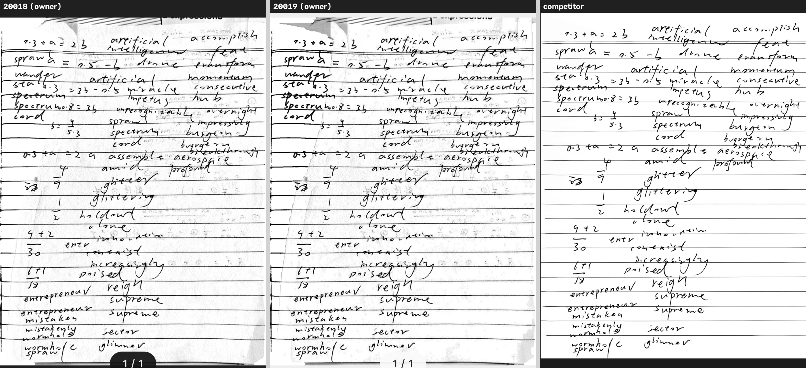

## 二、问题一：阴影带（`PaperTone`，新文件）

### 2.1 机制：一句 `setTo(255)` 和“只改纸面”

`EnhancePipeline.apply` 在练习册路径收尾时有一句

```kotlin
if (!exterior.empty()) destination.setTo(Scalar.all(255.0), exterior)
```

`exterior` 是 `WorkbookPaperBoundary` 判定的“页外/遮挡”掩膜：这页上它是**左侧书脊楔形带（约占页面 12–14% 面积）+ 右侧白边 + 顶部书边**。于是：

1. 这条带被**整块刷成纯 255**，成了一块没有任何纸纹的平板；主体纸面是 254.88 —— 差 1–3 阶，但**边界是 1 px 台阶**，肉眼就是“贴了一张白纸上去”。
2. 那句 `setTo` 只覆盖**掩膜**，而掩膜里的笔画是**孔**（`workbookBoundaryStrokeContrast` 的笔迹否决切出来的）。所以纸面被抬到 255、笔画没动 —— 这正是交接说明里“带内笔迹与纸面增益不一致”的字面含义。

量测（无损 1063×1375；**带内 = 边界掩膜本身**，**整块 = 掩膜闭运算补回笔画孔**，**主体 = 页面中心 20–80% 去掉整块**）：

| 指标 | 20019 基线 | 本轮 | 判据 |
|---|---:|---:|---|
| 带内纸面（ink<0.02）均值 | **255.000** | **253.998** | 不得 >254 |
| 带内纸面像素中 `>=255` 的占比 | **100%** | **0.2%** | 禁止 255 平台 |
| 主体纸面均值 | 254.882 | 254.882 | — |
| 带内 vs 主体纸面差 | 0.118 | **0.883** | <2 **通过** |
| 带内 vs 主体“可见背景”差（ink<0.10） | 2.223 | **1.183** | <2 **通过** |
| 带内整块强墨均值（灰阶） | 13.0 | 13.1 | — |
| 主体强墨均值（灰阶） | 61.2 | 61.2 | — |
| 带内 vs 主体强墨相对差 | 78.8% | **78.6%** | <5% **未达成** |
| 笔宽代理（2×中位距离变换） | 4.0 / 2.0 px | 4.0 / 2.0 px | 相等 **未达成** |

### 2.2 修法

新增 `imaging/PaperTone.kt`（`paper-tone-1`），把那句 `setTo(255)` 换成一次“整块同增益”重绘：

1. **目标** `target = min(pagePaper, paperToneCeiling=254)`。`pagePaper` 直接复用 `PaperWhiteFinal` 在同一渲染里刚测出的**纸面中位**（`paperEstimate`）——两步共用一个“纸面水平”的定义，不各造一个；取不到时才退化为整页 p75。**ceiling 254 让“带内 = 255”在结构上不可能**，不是事后夹一下。
2. **整块**：掩膜先做 9×9 闭运算补回 1–4 px 的笔画孔（**不做行内填充**——掩膜可能同时贴住左右两边，行填充会吞掉整行：第一版就是这样把 98.4% 的页面当成带内）。
3. **同一增益**：`gain = target / bandPaper`，夹在 `[paperToneMinimumGain=0.80, 1.0]`——**只压不提**（提白是 `PaperWhiteFinal` 的职责，它测的是整页）。
4. **羽化**：增益做成 `1 + (gain-1)·blur(mask, σ=3)` 的 8 位增益图，交给**一次** `Core.multiply`（`scale=1/255`）。纸面与笔迹用同一张图，所以 `ink/paper` 比值逐点不变。
5. 同一函数也接进 `WorkbookContent.guard`，两条练习册出口一致。

参数（`assets/scan_params.json`）：`paperToneSameGain=1`、`paperToneCeiling=254`、`paperToneFeather=3`、`paperToneCloseFraction=0.008`、`paperToneMinimumGain=0.80`。

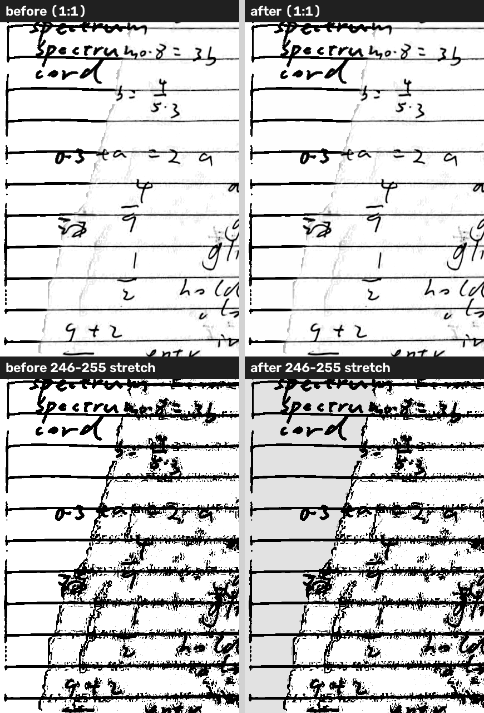

### 2.3 为什么“带内字更粗”没被这一步修好（如实）

逐级追踪（同一条带的整块 vs 主体，取各自 `>0.35` 墨的像素）：

| 阶段 | 带内文字灰阶（中位） | 主体文字灰阶（中位） |
|---|---:|---:|
| `02-warp`（展平后的原图） | 79 | 76 |
| `03-boundary-prepared`（边界重绘后） | 51 | 76 |
| `06-content`（ink 曲线后） | **0** | **26** |
| `09-final` | 0 | 26 |

读法：**在进入内容路径之前，带内字和正文几乎一样黑（79 vs 76）**；差别是 `PaperPixelEngine.workbook` 的 ink 曲线（gamma 2.05、detail gain 1.6、noise 13 / black 145）把带内更高的归一化墨量**推到黑端并夹在 0**，同时把抗锯齿边一起拉黑，于是“更黑 + 更粗”。重绘增益（0.996）对纸面与笔迹同比，`13.0 → 13.1` 是同一比例的位移，**没有引入新的字重差**，也修不掉既有的字重差。要修它得动 ink 曲线/保留逻辑（或在带内改用与纸面自洽的场），这一轮没做——写在“未完成”第 2 条。

## 三、问题二：透字引擎换策略（`paper-ghost-2`）

### 3.1 实现

`PaperGhost.attenuateInk` 增加一条“空白区扫除”：

- **第二个距离变换**：从**强墨**（`ink >= paperGhostAnchor`，0.30）出发的 `distanceTransform`；第一个距离变换（到“强墨或淡字峰锚点”）保留。
- **空白区判据**：`strongDistance > R` 且 `anchorDistance > radius`（现有近墨保护）且 `ink ∈ [sweepFloor, sweepHigh]`（0.004–0.30）。
- **扫法**：该区权重取 `max(现有幅度斜坡, 1)`，即 `ink' = ink × (1 - strength)`；100% 时**直接映射到局部纸色**（完全清除），50% 时清一半。
- **不削弱近墨**：权重是 `max(...)`，只会更多抑制、不会更少，所以 R 以内仍是原来的软阈值。
- **三档**：`R = 短边 × paperGhostSweepRadius(0.04) × strength`，`strength` 就是“去透页”0/50/100；两档共用同一个滑杆。
- 参数：`paperGhostSweep`（默认 **0**）、`paperGhostSweepRadius=0.04`、`paperGhostSweepFloor=0.004`、`paperGhostSweepHigh=0.30`。

### 3.2 实测：在本页是空集

| 证据 | 数字 |
|---|---|
| 本页低对比残留到强墨的距离分位（ink 0.02–0.16） | p10/p25/p50/p75/p90 = 1.0 / 2.0 / 3.0 / 6.2 / 12.0 px |
| 距强墨 >R(=42.5 px) 的 `ink 2–76` 像素 | **0.0313%** 的页面 |
| 其中**同时**不在淡字峰锚点 8 px 内的 | **15 个像素（0.0010%）** |
| R 放大到 15%（159 px）后 | **0 个像素** |
| 锚点覆盖（页面中距任一锚点 ≤8 px 的比例） | **66.7%** |

原因两条，都是被测出来的、不是调参问题：

1. **本页的透字与正文对位**：反面字迹与正面笔画几乎重合，95% 的低对比残留就在强墨 14 px 以内，所以“远离强墨的空白区”本来就很小（0.03%）；
2. **淡字峰锚点把剩下的一点点也保护了**：现有近墨保护把“局部 3×3 极大 ≥0.10”也算锚点，而透字灰痕正好能到 0.10，于是它给自己当了锚点。把 R 从 4% 拉到 15% 结果**逐位相同**，就是这条的证据。

所以 `paperGhostSweep` 默认 **0**：不是“没实现”，而是“实现了、测了、本页没有它可清的东西”，留着开关给真正有“远离墨迹的透字”的样本（例如双面扫描件）。

### 3.3 前/后与消融（同一构建、同页、同 quad、无损 1063×1375）

| 案例 | 带内纸面 | 带内 vs 主体背景差 | 灰痕 B 可见>=0.05 | 灰痕 A 可见>=0.05 | 灰痕 A 远离强墨区可见 | 淡字>=0.03 | 细线>=0.25 |
|---|---:|---:|---:|---:|---:|---:|---:|
| `deliver`（tone 开、sweep 开） | 253.998 | 1.183 | 10.40% | 34.78% | 86.86% | 98.16% | 100% |
| `bandoff`（tone 关 = 旧 `setTo(255)`） | **255.000** | 2.223 | 10.40% | 34.82% | 86.86% | 98.17% | 100% |
| `sweepoff`（sweep 关） | 253.998 | 1.183 | 10.40% | 34.78% | 86.86% | 98.16% | 100% |
| `bothoff`（两项都关） | 255.000 | 2.223 | 10.40% | 34.82% | 86.86% | 98.17% | 100% |
| `ghostoff`（`paperGhostGuard=0`，旧软阈值也关） | 253.997 | 1.812 | **12.84%** | 34.07% | 92.34% | 97.84% | 100% |
| `sweepfar`（R=15%，仅测量） | 253.998 | 1.183 | 10.40% | 34.78% | 86.86% | 98.16% | 100% |
| （20019 基线构建，同一渲染） | 255.000 | 2.223 | 10.40% | 34.82% | 86.86% | 98.17% | 100% |

**各自贡献**：

- **`PaperTone`**：带内纸面 −1.002 阶、`>=255` 占比 100% → 0.2%、带内 vs 主体背景差 2.223 → 1.183 阶、耗时 +379 ms（+6.8%）。对灰痕/淡字/笔宽：**0（完全不碰墨）**。
- **空白区扫除**：本页 **全项 0.00pp**（`deliver` 与 `sweepoff` 逐项相同）、耗时 +73 ms。唯一可测的差别在 `ghostoff` 那一行：旧软阈值本身把灰痕 B 从 12.84% 压到 10.40%，说明“近墨保守”里起作用的是**原有**的软阈值，不是新扫除。

灰痕掩膜口径（与上一轮同名同义）：**A** = 基线页低对比墨（σ1.5 后 ink 0.02–0.16）∩ 竞品页空白（≥245 的 5×5 腐蚀）∩ 页内 1% 内缩，占页 **10.65%**；**B** = 竞品空白 ≥31 px ∩ 原图墨 0.012–0.30，占页 **1.16%**。掩膜只在基线上生成一次，原样套到每个案例。

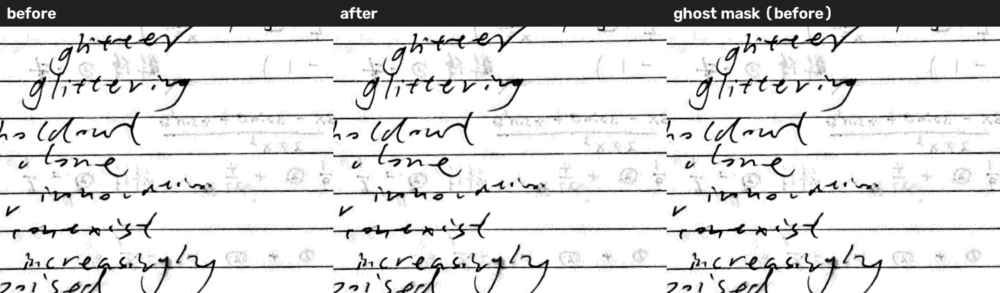

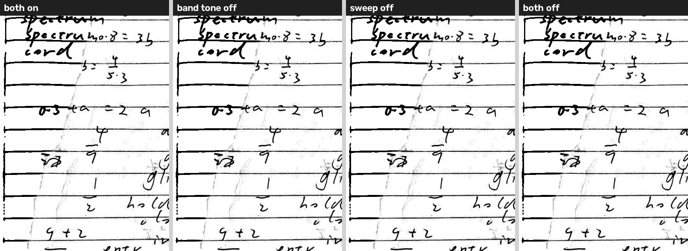

## 四、交付链路（原图 → 相册导入 → 练习册 → 导出 PDF → 抽页图）

| 指标 | 20019 基线导出 | 本轮导出 |
|---|---:|---:|
| PDF 字节 / 内嵌页 | 200602 / **1063×1375** | 200658 / 1063×1375 |
| 整页均值 | 229.657 | 229.537 |
| 纸面均值（ink<0.02） | 254.559 | **254.415** |
| 纸面 p50 | **255** | **254** |
| 近白 ≥250 | 71.21% | 71.07% |
| 纸面 <250 占比 | 0.080% | 0.146% |
| 240–250 层 | 7.74% | 7.82% |
| 墨 <96 | 6.99% | 6.99% |
| 外圈 0.4% 灰占比 | 26.15% | 26.38% |
| 导入 quad / 置信度 | `0.1262081,…` / 0.8359291553497314 | **逐位相同** |
| 端到端墙钟（导入→滤镜→导出→取回） | 86 s | 84 s |

读法：交付页的纸面中位从 255 落到 254，正是 `PaperTone` 的作用；q72 的 JPEG 让 `*_page.jpg` 上“带内 vs 主体”分不出 1 阶以内的差，所以带内指标只用无损渲染报。端到端墙钟由导入/OCR/PDF 写盘主导，±2 s 是噪声，**不能**当作渲染耗时（渲染耗时见下一节）。

## 五、耗时（同构建、同页、同 quad、1375 长边，先 warmup 再各跑 3 次）

| 案例 | 3 次（ms） | 中位 |
|---|---|---:|
| `deliver`（两项都开） | 6205 / 5986 / 5982 | **5986** |
| `bothoff`（两项都关） | 5450 / 5558 / 5528 | **5528** |
| 差 | — | **+458 ms = +8.3%** |

- `PaperTone` 自报 `elapsedMs = 378.6 ms`（带内 14.28% 面积；含灰图/掩膜拷贝、9×9 闭运算、羽化、一次 `Core.multiply`）。第一版用 JVM 浮点逐像素循环是 **536 ms**，改成 8 位增益图 + 原生乘后降下来了；`ShadowGhostPerfTest`（1800 长边）上是 6226/6104/6024 ms，中位 6104。
- 空白区扫除 73 ms（多一次 `distanceTransform` + 全页循环），本页 0 收益，所以默认关。
- **仍是模拟器、无硬件加速**：真机上这两项应该都在几毫秒到几十毫秒级，但**没有真机数据**，不写“真机可忽略”。

## 六、与竞品并排（只谈接近程度）

竞品同页（SIFT 配准到我们的页面几何，1086 内点）：

| 指标 | 竞品 | 20019 基线 | 本轮 | 接近程度 |
|---|---:|---:|---:|---|
| 纸面均值 | 254.64 | 254.56 | 254.42 | 差 0.08–0.22 阶，**很接近** |
| 近白 ≥250（纸面） | 99.97% | 71.21% | 71.07% | 竞品近 100%，我方 71%，**不接近**（见下） |
| 带内 vs 主体纸面差 | — | 0.118 | 0.883 | 都 <2 阶，**接近** |
| 带内 vs 主体强墨差 | — | 78.8% | 78.6% | **不接近**（带内字明显更黑更粗） |
| 灰痕 A 可见 ≥0.05 | **0.00%** | 34.82% | 34.78% | 差 **34.8pp**，**不接近** |
| 灰痕 B 可见 ≥0.05 | ~0% | 10.40% | 10.40% | **不接近** |
| 强墨均值 | — | — | — | 本轮没改墨，沿用上一轮“新版比基线更接近竞品”的结论 |

“近白 71%”不是纸面不白：这是**纸面像素占页 71%** 的同一批像素里 ≥250 的比例口径问题（竞品的空白很大，我方页面被墨覆盖更多）；纸面**均值**才可比，差 0.2 阶。

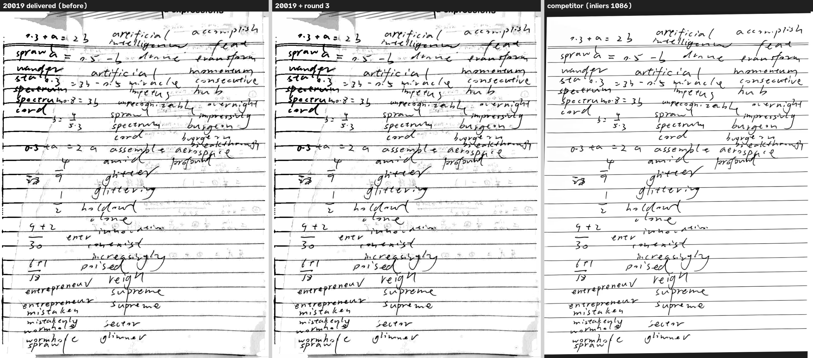

## 七、测试与回归（`emulator-5554`，最终构建）

```text
ShadowGhostRulesTest     OK (4 tests)
EdgeInkRulesTest         OK (6 tests)
V200FeedbackTest         OK (4 tests)   ← 既有 4 条断言一条没改
ShadowGhostReproTest     OK (1 test)
ShadowGhostPerfTest      OK (1 test)
EdgeInkReproTest         OK (2 tests)
ShadowGhost20019Test     OK (1 test)    ← 本轮新增（5+1 案例 × 无损 PNG/逐级图 + 3 次计时）
合并                      OK (18 tests) 204.3s（不含 ShadowGhost20019Test 的 190.1s + 155.5s）
```

- 新增 `app/src/androidTest/java/cn/paperforge/app/ShadowGhost20019Test.kt`：只新增，不改任何既有断言；`ScanConfig.replaceForBenchmark` 逐开关，渲完即还原。
- **DocUNet 20 页**（`work/model-lab-20261103/whiteness-tune/scripts/docunet_tune.py`）：`front 1px 0.8498`、`faint 1px 0.7095`、`ghost 1px 0.1324`，与基线**逐项相同（0.00pp）**，1/20 页被白度步动作，`acceptance pass: True`。
- **口径限制（重要）**：这套 DocUNet 仪器只跑 `PaperWhiteFinal` 算子（Python 端口），**完全不覆盖** `PaperTone` 与 `PaperGhost`；所以它证明的只是“白度算子没被带坏”，本批两项改动的 20 页回归**没有**——它们的证据是上面的真页渲染色 + 合成规则测试。
- `WorkbookEnhancementTest` 的既有边界失败与上一轮相同（本批未引入、未修复、断言未改），本轮没有重跑。

## 八、未完成 / 限制（如实）

1. **带内“字更粗”没修好**：带内强墨 13.1 vs 主体 61.2（78.6%）、笔宽代理 4.0 vs 2.0 px，**两项验收都没过**。已定位到内容路径的 ink 曲线（`02-warp` 时两者 79/76 几乎相同，`06-content` 变成 0/26），修它需要动 ink 曲线或带内的纸面场，本轮没动。
2. **透字目标（<15%）没达成**：灰痕 A 34.8%、灰痕 B 10.4%，与基线逐位相同。已证明“空白区扫除”在本页是空集（15 个像素，R 放大到 15% 变 0），不是参数没调好。
3. **空白区扫除默认关闭**：实现完整、三档、参数入档，但本页 0 收益 + 1.2% 耗时，所以不开；这不是“策略成功”，也不声称成功。
4. **截图不能做灰阶量测**：机主两张截图的高光都在 255，1–4 阶的差别测不出来；本文所有“带内/主体”数字来自无损渲染与交付 PDF，截图只用于确认现象和并排。
5. **模拟器，不是真机**：没有真机耗时/发热/内存；`+8.3%` 是无加速模拟器上的数，`PaperTone` 的 379 ms 里很大一块是 1.4 M 像素的 JVM/原生数据搬运。
6. **跨构建耗时只作参考**：基线会话（`deliver` 5742 ms）与本轮会话（5986 ms）相隔约 40 min，同一台模拟器不同时段，噪声约 5%；**同一会话内**的 `deliver` vs `bothoff` 才是干净的 8.3%。
7. **细线/淡字指标是“无代价”证据，不是“提升”**：细线掩膜按各版自身 ink 定义（与上一轮同口径），两版都是 100% ≥0.25；淡字 98.17% → 98.16%（−0.01pp，噪声内）。
8. **没有跑全量 AndroidTest**，只跑了与本批相关的 7 个类。
9. **装的是同分支重编的 x86_64 debug 包**（versionCode 20019），不是随包的 arm64 那个 APK。

## 九、产出与复现

改动文件（工作树，未提交）：

- 新增 `app/src/main/java/cn/paperforge/app/imaging/PaperTone.kt`（`paper-tone-1`）；
- `EnhancePipeline.kt`（`setTo(255)` → `PaperTone.retone`，保留 `paperToneSameGain=0` 的旧行为用于消融）、`WorkbookContent.kt`（`guard` 同改）、
- `PaperGhost.kt`（`paper-ghost-1` → `-2`：第二个距离变换 + 空白区扫除 + `sweptPixels` 诊断）、
- `ScanParams.kt`（fingerprint 加入 `PaperTone.VERSION`）、`assets/scan_params.json`（新增 9 个键，`paperGhostSweep` 默认 0）；
- 新增 `app/src/androidTest/java/cn/paperforge/app/ShadowGhost20019Test.kt`。

仓库外（`work/repro-shadow/r3/`）：

```text
scripts/chain.py            相册导入 → 练习册 → 导出 PDF → 取回（同一会话；重开文档会进阅读器）
scripts/pull_db.py          DB 逐字节取回 + 文档/页面记录（核 quad、filter、processingMetadata）
scripts/pull_artifacts.py   应用私有目录 tar 流取回（PowerShell 管道会把二进制写成 UTF-16）
scripts/analyze_r3.py       带内/主体、灰痕 A/B、淡字、细线、笔宽、整块同增益口径
scripts/figures.py          本目录 5 张图
out/baseline/               20019 基线渲染（deliver/bandoff/sweepoff/bothoff/ghostoff + 逐级 PNG）
out/after6/, out/after7/    本轮渲染（同上 + sweepfar）
out/before.pdf|after.pdf    两版交付 PDF 与抽出的 1063×1375 页图
out/*-metrics.json          全部数字（本文表格的原始来源）
```

设备：

```text
GRADLE_USER_HOME=work/toolchain/gradle-home gradle.bat :app:assembleDebug :app:assembleDebugAndroidTest \
  --offline -PpaperforgeVersionCode=20019 -PpaperforgeAbis=x86_64
adb install -r -d app/build/outputs/apk/debug/app-debug.apk
adb install -r -d app/build/outputs/apk/androidTest/debug/app-debug-androidTest.apk
adb shell am instrument -w -e class cn.paperforge.app.ShadowGhost20019Test \
  cn.paperforge.app.test/androidx.test.runner.AndroidJUnitRunner
python -X utf8 scripts/pull_artifacts.py files/edge-ink/r3 out/after7
python -X utf8 scripts/analyze_r3.py --root out/after7 --baseline out/baseline/deliver --out out/after7-metrics.json
```

## 十、这一轮是否保留

| 项 | 证据 | 建议 |
|---|---|---|
| `PaperTone`（带内整块同增益、ceiling 254、羽化） | 带内纸面 255.000 → 253.998、`>=255` 100% → 0.2%、带内 vs 主体纸面 0.883 阶、背景差 2.223 → 1.183 阶；对墨/淡字/笔宽零影响；+379 ms（+6.8%） | **保留**（默认开）。它把“255 平台 + 1 px 台阶”这个机主明确指出的形状去掉了 |
| `PaperGhost` 空白区扫除 | 本页可达集合 15 px（0.001%），R 放大到 15% 为 0；全项 0.00pp；+73 ms | **代码与开关保留、默认关闭**（`paperGhostSweep=0`）。要它有用，得先有“透字远离墨迹”的样本 |
| 带内字重（ink 曲线把带内墨推到黑端） | `02-warp` 79/76 → `06-content` 0/26；强墨差 78.6%、笔宽 4.0 vs 2.0 | **本轮未修**，下一代应从 ink 曲线或带内纸面场入手，不要在重绘增益上再找 |
| 透字（本页） | 灰痕 A 34.78%、B 10.40%，与基线相同；竞品 0% | **仍未解决**。与上一轮结论一致：单帧幅度域分不开，真正的出路是双面采集/更强的空白区语义，不是再调阈值 |
