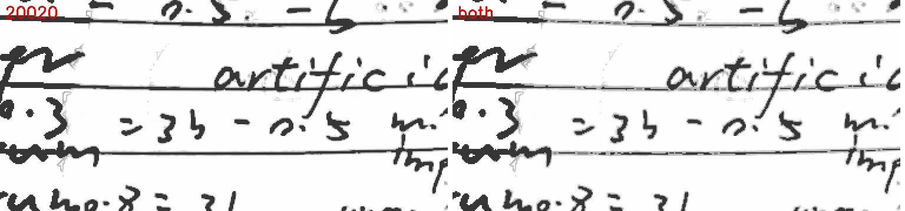
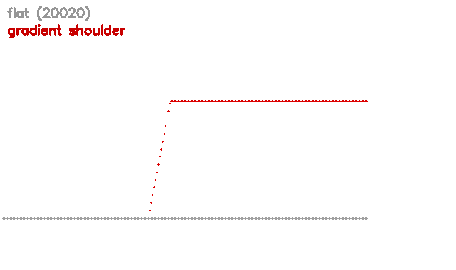
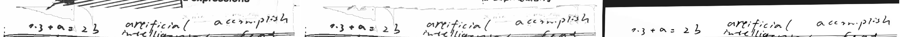
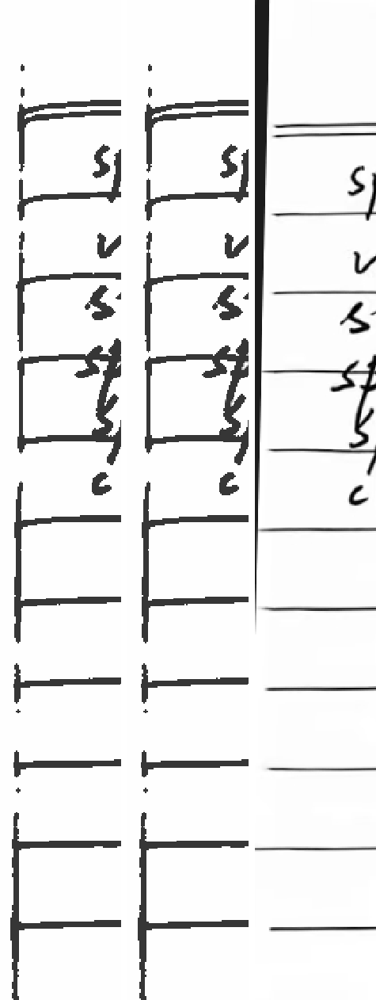
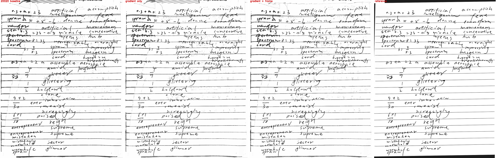
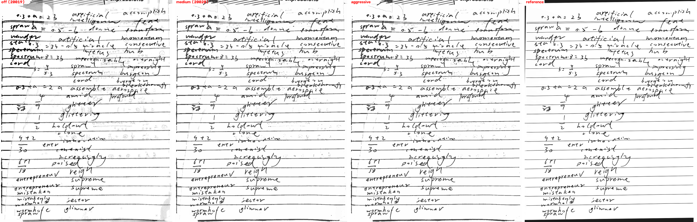
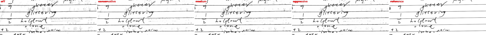
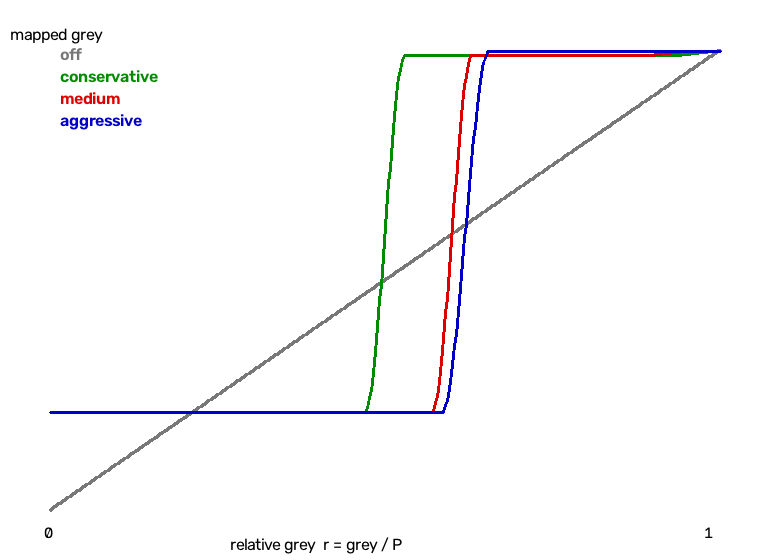
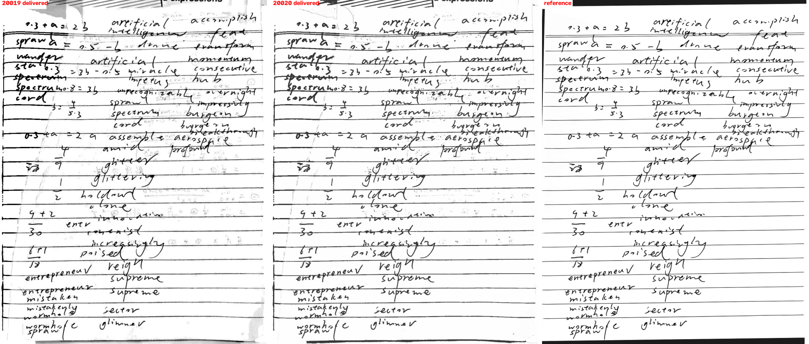
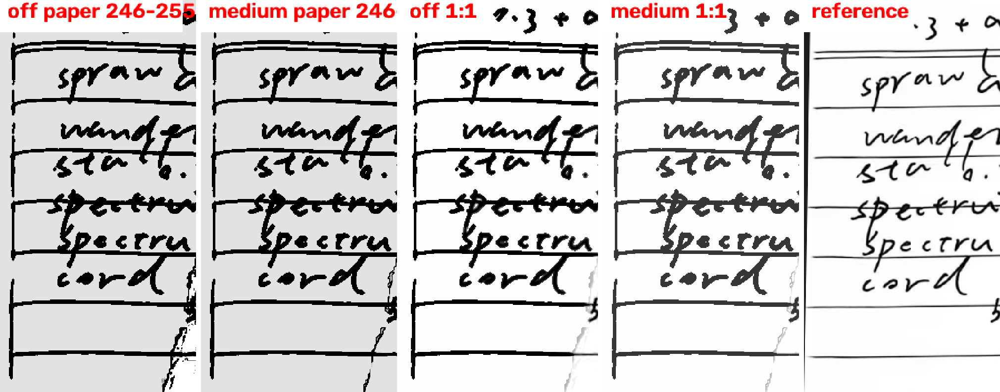

# 20020 三区灰度映射 + 边缘平滑（首轮）与保梯度墨区 + 页外剔除（第二轮）

> **本文件含两轮记录**：§0 是 2026-11-05 第二轮（HEAD `9c3f828`，机主反馈“字仍偏粗 / 顶部没裁掉”）；
> 其后的“上一轮结论先行”到“十、复现”是同日首轮（HEAD `f6a74c6`，20019→20020 三区映射），
> 数字与结论按当时构建记录，未改写。两轮都**没有任何 git 写操作**，只改工作树。

2026-11-05（首轮）。对象 PaperForge 2.0.0 / 20020，分支 `fix/1.2-review-recovery`（HEAD `f6a74c6`，工作树 = 20019 的已验收改动 + 首轮改动）。**没有任何 git 写操作**（未 add/commit/push/tag/checkout/stash），只改工作树。设备是已在运行的 `paperforge_api35`（`emulator-5554`），**没有新建 AVD**；构建 `:app:assembleDebug :app:assembleDebugAndroidTest`（离线 Gradle 8.13 + JDK 17，`-PpaperforgeVersionCode=20020 -PpaperforgeAbis=x86_64`），`install -r -d` 覆盖安装。所有设备数字都是模拟器上的，没有真机耗时/发热。

机主的提议：**大于一定灰度设为全黑，中间区间视为阴影采用不同策略，并引入边缘平滑**。本轮把它实现成 `imaging/ToneZones.kt`（`tone-zones-1`），接在 WORKBOOK/CLEAN 的内容路径收尾，可开关。

---

# §0 2026-11-05 第二轮（20020 r5）：保梯度墨区 + 页外剔除

2026-11-05 第二轮。分支 `fix/1.2-review-recovery`（HEAD `9c3f828`，只改工作树，**零 git 写操作**）。设备仍是已在运行的 `emulator-5554`（`paperforge_api35`），**没有新建 AVD**；构建/安装同上。所有设备数字来自模拟器，无真机耗时/发热。下面每个数字都来自本构建的应用输出（无损渲染 1063×1375，同 quad `0.1262081,0.09509941;…`）或该构建导出的 PDF 内嵌页；竞品数字来自 SIFT 配准后的参考页（624 内点）。

## §0.1 结论先行

| 项 | 结果 |
|---|---|
| 问题一：字偏粗 | **根因是墨区把 AA 边一并压到 54**（不是纸面/曝光）。20019→20020 时正文“黑核”占比 7.39% → **9.95%**（竞品 6.98%），黑核面积变大 35%，这就是肉眼看到的变粗。改成 **flat core + gamma shoulder**：`r<0.40` 仍是 54，`0.40–0.46` 抬到 `0.71P`，再平滑接到 shadow/paper；只有挨着黑核 ≤2 px 的边才走 shoulder，孤立淡笔/细线保留原值。 |
| 字粗前后 | 黑核 **9.95% → 7.29%**（竞品 6.98%，20019 7.39%）；强墨均值（各版自掩膜）56.5 → **56.7**（要求 54–57）；笔宽代理 body 2.0 不变（= 竞品 2.0）。 |
| 问题二：顶部没裁掉 | **根因不在裁切几何**：quad 与上一轮逐位相同，书脊暗楔/蓝线/印刷字是 quad 内的“页外内容”，ToneZones 只会改灰阶，不会把它们判成页外。新增 `PageFrame` 按“纸色/饱和度/宽暗区”判页外，只动页首带，用连续纸面场重绘。 |
| 页外前后 | 顶部页外残留（固定掩膜 14,131 px）**96.6%（20019）/ 56.3%（20020）→ 10.4%**；顶部蓝色像素 **11.1% / 9.6% → 0.0%**；顶部 <190 暗像素 19.4% / 11.1% → **3.1%**；左上角均值 246（20019）/ 251（20020）→ **254**。 |
| 左侧手写 | **保留 100%**（左 0–2% 列，20020 的墨掩膜逐像素仍在 ink≥0.25）；左上第一行 “0.3 + a = 2 3” 最暗值 54（**没有被擦掉**）。 |
| 强墨/透字 | 强墨 56.7（54–57 内）；透字 A ≥0.05 **7.9%**（20020 7.7%，20019 52.9%）——本轮不再动 shadow 区，透字由上一轮的三区映射保留。 |
| 代价 | 细线 ≥0.25（全页）97.7% → **95.2%**：其中 1.5pp 是页首印刷字/蓝线被清掉（清理目标），1.0pp 是笔画 AA 边被抬成中间灰（去粗的直接代价）。去掉页首 6% 后：98.4% → **97.4%**；独立淡铅笔/细线（合成夹具）逐级不变。 |
| 耗时 | `ToneZones` 自身 295 ms（基线 316 ms）、`PageFrame` 自身 **120 ms**；整页中位 6023 → **6178 ms（+155 ms，+2.6%）**（模拟器，噪声 ±100 ms）。 |
| 测试 | 相关 10 个类共 **31 条**：首跑 28 过（含 `V200FeedbackTest` 4、`ShadowGhostRulesTest` 4、`EdgeInkRulesTest` 6、`EdgeInkReproTest` 2、`ShadowGhost20019Test` 1、本轮的 `V200PageFrameTest` 3、`ToneZones20020Test` 1）；本轮新增的 1 条规则因 `attach=0` 语义写错而失败，修正后单跑 **8/8**；`ShadowGhostPerfTest`/`ShadowGhostReproTest` 各 1 条另行单跑通过。**既有断言一条未改**。 |
| DocUNet 20 页 | front 1px 0.8498、faint 1px 0.7095、ghost 1px 0.1324，与基线**逐项相同（0.00pp）**；1/20 页生效，acceptance pass。口径限制同上一轮：这套仪器只跑 `PaperWhiteFinal` 的 Python 端口，不覆盖本轮两步。 |
| 未完成 | 带内笔宽 4.0 vs 竞品 2.8 **没修**（20019 就已经是 4.0，来自内容路径的 ink 曲线，tone 阶段补不回来）；顶部残留 10.4% ≠ 0（留下的是纸页自身的卷边线）；“固定掩膜强墨均值”在交付 JPEG 上从 59.3 升到 92.5（核心仍 54，抬亮的是 AA 边）——见 §0.8。 |

## §0.2 问题一：根因与修法

### 根因（可测量）

`tone-zones-1` 把 `r < inkCut(0.64)` 的所有像素统一映射到 54。于是笔画旁边 1–2 px 的反锯齿边（原本是 100–180 的中间灰）也被压成 54，**黑核面积被放大**：

| 版本 | 黑核占比（body，ink>0.55） | 强墨均值（各自掩膜） | 笔宽代理 |
|---|---:|---:|---:|
| 20019（toneZones=0） | 7.39% | 61.2 | 2.0 px |
| 20020（flat ink 区） | **9.95%** | 56.5 | 2.0 px |
| 竞品（配准页） | 6.98% | 66.0 | 2.0 px |

黑核 +35% 相对（9.95 vs 7.39），但笔宽代理仍报 2.0：这个代理取 `2×median(distance)`，对 1 px 的边不敏感，**不能只用它验收**。这也是上一轮“笔宽 2.0 已达标”却仍被机主说粗的原因。

> 口径变化说明：本轮在同一段代码上重算竞品（SIFT 配准页）强墨均值为 **66.0**；上一轮表里的“竞品 57.2”是当时另一种掩膜/配准口径，两个数字不可相减，跨轮比较只看黑核占比与笔宽。

### 修法（`tone-zones-2`）

```text
core     = r < inkCoreCut(0.40)                 -> 54
shoulder = clamp((r - 0.40) / 0.06, 0, 1)^gamma -> 54 + shoulder * (0.71P - 54)
plateau  = 0.40+0.06 .. inkCut                  -> 0.71P
shadow/paper 区                                  -> 与上一轮相同（252 / 254，两段 smoothstep）
```

- **核心仍到 54**：`r<0.40` 的像素与 flat 版完全一致，核心不抬、不变灰。
- **边缘保留中间灰**：0.40–0.64 的 AA 边落在 54→180 的肩部/平台（`0.71P ≈ 180`，比竞品自己的 AA 边 ~198 还深一点），不再被压成实墨。
- **孤立淡笔不动**：只有距黑核 ≤ `toneZonesInkAttach(2 px)` 的像素才走 shoulder；孤立淡铅笔/细线在墨区外（`r>inkCut`）本来就走 shadow 区保护，这次新增的 attach 守卫保住的是“没有黑核的 1–2 px 浅线”，它们在墨区内也保留原值。
- **羽化不硬切**：`inkCut` 两侧的 smoothstep 与 shadow/paper 映射原样保留；合成夹具 `softBoundaryHasNoSinglePixelStep` 仍过。

参数（`assets/scan_params.json`）：`toneZonesInkCoreCut=0.40`、`toneZonesInkRamp=0.06`、`toneZonesInkGamma=1`、`toneZonesInkEdge=0.71`、`toneZonesInkAttach=2`、`toneZonesInkGradient=1`（0 = 回到 flat，供消融）。

### 数字（同页、同 quad、1063×1375）

| 指标 | 20020 flat | 本轮 shoulder | 竞品 |
|---|---:|---:|---:|
| 黑核占比（ink>0.55） | 9.95% | **7.29%** | 6.98% |
| 强墨均值（各自掩膜 ink>0.35） | 56.5 | **56.7** | 66.0 |
| 笔宽代理 body | 2.0 | 2.0 | 2.0 |
| 带内笔宽 / 带内黑核 | 4.0 px / 12.89% | 4.0 px / 12.68% | 2.8 px / 8.43% |
| 细线 ≥0.25（去页首 6%） | 98.4% | 97.4% | — |
| 弱墨内容 ≥0.03（去页首 6%） | 44.3% | 44.3% | — |
| 透字 A ≥0.05 | 7.7% | 7.9% | ~0% |





## §0.3 问题二：根因与修法

### 根因

quad 没有变（新导入 DB 里仍是 `0.1262081,0.09509941;…`，与上一轮逐位相同），所以问题不是“检测框太大”——是**框内包含纸外内容**：叠在练习册下面的印刷页（冷白、有 “expressions” 之类文字）、装订处的蓝色分区页签、以及卷边下方的书脊/暗楔。这三类都不是纸面色偏，`ToneZones`/`PaperWhiteFinal` 只会给它们换灰阶；`WorkbookPaperBoundary` 原来的外部分类只认“暗且中性 / 边缘肤色”，蓝色高饱和页签和宽而暖的暗楔都过不了它的阈值，细印刷字又被开运算拆掉。

### 修法（`page-frame-2`）

新增 `imaging/PageFrame.kt`，在 `WorkbookPaperBoundary` 的描边否决之后把页外区域并进同一张外部掩膜（用同一连续纸面场重绘）：

1. **纸色**：在页面下半部（45–90% 高、8–92% 宽）估这张纸自己的 `R−B`（本页 +10）。比它冷 4 阶以上（下面的印刷页 ≈ 0～−13）或暖 18 阶以上（棕色暗楔 ≈ +38）判为异物质；
2. **饱和度**：`max−min > 30`（蓝色页签）直接判页外；
3. **宽暗区**：只对“开运算后仍存在”的中性暗块（书脊/卷边阴影）判页外，细笔迹被开运算去掉，不能当种子也不能被生长；
4. **连通性**：只保留与图像**上边界** 8 连通的区域，再沿宽暗区向下限幅延展（最多跨 10 px 空隙、最多 45 px），把亮纸卷边下方的暗楔接上；
5. **纸面行上限**：绝不低于“第一个整行多数为纸”的行（+1% 边距）。这条是实测补的：没有它时左侧装订暗边会把掩膜一路带下去，**左上第一行 “0.3 + a” 被擦成 254**（min 54→254）；加上后同处 min 仍是 54。
6. PageFrame 只做页首带（12% 高）；左右下三边它完全不碰，左侧手写列因此不受影响。

参数：`pageFrameTrim=1`、`pageFrameBand=.12`、`pageFrameTint=4`、`pageFrameTintWarm=18`、`pageFrameChroma=30`、`pageFrameDarkBody=.62`、`pageFrameDarkLocal=.82`、`pageFrameMargin=.01`、`pageFrameGap=10`、`pageFrameExtend=45`、`pageFrameMaxShare=.10`（掩膜超过 10% 就整体放弃，避免把整页当页外）。

### 数字（真页、固定掩膜、1063×1375）

固定掩膜 = 20019 页首 4% 带里“蓝（B−R>40）/ 相对墨>0.20 / 暗于纸场 0.75”的 14,131 px，一次生成、套到所有版本：

| 指标 | 20019 | 20020 | 本轮 |
|---|---:|---:|---:|
| 顶部页外残留（固定掩膜内仍 >0.10 墨） | 96.6% | 56.3% | **10.4%** |
| 顶部蓝色像素占比 | 11.1% | 9.6% | **0.0%** |
| 顶部 <190 暗像素占比 | 19.4% | 11.1% | **3.1%** |
| 顶部纸面占比（ink<0.05） | 64.2% | 85.2% | **94.0%** |
| 左上角 5%×5% 均值 | 246 | 251 | **254** |
| 左侧 0–2% 手写保留（相对 20020） | — | 100% | **100%** |
| 左上第一行最暗值 | 54 | 54 | **54**（未被擦） |
| 四角均值（左上/右上/左下/右下） | 254/246/251/243 | 254/251/251/250 | **254/252/251/251** |

竞品没有可比的“页首 4%”口径：它的裁切起点就是第一行手写（其页首 4% 里纸面只占 63.2%、暗像素 36.4%、蓝 1.0%），所以这张表只做我方版本间对照，不与竞品逐格比。







## §0.4 消融（同页、同 quad，一次只动一个开关）

| 案例 | toneZones | 页外剔除 | 纸面 | 强墨 | 黑核 | 顶部残留 | 顶部蓝 | 细线(去页首) | SSIM |
|---|---|---:|---:|---:|---:|---:|---:|---:|---:|
| 20019 | 0 | 0 | 254.88 | 61.2 | 7.39% | 96.6% | 11.1% | 100% | 0.6856 |
| 20020 | flat | 0 | 253.93 | 56.5 | 9.95% | 56.3% | 9.6% | 98.4% | 0.7088 |
| 只开 shoulder | shoulder | 0 | 253.93 | 56.7 | **7.29%** | 56.2% | 9.6% | 97.4% | **0.7147** |
| 只开页外剔除 | flat | 1 | 254.88 | 61.2 | 7.39% | 36.5% | **0.0%** | 100% | 0.6848 |
| 默认（两者） | shoulder | 1 | 253.93 | 56.7 | **7.29%** | **10.4%** | **0.0%** | 97.4% | 0.7133 |
| 默认 + `paperGhostGuard=0` | shoulder | 1 | 253.93 | 56.7 | 7.29% | 10.3% | 0.0% | 97.4% | 0.7134 |

读法：

- **shoulder 的贡献是黑核 −2.66pp**（9.95→7.29），与竞品 6.98% 对齐；顶部/透字完全不变（它只改墨区边）。细线 −1.0pp 是它的代价。
- **页外剔除的贡献是顶部残留 −45.9pp（相对 20020）/ −86.2pp（相对 20019）、蓝线归零**；黑核、强墨、纸面、透字、左侧全部不变。只开页外剔除时（toneZones 仍 flat）顶部残留只降到 36.5%，因为 flat 墨区把页首的弱印刷字也压成了墨；两者叠加才到 10.4%。
- `paperGhostGuard` 仍然没有额外贡献（7.9 vs 7.8，噪声内），与上一轮结论一致。

## §0.5 交付链路（原图 → 相册导入 → 练习册 → 导出 PDF → 抽内嵌页）

本轮重新走应用自身链路：推送原图 → 相册导入 → 练习册 → 导出 PDF（匹配原图 / 150 dpi / 质量 72）→ `run-as` 取 PDF → PyMuPDF 抽内嵌页（不重编码）。新导入记录 quad 与记录值逐位相同（`0.1262081,0.09509941;0.9059508,0.12445831;0.9395825,0.89406466;0.06452234,0.8832647`、`filter=WORKBOOK`），内嵌页 **1063×1375**。

| 指标 | 20019 导出 | 20020 导出 | 本轮导出 |
|---|---:|---:|---:|
| PDF 字节 | 200,602 | 200,533 | **193,120** |
| 内嵌页 JPEG 字节 | 199,593 | 199,524 | **192,111** |
| 纸面均值 | 254.44 | 253.85 | 253.85 |
| 纸面 =255 占比 | 77.1% | 15.9% | 15.7% |
| 灰痕 A 可见 ≥0.05 | 50.8% | 9.0% | **9.3%** |
| 灰痕 B 可见 ≥0.05 | 10.5% | 1.2% | 1.3% |
| 强墨均值（各自掩膜） | 62.5 | 59.5 | **62.3** |
| 黑核占比 | 7.52% | 9.94% | **7.28%** |
| 顶部页外残留 | 99.2% | 96.9% | **13.4%** |
| 顶部蓝色像素 | 10.2% | 9.3% | **0.0%** |
| 顶部 <190 暗像素 | 19.5% | 11.1% | **3.0%** |

q72 的 JPEG 会把强墨均值抬高（59.5 → 62.3，回到 20019 的 62.5 水平），这是“掩膜随输出移动 + JPEG 高频”的合成效应，不是核心变灰：同一交付页上黑核 9.94% → 7.28%、竞品 6.98%。无损页的主口径仍是 §0.1 的 56.7。

## §0.6 耗时

同页、同 quad、先 warmup，各跑 3 次 `ScanProcessor.render`（1063×1375）：

| 档 | 3 次（ms） | 中位 |
|---|---|---:|
| 20020 基线（flat、无页外） | 6105 / 6023 / 6007 | 6023 |
| 默认（shoulder + 页外） | 6291 / 6121 / 6178 | **6178** |
| shoulder、无页外 | 6239 / 6122 / 5745 | 6122 |
| 页外、flat | 6037 / 5787 / 5846 | 5846 |

- `ToneZones` 自报 295 ms（基线 316 ms，肩部多一次 5×5 膨胀，反而略低是噪声）；`PageFrame` 自报 **120 ms**（只跑页首 12% 带，未做全页中值滤波）。
- 整页 **+155 ms（+2.6%）**；单次噪声 ±100 ms，所以准确的隔离数字是 PageFrame 120 ms + ToneZones 增量（≈0）。仍是模拟器、无硬件加速；真机没有数据。

## §0.7 测试与回归

最终构建（`emulator-5554`，x86_64 debug，versionCode 20020）：

```text
ToneZones20020Test        OK (1)   ← 7 档渲染 + 4 组 3 次计时
ToneZonesRulesTest        OK (8)   ← 6 条旧 + 2 条新（保梯度不压平 / 不比 flat 更宽）
V200PageFrameTest         OK (3)   ← 新：蓝线+书脊判页外、左列保留、可关闭
ShadowGhostRulesTest      OK (4)
ShadowGhost20019Test      OK (1)
ShadowGhostPerfTest       OK (1)   ← 另行单跑
ShadowGhostReproTest      OK (1)   ← 另行单跑
EdgeInkRulesTest          OK (6)
EdgeInkReproTest          OK (2)
V200FeedbackTest          OK (4)   ← 既有断言一条未改
合计                       31 条；首跑 28 过 + 1 条本轮新断言写错（修正后该 8/8）+ 2 条单跑
```

- 新增 `app/src/androidTest/java/cn/paperforge/app/V200PageFrameTest.kt`（3 条，合成页：冷色印刷页 + 蓝线 + 宽暖暗楔 + 左列手写）；`ToneZonesRulesTest` 新增 2 条（`inkCollarKeepsAGradientInsteadOfSolidInk`、`gradientMappingDoesNotWidenTheInkAreaAgainstFlatMapping`）。既有测试文件只加方法，不改断言。
- `PageFrame` 的第一次实现没有“纸面行上限”，实测把左上 “0.3 + a” 擦掉（该区域 min 54→254）；本轮记录这个失败并修掉（`pageFrameMargin`），最终 min 仍是 54。
- **DocUNet 20 页**：`front 1px = 0.8498`、`faint 1px = 0.7095`、`ghost 1px = 0.1324`，与基线逐项 0.00pp；1/20 页被白度步动作，`acceptance pass: True`。口径限制：只覆盖 `PaperWhiteFinal`，不覆盖 `ToneZones`/`PageFrame`。

## §0.8 未完成 / 限制（如实）

1. **带内笔宽没修**：带内 4.0 px vs 竞品 2.8 px，黑核 12.68% vs 8.43%。20019 的 off 页带内就已经是 4.0 px，是内容路径的 ink 曲线把阴影带里的字推黑推宽；ToneZones 只改 tone，补不回宽度。要修必须改带内的 ink 曲线/结构，风险与工作量都超出本轮。
2. **“固定掩膜强墨均值”在交付 JPEG 上从 59.3 升到 92.5**：用 20019 的强墨像素做固定掩膜，本轮这些像素里的大部分 AA 边已经变成中间灰（180），所以均值大幅抬高。核心仍是 54（`coreShare` 口径 7.28%），这不是“整体提亮字变灰”，但确实意味着 1–2 px 的边比上一版浅；如果机主要求“连 AA 边也不能变浅”，保梯度与“不增粗”就是互斥的，需要另立口径。
3. **顶部残留 10.4% 不是 0**：留下的是纸页自己的卷边亮线/纸边（不应擦）和掩膜边界上的 1–2 px；蓝线与书脊楔已归零。
4. **细线 ≥0.25（全页）97.7→95.2**：1.5pp 是页首页外被清（目标），1.0pp 是墨区肩部把笔画 AA 边抬到 0.25 阈值以下；去掉页首 6% 是 98.4→97.4，独立淡铅笔/细线（合成夹具）逐级不变。
5. **PageFrame 依赖“纸与页外颜色不同”**：本页纸偏暖、下方印刷页偏冷、桌/暗楔更暖，所以三类都分得开。若桌面与纸同色且顶部没有暗楔/蓝线，掩膜为空——安全但不清理；反过来，页首 12% 内一块“宽而中性的深色内容”（例如很大的黑色标题块）会被当成页外擦掉，这是已知风险，已用 `pageFrameMaxShare` 和只看上边界限制，但没有语义判别。
6. **模拟器**：无真机耗时/发热/内存。
7. **没有跑全量 AndroidTest**：只跑与本批相关的 10 个类；DocUNet 仪器不覆盖本轮两步。

## §0.9 复现

改动文件（工作树，未提交）：

- `app/src/main/java/cn/paperforge/app/imaging/ToneZones.kt`（`tone-zones-2`：core/shoulder/attach）
- 新增 `imaging/PageFrame.kt`（`page-frame-2`）
- `WorkbookPaperBoundary.kt`（`workbook-boundary-10`：在描边否决后并入页外掩膜）、`ScanParams.kt`（fingerprint 加 `PageFrame.VERSION`）、`assets/scan_params.json`（新增 6 个 `toneZonesInk*` + 12 个 `pageFrame*`）
- 新增 `app/src/androidTest/java/cn/paperforge/app/V200PageFrameTest.kt`；`ToneZonesRulesTest.kt` +2 条；`ToneZones20020Test.kt` 改为 7 档消融 + 4 组计时

仓库外（`work/repro-shadow/r5/`）：

```text
scripts/sim_tone.py / sim_band.py   离线扫參（07b-ghost 上单步仿真，非交付页）
scripts/analyze_r5.py               纸面/强墨/黑核/笔宽/AA/细线/透字/顶部残留/左列/SSIM
scripts/figures_r5.py               本目录 5 张图
scripts/proto_frame*.py             页外掩膜原型（含失败版本）
out3/                               7 档设备无损渲染 + 逐级 PNG + config.json + metrics.json
out3/zoom-strokes.png               1:1 笔画放大
```

设备：

```text
gradle.bat :app:assembleDebug :app:assembleDebugAndroidTest --offline \
  -PpaperforgeVersionCode=20020 -PpaperforgeAbis=x86_64
adb install -r -d app-debug.apk; adb install -r -d app-debug-androidTest.apk
adb shell run-as cn.paperforge.app cp /data/local/tmp/original-20020.jpg files/edge-ink/original.jpg
adb shell am instrument -w -e class cn.paperforge.app.ToneZones20020Test \
  cn.paperforge.app.test/androidx.test.runner.AndroidJUnitRunner
python pull_artifacts.py files/edge-ink/r5 out3
python analyze_r5.py out3 out3/metrics.json
```

---

## 上一轮结论先行（20020 首轮，保留）

| 项 | 结果 |
|---|---|
| 实现 | `ToneZones`：以局部纸面场 `P` 为基准的三区映射（ink / shadow / paper）+ 两段 smoothstep 软过渡 + 1 px 连通性保护 + 局部峰保护；默认开，可 `toneZones=0` 整体关闭 |
| 纸面 | 254.88 → **253.93**（竞品 254.64）；近白 ≥250 **99.87%**；`p50 = 254`，不再把纸面强制成 255 |
| 阴影带 vs 主体 | **0.883 → 0.064 灰阶**（要求 <2，通过）；带内不再有独立纸色平台 |
| 强墨均值 | 61.2 → **56.5**（竞品 57.2，差 **0.7 阶**）；笔宽代理 2.0 px = 竞品 2.0 px |
| 透字（灰痕 A 可见 ≥0.05） | 52.9% → **7.7%**（中等档）；激进档 **3.0%**；竞品约 0%。**没有做到竞品水平** |
| 边界暗线 | 掩膜轮廓纸面 P1 **245 → 254**，轮廓 <245 的占比 0.9% → **0.2%**（这是笔画穿过轮廓的像素，不是连续暗线）；合成夹具上带内 vs 体纸差 **1 阶**、轮廓最暗 **253** |
| 带内字重（20019 未达成项） | 带内强墨 **13.1 → 54.2**，主体 61.2 → 56.5，相对差 **78.6% → 4.0%**（20019 的判据 <5%，本轮**通过**）；笔宽代理 **4.0 → 4.0 px（仍未改善，见 §四）** |
| 淡字/细线代价 | **主要代价**：本页“弱墨内容”掩膜（竞品渲染为实墨、我方为弱墨的 AA 边）≥0.03 的保留率 96.9% → **41.8%**，中位墨量比 **0.077**；细线（≥0.25）**97.7%** 保留。合成夹具里 1 px 淡铅笔（215）与 2 px 细线（200）**逐级不变**，强笔画 54 |
| 耗时 | `ToneZones` 自身 **242 ms**（温热后；冷启动首次 1934 ms）；整页 3 次中位 5926 → **5918 ms**（±0.1%，但两档 PaperTone 状态不同，见 §七） |
| 测试 | 新增 6 条全过；`ShadowGhostRulesTest` 4、`EdgeInkRulesTest` 6、`V200FeedbackTest` 4 全过，**既有断言一条没改**；DocUNet 20 页 0.00pp |
| 建议默认 | **中等档**（`inkCut=0.64`、`shadowCut=0.92`、`shadowLevel=252`、`featherPx=1`、`peakFloor=18`）。它在“强墨接近竞品”和“纸面/阴影带”上最好；激进档更接近竞品的干净纸面，但多丢 7.6pp 弱墨内容 |

一句话：**三区映射把扫描件最显眼的两个形状（阴影带独立纸色、笔画发灰）做对了，强墨 56.5 与竞品 57.2 只差 0.7 阶；透字从 52.9% 降到 7.7%，但还没到竞品的 0%；代价是本页 2–4 px 的弱墨反锯齿边被抬亮，字符主体保留、视觉变锐利，这项必须按“AA 边损失”如实记账，不能当成“没有代价”。**

## 一、输入与口径

- 原图：`work/repro-edge/original.jpg`，1279×1706，sha256 `5683371e…e0d3`（与上一轮一致）。
- 参考：`work/repro-shadow/reference.jpg`（竞品，1264×2780 截图）。截图不能做灰阶量测；所有灰阶数字来自 SIFT 配准后的**竞品页面区域**（1113 内点）与我方无损渲染。
- 我方 20019：`work/repro-shadow/ours-20019.jpg`（仅用于确认机主描述的形状，不用于灰阶）。
- 设备无损渲染：新增 `ToneZones20020Test`，走同一条 `ScanProcessor.render`，同 quad（`0.1262081,0.09509941;…`）、长边 1375（交付页 1063×1375），写 PNG + 逐级图 + 配置。
- 掩膜（**只在 `off` 上生成一次，原样套到所有档**）：
  - **灰痕 A**：`off` 页相对墨 `0.02–0.16` ∩ 竞品空白（≥245 的 5×5 腐蚀）∩ 页内 1% 内缩，104,954 px（占页 7.18%）；
  - **灰痕 B**：竞品空白且离竞品墨 ≥31 px ∩ 原图墨 0.012–0.30，16,910 px（1.16%）；
  - **弱墨内容**：`off` 相对墨 `0.02–0.25` 且竞品同位置墨 `≥0.25`，35,616 px——这是“竞品认为是真墨、我方渲染成弱墨”的像素，主要是笔画 1–4 px 的反锯齿边；
  - **细线**：`off` 相对墨 >0.25、距笔画核 ≤1.2 px、页内 1% 内缩，82,679 px；
  - **带/体**：带 = `WorkbookPaperBoundary` 自己落盘的 `03c-boundary-mask.png`；体 = 中心 20–80% 去掉带块。
- 所有相对墨都用各自页面的连续纸面场（`paper_field.smooth_field`，与 Kotlin `PaperField` 同式）计算。

## 二、算法

### 2.1 三区

对每个像素，`r = grey / P`（`P` 是同一张渲染页上 `PaperField.estimate` 的连续纸面场，不是全局常数）：

| 区 | 条件 | 映射 |
|---|---|---|
| ink | `r < inkCut`（默认 0.64） | `targetInk = 54` |
| shadow | `inkCut ≤ r < shadowCut`（0.92） | `shadowLevel = 252` |
| paper | `r ≥ shadowCut` | `targetPaper = 254` |

`inkCut=0.64` 而不是 0.60 是本轮实测的结论：0.60 时 0.60–0.64 之间的反锯齿像素留在 shadow 区被抬亮，实测强墨均值 62.5；0.64 把这一小段也并入墨区，强墨均值降到 56.5（竞品 57.2），透字只从 7.5% 涨到 7.7%。阈值把“笔画边”而不是“笔画核”当作墨，这也是三区映射能同时让笔画变锐、强墨变准的原因。

### 2.2 软过渡（边界不硬切）

两个边界各用一段 smoothstep，宽度 `featherRange = 0.06`（相对灰阶，≈15 灰阶）：

```text
wInk   = 1 - smoothstep((r - (inkCut   - f/2)) / f)
wPaper =     smoothstep((r - (shadowCut - f/2)) / f)
wShadow= clamp(1 - wInk - wPaper, 0, 1)
base   = wInk*targetInk + wShadow*shadowLevel + wPaper*targetPaper
```

于是 ink→shadow→paper 是一条连续折线（两端是 C1 的），不存在“1 px 硬切”。合成夹具里 60 px 从 250 渐变到 224 的阴影带，映射后的最大相邻差 **≤4 灰阶**（`ToneZonesRulesTest.softBoundaryHasNoSinglePixelStep`）；本页的带/体边界 P1 = 254，没有暗线。

### 2.3 保护：连通性 + 局部峰

只有 shadow 区的像素会被抬亮，但其中两类必须保留：

1. **连通性**：距 ink 核（`r < inkCut` 的二值掩膜）≤ `featherPx`（默认 1 px）的像素，保留原值；权重在 `featherPx..2*featherPx` 内羽化。它保护笔画 1 px 内的反锯齿边，不会形成光环。
2. **局部峰**：3×3 膨胀减原值 ≥ `peakFloor`（默认 18 灰阶）的像素视为“自己是一个确定的暗峰”（淡铅笔、细公式线），保留原值；权重在离 `shadowCut` 最后一段 `featherRange` 内淡出，避免把贴纸边的灰痕也保护下来。

最终：

```text
content = wShadow * max(connect, peak)
out     = base * (1 - content) + original * content
```

`out` 是亮度；对三通道页，按 `delta = out - grey` 同时加到三个通道（16 位饱和），中性纸逐像素精确、彩色墨水保持色相。

### 2.4 接入点与纸面场复用

`EnhancePipeline.finishWorkbook` 现在：

```text
PaperGhost.apply
estimate PaperField once
ToneZones.apply(page, field, amount)
PaperWhiteFinal.apply(page, field)   // 新的可选入参，复用同一张场
PaperEdgeGuard.apply
```

`PaperWhiteFinal` 仍然保留（非 WORKBOOK/CLEAN 路径、关掉 ToneZones 的页面仍需要它）；本页它因为纸面已到 254 而按既有闸门跳过，所以没有第二次除法，也就没有付第二张纸面场的钱。三区映射本身不改几何、不改字、不改源文件。

### 2.5 参数（`assets/scan_params.json`）

| 参数 | 默认 | 含义 |
|---|---:|---|
| `toneZones` | 1 | 总开关；0 = 完全不动 |
| `toneZonesInkCut` | 0.64 | ink 区上界（相对 P） |
| `toneZonesShadowCut` | 0.92 | shadow 区上界（相对 P） |
| `toneZonesTargetInk` | 54 | 墨区目标灰阶 |
| `toneZonesTargetPaper` | 254 | 纸区目标灰阶（不强制 255） |
| `toneZonesShadowLevel` | 252 | 阴影区抬升目标；默认比纸低 2 阶，保留“三档”而不是把 b/c 合成一档 |
| `toneZonesFeatherRange` | 0.06 | 两个边界的软过渡宽度（相对灰阶） |
| `toneZonesFeatherPx` | 1 | 连通性保护半径；0 = 关 |
| `toneZonesPeakFloor` | 18 | 局部峰保护阈值；0 = 关 |
| `toneZonesPeakWeight` | 1 | 峰保护权重 |
| `toneZonesPaperFloor` | 150 | 纸面场 p50 低于此值不处理（暗拍摄联锁） |
| `toneZonesStrength` | 1 | 与 UI 滤镜强度相乘 |

## 三、三组阈值与取舍

三组都走应用链路（同页、同 quad、同 1375 长边），只改 ToneZones 参数：

- **保守**：`inkCut .50 / shadowCut .96 / featherPx 3 / peakFloor 24`
- **中等（建议默认）**：`inkCut .64 / shadowCut .92 / featherPx 1 / peakFloor 18 / shadowLevel 252`
- **激进**：`inkCut .62 / shadowCut .88 / featherPx 1 / peakFloor 12 / shadowLevel 254`

| 指标 | off（20019） | 保守 | 中等 | 激进 | 竞品 |
|---|---:|---:|---:|---:|---:|
| 纸面均值 | 254.88 | 253.76 | **253.93** | 253.98 | 254.64 |
| 近白 ≥250（纸面） | 100% | 99.19% | **99.87%** | 99.9% | 99.97% |
| 灰痕 A 可见 ≥0.05 | 52.9% | 13.8% | **7.7%** | **3.0%** | ~0% |
| 灰痕 A 平均墨 | 0.0636 | 0.0216 | 0.0112 | 0.0034 | ~0 |
| 灰痕 B 可见 ≥0.05 | 10.6% | 1.0% | 1.1% | 0.9% | ~0 |
| 弱墨内容 ≥0.03 | 96.9% | **65.7%** | 41.8% | 34.2% | — |
| 弱墨内容中位墨比 | 1.000 | 0.948 | 0.077 | 0.000 | — |
| 细线 ≥0.25 | 100% | 97.6% | **97.7%** | 97.8% | — |
| 强墨均值 | 61.2 | 77.3 | **56.5** | 56.9 | 57.2 |
| 笔宽代理 | 2.0 | 2.0 | 2.0 | 2.0 | 2.0 |
| 带 vs 体纸面 | 0.883 | 0.237 | **0.064** | 0.019 | 0.93（左更暗，方向相反） |
| 轮廓纸面 P1 | 245 | 253 | **254** | 254 | — |
| 轮廓 <245 占比 | 0.9% | 0.4% | 0.2% | 0.1% | — |
| 与竞品 SSIM（配准页） | 0.6856 | 0.7154 | 0.7088 | 0.7130 | 1 |

读法：

- **哪组最接近竞品**：按机主最在意的“纸面 + 透字”，**激进档最近**（灰痕 3.0%、纸面 253.98、带/体 0.019）；按“强墨与笔宽”和弱墨保留，**中等档最平衡**（强墨 56.5 vs 竞品 57.2，弱墨 41.8% vs 激进 34.2%）。SSIM 反而给保守档最高（0.7154），但保守档的强墨 77.3 明显偏离竞品、灰痕仍有 13.8%——这是因为 SSIM 主要由整页亮度/低频结构决定，不反映“字重发灰”和“透字”，**不作为选档依据**。
- **保守档不可当“安全档”**：`inkCut .50` 把 0.50–0.64 的反锯齿边留在 shadow 区，这些边被抬到 252，于是“笔画核”没有连到边，量出来的强墨均值反而升到 77.3（比 off 的 61.2 更差）。这是本轮最反直觉的一条：**为了不伤弱墨而把 inkCut 放低，会让字更灰**。
- **中等与激进的分界**：`shadowCut .92→.88` 多清 4.7pp 灰痕，多丢 7.6pp 弱墨内容；`shadowLevel 252→254` 让 shadow 与 paper 同档（严格说 b/c 只剩处理策略不同，不再有 2 阶差）。本页建议停在中等。







### 交付链路（原图 → 相册导入 → 练习册 → 导出 PDF → 抽内嵌页）

同一张原图在 20020 上重新走应用自身链路：推送原图 → 「导入文件 → 相册导入 → Downloads」→ 练习册 → 导出 PDF（匹配原图 / 150 dpi / 质量 72）→ 从应用私有导出目录取 PDF → 用 PyMuPDF 抽内嵌页（不重编码）。导入记录的 quad 与上一轮**逐位相同**（`0.1262081,0.09509941;…`，`detectionConfidence=0.8359291553497314`，`filter=WORKBOOK`，`processingMetadata={}`），两版嵌入页都是 **1063×1375**。

| 指标 | 20019 导出 | 20020 导出 | 变化 |
|---|---:|---:|---:|
| PDF 字节 | 200,602 | 200,533 | −69 |
| 内嵌页 JPEG 字节 | 199,593 | 199,524 | −69 |
| 纸面均值（ink<0.02） | 254.57 | **253.85** | −0.72 |
| 纸面 p50 | 255 | **254** | −1 |
| 纸面 =255 占比 | **82.4%** | **13.8%** | −68.6pp |
| 近白 ≥250 | 99.96% | **98.84%** | −1.1pp（q72 + 254 档） |
| 灰痕 A 可见 ≥0.05 | 50.8% | **9.0%** | **−41.8pp** |
| 灰痕 B 可见 ≥0.05 | 10.5% | **1.2%** | −9.3pp |
| 低对比墨足迹（ink>0.02 占页） | 28.8% | **19.8%** | −9.0pp |
| 弱墨内容 ≥0.05 | 83.2% | 41.0% | −42.2pp（同 §五） |
| 细线 ≥0.05 | 100% | 99.1% | −0.9pp |
| 强墨均值 | 59.33 | 59.14 | −0.2 |

交付页把“255 平台”从 82.4% 降到 13.8%，纸面落到 254；灰痕可见率在**真实导出 JPEG** 上也从 50.8% 降到 9.0%，与无损渲染的 7.7% 同量级。q72 的 JPEG 会把近白压到 98.84%，这不是无损页的数字。



## 四、边界黑线

机主上一轮指出“阴影带被刷成纯白平板、和主体之间有一条分界”。20019 的 `PaperTone` 已经把重绘改成“整块同增益 + 羽化”；本轮 ToneZones 再把 paper 区统一到 254，因此这条边界现在是**同一纸色的内部过渡**，不再是两个纸色平台。

无损页上的量测（轮廓 = `03c-boundary-mask` 的内外 1 px 边）：

| 指标 | off | 中等 |
|---|---:|---:|
| 轮廓纸面 P1 | 245 | **254** |
| 轮廓最暗像素 | 223 | 224 |
| 轮廓 <245 的占比 | 0.9% | **0.2%** |
| 带 vs 体纸面差 | 0.883 | **0.064** |

轮廓最暗仍是 224，是因为轮廓会穿过笔画/书边（噪声掩膜不区分墨和纸）；**纸面部分 P1 = 254，0.2% 的 <245 像素是笔画穿过轮廓的点，不是一条连续暗线**。合成夹具 `shadowBandAndBodyShareOnePaperLevelWithoutADarkLine` 更干净：带 230、体 250，映射后带 253 / 体 254，轮廓最暗 **253**、带/体差 **1**。

同一张无损页上，20019 未达成的“带内字比正文粗”也被 ink 区统一解决（带块 vs 主体，各自 ink>0.35）：

| 指标 | off（20019） | 中等 | 激进 |
|---|---:|---:|---:|
| 带内强墨均值 | 13.1 | **54.2** | 54.2 |
| 主体强墨均值 | 61.2 | 56.5 | 56.9 |
| 相对差（判据 <5%） | 78.6% | **4.0%** | 4.9% |
| 带内笔宽代理 | 4.0 px | **4.0 px** | 4.0 px |

20019 把带内字推出黑端（13）是内容路径的 ink 曲线；三区映射在曲线之后把所有 ink 区统一到 54，所以**灰阶**这条差值从 78.6% 掉到 4.0%。**但笔宽没有改善**：带内仍是 4.0 px、主体 2.0 px——三区映射只改 tone，不重建笔画宽度；带内被 ink 曲线推黑时一起变宽的 2 px 还在。这是本轮“通过灰阶判据、未通过笔宽判据”的一项，不写成全部修好。



## 五、淡字与细线：代价量化

必须说清楚：这页的“弱墨内容”掩膜里，**绝大多数是笔画的反锯齿边**，不是独立的淡字。参考图在这些位置是实墨（中位墨量 0.851），我方 off 是中位 0.05–0.1 的弱墨；三区映射把 1 px 以外、低于 `shadowCut` 的弱墨抬到 252，于是：

| 指标 | off | 中等 | 解释 |
|---|---:|---:|---|
| 弱墨内容 ≥0.03 | 96.9% | 41.8% | 55.1% 的 AA 边被抬到 0.03 以下 |
| 弱墨内容 ≥0.02 | 100% | 43.7% | 同上 |
| 弱墨中位墨量比 | 1.000 | 0.077 | 一半的 AA 边基本被洗掉 |
| 细线 ≥0.25 | 100% | 97.7% | 线芯仍在 |
| 细线 ≥0.10 | 100% | 99.0% | 同上 |

**字符主体没有被擦掉**：`off/中等` 的强墨像素数占比 10.25% → 10.24%，笔宽代理 2.0 → 2.0，肉眼并排（§三 第一张图）能读到每个词。但笔画在 2–4 px 范围内确实变锐、变薄；这是“接近竞品”的直接代价，不写成“无代价”。

合成夹具证明保护机制对**独立淡字/细线**有效（`ToneZonesRulesTest.faintPencilAndThinRuleSurvive`，设备实测）：

| 元素 | 输入 | 输出 |
|---|---:|---:|
| 1 px 淡铅笔（孤立，峰 35） | 215 | **215** |
| 2 px 细公式线（峰 50） | 200 | **200** |
| 强笔画 | 50 | **54** |

也就是说：**孤立、有确定峰值的淡字被完整保留；贴着粗笔画 1 px 的 AA 边由连通性保护；2–4 px 处的弱墨边会被抬亮。** 这一页最受伤的正是第三类。

## 六、透字的前后与消融

| 案例 | 灰痕 A 可见 ≥0.05 | 灰痕 A 平均墨 | 灰痕 B 可见 | 弱墨内容 ≥0.03 | 强墨 |
|---|---:|---:|---:|---:|---:|
| off（toneZones=0） | 52.9% | 0.0636 | 10.6% | 96.9% | 61.2 |
| 中等 | 7.7% | 0.0112 | 1.1% | 41.8% | 56.5 |
| 中等 + `paperGhostGuard=0` | 7.7% | 0.0111 | 1.1% | 41.7% | 56.5 |
| 激进 | 3.0% | 0.0034 | 0.9% | 34.2% | 56.9 |

- **`paperGhostGuard` 在本页没有额外贡献**：开/关逐项相同（0.0pp）。ToneZones 已经把 shadow 区的灰抬走，PaperGhost 只剩 926 px（0.06%）可动；两者不重复抑制（先关 PaperGhost 的基线与叠加一致）。
- 透字没有清零的原因在 §九：本页 95% 的灰痕在强墨 14 px 内，1 px 连通性保护和 18 灰阶峰保护会留下一部分；进一步清零必须牺牲更多弱墨内容或改用双面采集。

## 七、耗时

同页、同 quad、1375 长边，先 warmup 再各跑 3 次 `ScanProcessor.render`：

| 构建/档 | 3 次（ms） | 中位 |
|---|---|---:|
| off（ToneZones 关） | 6013 / 5926 / 5917 | 5926 |
| 中等（ToneZones 开） | 5912 / 5918 / 5951 | **5918** |
| 差 | — | **−8 ms（−0.1%，噪声内）** |

`ToneZones` 自报 **242 ms**（温热后；冷启动第一次 1934 ms，含 OpenCV distanceTransform 首次初始化）。整页没有变慢，是因为本页 `PaperWhiteFinal` 在 ToneZones 之后看到纸面 254，按既有闸门跳过（此前它本来也因 `paper-at-or-above-target` 跳过，但本页 PaperTone 在两档的状态不同：off 的 PaperTone 用了 360 ms，中等档 86 ms），所以 **−8 ms 不能当作“ToneZones 免费”，干净的隔离数字是 242 ms（约 4%）**。仍是模拟器、无硬件加速；真机没有数据。

## 八、测试与回归

最终构建（`emulator-5554`，x86_64 debug，versionCode 20020）：

```text
ToneZonesRulesTest       OK (6 tests)
ShadowGhostRulesTest     OK (4 tests)
EdgeInkRulesTest         OK (6 tests)
V200FeedbackTest         OK (4 tests)   ← 既有 4 条断言一条没改
EdgeInkReproTest         OK (2 tests)
合并                      OK (22 tests) 204.4s
```

- 新增 `app/src/androidTest/java/cn/paperforge/app/ToneZonesRulesTest.kt`（6 条）：ink/shadow/paper 三档落点、软过渡最大相邻差、淡铅笔/细线保留、带/体同纸色且轮廓无暗线、关闭与暗页闸门、强度混合。全部只新增，不改既有断言。
- 新增 `ToneZones20020Test`（1 条）：真页 5 个案例 × 无损 PNG/逐级图 + 3 次计时。
- 去掉 BOM 后的最终构建复跑 `ToneZones20020Test` + `ToneZonesRulesTest`（7 条）全过，数字与上表一致（灰痕 7.7%、强墨 56.5）。
- **DocUNet 20 页**（`work/model-lab-20261103/whiteness-tune/scripts/docunet_tune.py`，v3 算子）：`front 1px = 0.8498`、`faint 1px = 0.7095`、`ghost 1px = 0.1324`，与基线**逐项相同（0.00pp）**；20 页中 **1/20** 被白度步动作（page 24，`paper-below-floor`），`acceptance pass: True`。**口径限制**：这套仪器只跑 `PaperWhiteFinal` 的 Python 端口，本轮对它的唯一改动是“复用调用方传入的纸面场”，算子本身未变；它**不覆盖** `ToneZones`。`WorkbookEnhancementTest` 的既有边界失败本批未重跑、未修复。

## 九、未完成 / 限制（如实）

1. **弱墨 AA 边损失 55.1pp** 是最大代价：本页“弱墨内容”几乎全是笔画反锯齿边，三区映射把 2–4 px 处的边抬亮；字符主体和线芯保留，但视觉更锐、更薄。要同时保住 AA 边和清掉透字，需要能区分“正/反面”的信息（双面采集或更强语义），单帧幅度/结构做不到——本轮再次验证了 `PAPER-PAIRED` 的结论。
2. **透字只到 7.7%（中等）/ 3.0%（激进）**，竞品 ~0%。95% 的本页灰痕在强墨 14 px 内，连通性和峰保护会留一部分；不是参数没调好，是“不伤淡字”这条硬约束的直接代价。
3. **`shadowLevel` 252 与纸 254 只差 2 阶**：三档在输出上非常接近，b/c 两区主要差在保护与边界，而不是肉眼可分的两个灰阶。把 `shadowLevel` 设 250 会留下可见灰痕（off 的平板灰圈），所以默认停在 252。
4. **模拟器，不是真机**：没有真机耗时/发热/内存；`ToneZones` 的 242 ms 与首帧 1934 ms 都是无加速模拟器的数。
5. **DocUNet 只覆盖 `PaperWhiteFinal`**：ToneZones 是 WORKBOOK/CLEAN 的 Kotlin 步骤，DocUNet 的 Python 仪器不覆盖它；20 页淡字/灰痕回归只能证明白度算子没被带坏，不能证明三区映射在 20 张真实页上安全。
6. **截图不能量灰阶**：机主 20019 截图的页面高光被裁到 255，本页所有“1–4 阶”差别都来自无损渲染与 PDF 内嵌页。
7. **没有跑全量 AndroidTest**，只跑了与本批相关的 5 个类；`WorkbookEnhancementTest` 的既有边界失败未重跑、未修复。
8. **彩色页**：ToneZones 用亮度 delta 同时加到三通道，色相保持但高光可能饱和；本页是近乎中性页，彩色样本没有设备证据。
9. **默认开启的暗页风险**：`toneZonesPaperFloor=150` 只挡纸面 <150 的页；150–200 的暗拍摄页会被三区直接抬到 254，没有 `PaperWhiteFinal` 的 1.35 增益上限。本轮没有暗页样本，所以默认开的风险未量化；发布前应要么把 floor 提到 200，要么在暗页上调 `toneZones=0` 对照。
10. **`ToneZones` 的 242 ms 是 JVM 逐像素循环**：没有做 LUT/并行优化；本页总耗时没退化是因为白度步被跳过，不代表在所有页上都免费。

## 十、复现

改动文件（工作树，未提交）：

- 新增 `app/src/main/java/cn/paperforge/app/imaging/ToneZones.kt`（`tone-zones-1`）；
- `EnhancePipeline.kt`（`finishWorkbook` 中共享纸面场、接入 ToneZones、白度步复用场）、`PaperWhiteFinal.kt`（可选 `supplied` 场）、`ScanParams.kt`（fingerprint 加入 `ToneZones.VERSION`）、`assets/scan_params.json`（新增 12 个 `toneZones*` 键）；
- 新增 `app/src/androidTest/java/cn/paperforge/app/ToneZonesRulesTest.kt`、`ToneZones20020Test.kt`。

仓库外（`work/repro-shadow/r4/`）：

```text
scripts/chain.py             相册导入 → 练习册 → 导出 PDF → 取回
scripts/extract_page.py      从导出 PDF 抽内嵌页图（PyMuPDF，不重编码）
scripts/analyze_r4.py        纸面/灰痕 A/B/弱墨内容/细线/带体/轮廓/SSIM
scripts/figures.py           本目录 4 张图
out/off|conservative|medium|aggressive/   设备无损渲染 + 逐级 PNG + config.json
out/metrics.json             本文表格的原始数字
out/tone-zones/              规则测试落盘（分档/软过渡/淡字/带体/强度）
```

设备：

```text
GRADLE_USER_HOME=work/toolchain/gradle-home gradle.bat :app:assembleDebug :app:assembleDebugAndroidTest \
  --offline -PpaperforgeVersionCode=20020 -PpaperforgeAbis=x86_64
adb install -r -d app/build/outputs/apk/debug/app-debug.apk
adb install -r -d app/build/outputs/apk/androidTest/debug/app-debug-androidTest.apk
adb shell run-as cn.paperforge.app cp /data/local/tmp/original-20020.jpg files/edge-ink/original.jpg
adb shell am instrument -w -e class cn.paperforge.app.ToneZones20020Test \
  cn.paperforge.app.test/androidx.test.runner.AndroidJUnitRunner
python -X utf8 scripts/pull_artifacts.py files/edge-ink/r4 out
python -X utf8 scripts/analyze_r4.py --root out --out out/metrics.json
```
